# Capítulo 1. Git por dentro

## Lo que podrás hacer al terminar

1. Explicar qué guarda un *commit* (confirmación): una instantánea (*snapshot*) del proyecto, sus padres y sus metadatos; y por qué cambiar un commit antiguo cambia el identificador de todos los que vienen detrás [h01-402, h01-403, h01-404, h01-638, h01-570, h01-571, h01-647].
2. Dibujar el grafo de commits, ramas y `HEAD` antes y después de un commit, de un *merge* (fusión) por avance rápido o a tres bandas, de un *rebase* (reaplicar los commits de una rama sobre otra) y de un `git reset`, y comprobar el dibujo con `git log --graph` y con los archivos de `.git` [h01-761, h01-435, h01-441, h01-503, h01-314, h01-652, h01-663].
3. Elegir entre merge, rebase y `git revert` según el historial esté ya publicado o no, y justificar la elección [h01-535, h01-591, h01-594].
4. Predecir qué hacen `git reset --soft`, `--mixed` y `--hard` sobre `HEAD`, el índice y el directorio de trabajo, y recuperar con `git reflog` un commit que parecía perdido [h01-701, h01-717, h01-720, h01-725, h01-728, h01-783, h01-784].
5. Construir sin ayuda un repositorio con tres ramas, provocar y resolver un conflicto y limpiar el historial con rebase interactivo, dibujando el grafo antes y después.

## Lo que necesitas antes

- Capítulos previos: ninguno.
- Git instalado y una terminal en la que sepas moverte entre carpetas. Los ejemplos se han ejecutado con Git 2.43. El capítulo 3 trata la terminal a fondo.
- Tu nombre y tu correo configurados en Git (`user.name` y `user.email`), porque Git los usa, junto con una marca de tiempo, para anotar el autor y el confirmador de tus commits [h01-639].
- La rama inicial llamada `main`, fijada con la variable de configuración `init.defaultBranch` [h01-279], para que tus salidas coincidan con las del libro. El recuadro «Ojo con la versión» de la sección 1.2 cuenta por qué.

Cómo configurar ambas cosas está en el apéndice «Preparar el entorno».

## El problema

Antes de abrir un *pull request* (PR, solicitud de integración de cambios), quieres que el historial de tu rama se vea limpio. Se lo pides a un asistente de IA y te devuelve cuatro órdenes: `git rebase -i HEAD~4`, `git reset --soft HEAD~2`, `git commit -m "Añade la exportación a CSV"` y `git push --force`. Las ejecutas. El historial queda ordenado y nada protesta.

Al día siguiente te escribe una compañera que había partido de tu rama para su trabajo. Al traer tus cambios ve tus commits repetidos en su historial, y su PR ya no se puede fusionar.

Te toca dar explicaciones, y para eso tienes que responder tres preguntas. ¿Qué hizo exactamente cada uno de esos comandos? ¿Dónde están ahora los commits que «desaparecieron» de tu rama? ¿Cómo defiendes lo que pasó en la revisión? Este capítulo construye el modelo que responde a las tres.

## 1.1 Qué es el control de versiones

Un sistema de control de versiones registra los cambios de un conjunto de archivos a lo largo del tiempo para que puedas recuperar versiones anteriores, de un archivo o del proyecto entero [h01-101, h01-102, h01-103]. Git es distribuido: cada clon es una copia completa del repositorio, así que casi todo lo que haces ocurre en tu disco, sin red [h01-119, h01-121, h01-206, h01-207].

Para ordenar las ideas, fíjate en dónde vive el historial: solo en tu máquina, en un servidor central o en todas las máquinas a la vez. La forma más simple de la primera opción ya la conoces: copiar los archivos a otro directorio [h01-105]. Es lo que acaba en carpetas como `facturas_v2_final_DEFINITIVO`. Es sencillo, pero muy propenso a errores: olvidas en qué copia estás, guardas en el archivo equivocado o sobrescribes lo que no querías [h01-106, h01-107]. Las herramientas locales, como RCS, llevan el registro de los cambios en una base de datos sencilla y los guardan como conjuntos de parches, es decir, como diferencias entre archivos [h01-108, h01-109, h01-134].

El servidor central aparece cuando hace falta colaborar con gente que trabaja en otras máquinas [h01-110]. Los sistemas centralizados, como CVS o Subversion, tienen un único servidor con todos los archivos versionados y varios clientes que descargan de él los archivos [h01-111, h01-112]. La tercera opción es la de Git: en un sistema distribuido, cada máquina no se queda solo con la última instantánea de los archivos, sino con una réplica completa del repositorio [h01-119, h01-120].

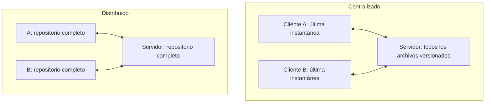

La diferencia no está en las flechas, sino en lo que guarda cada máquina [h01-112, h01-120].

Compruébalo con `facturas`, el repositorio que te acompaña en todo el capítulo. El ejemplo muestra su historial, de un solo commit, lo clona en la carpeta `copia` y muestra el del clon.

<!-- ejemplo: ejemplos/cap-01/01-clon-completo.sh -->
```console
# Ejecutado con Bash 5.2.21, Git 2.43.0
$ cd facturas && git log --oneline
ce4f8a1 Primera versión de la factura
$ cd .. && git clone facturas copia
Cloning into 'copia'...
done.
$ cd copia && git log --oneline
ce4f8a1 Primera versión de la factura
```
<!-- /ejemplo -->

El clon tiene el mismo commit, con el mismo identificador, `ce4f8a1`: la copia no trae solo los archivos, sino el repositorio entero [h01-120, h01-121]. De dónde sale ese identificador lo verás en la sección 1.2.

¿Qué ganas replicándolo todo? Mira primero el punto débil del modelo centralizado: el servidor es un punto único de fallo [h01-116]. Si se cae durante una hora, durante esa hora nadie puede colaborar ni guardar los cambios en los que estaba trabajando [h01-117]. Con Git tienes el historial completo en tu disco: puedes confirmar cambios en un tren sin cobertura y subirlos cuando vuelvas a tener red [h01-207, h01-208].

El diseño tiene también una historia. De 1991 a 2002, el *kernel* (núcleo) de Linux se mantuvo casi todo el tiempo intercambiando parches y archivos [h01-125]. En 2002 el proyecto pasó a BitKeeper, un sistema distribuido propietario; en 2005 se rompió la relación con la empresa y la herramienta dejó de ser gratuita [h01-126, h01-127]. Aquello empujó a la comunidad de Linux, y en particular a Linus Torvalds, a desarrollar una herramienta propia [h01-128]. Entre los objetivos del nuevo sistema estaban la velocidad, un diseño sencillo, soportar miles de ramas en paralelo, ser completamente distribuido y manejar con eficiencia proyectos del tamaño del kernel [h01-128, h01-129, h01-130, h01-131, h01-132, h01-133]. Así nació Git, en 2005, y desde entonces ha madurado sin perder sus características iniciales: es muy rápido, eficiente con proyectos grandes y tiene un sistema de ramas para el desarrollo no lineal [h01-128, h01-809, h01-810].

Lleva el fallo al extremo: el disco del servidor se corrompe y nadie había hecho copias de seguridad. En un sistema centralizado pierdes toda la información del proyecto, salvo las instantáneas que cada persona tenga en su máquina [h01-118]. Con Git puedes copiar al servidor cualquiera de los clones para restaurarlo [h01-119, h01-122]. Esa red cubre lo que llegó a confirmarse [h01-345]. Si pierdes algo que nunca confirmaste, puede que no vuelvas a verlo [h01-347].

## 1.2 Fotos, no diferencias; los tres estados

Cada commit guarda una instantánea completa de tus archivos, nombrada por un *hash* (resumen) de su contenido, y lo que no ha cambiado no se vuelve a guardar: se enlaza [h01-203, h01-204, h01-214]. Entre tus archivos y esa instantánea hay una zona intermedia, el área de preparación, y lo que confirmas es lo que hay en ella, no lo que tienes en disco [h01-221, h01-229, h01-263].

Conceptualmente, la mayoría de los demás sistemas, como el RCS de la sección 1.1, guardan la información como una lista de cambios en los archivos [h01-201, h01-109]. Git no: guarda una serie de instantáneas, copias puntuales de los archivos completos [h01-401, h01-205]. Piensa en un álbum. Cada vez que confirmas, Git fotografía todos tus archivos y guarda una referencia a esa foto [h01-203]. Si un archivo no ha cambiado, no lo guarda otra vez: enlaza la copia idéntica que ya tenía [h01-204].

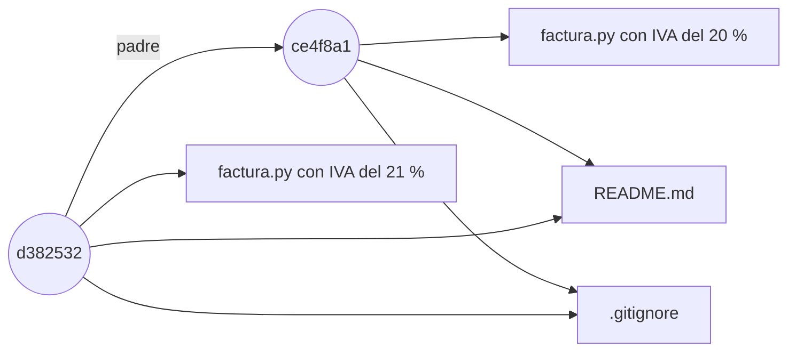

En el dibujo, el segundo commit de `facturas` solo cambia `factura.py`; `README.md` y `.gitignore` los comparte con el primero, que es su padre [h01-204, h01-404]. El dibujo simplifica: entre un commit y sus archivos hay un árbol, que verás en la sección 1.6 [h01-407, h01-630].

Compruébalo. El ejemplo confirma en el `facturas` de la sección 1.1 un cambio que solo toca `factura.py`, el IVA del 20 % al 21 %, y muestra el árbol de cada commit, primero el del anterior.

<!-- ejemplo: ejemplos/cap-01/03-fotos-no-diferencias.sh -->
```console
# Ejecutado con Bash 5.2.21, Git 2.43.0
$ git log --oneline
d382532 Cambia el tipo de IVA al 21 %
ce4f8a1 Primera versión de la factura
$ git cat-file -p HEAD~1^{tree}
100644 blob 7a60b85e148f80966a550e5ab6a762a907c69ca6	.gitignore
100644 blob 9d8ab3c07b02fa17caddef19459698b2b58b5fcc	README.md
100644 blob 6e7a5575ee3ce687d1f99a404d29344255b11abb	factura.py
$ git cat-file -p HEAD^{tree}
100644 blob 7a60b85e148f80966a550e5ab6a762a907c69ca6	.gitignore
100644 blob 9d8ab3c07b02fa17caddef19459698b2b58b5fcc	README.md
100644 blob 8ff14bec51fd28b8c6601ab9bcafa262cae0cbdb	factura.py
```
<!-- /ejemplo -->

`git cat-file -p` muestra un objeto de forma legible según su tipo [h01-623, h01-624], y `^{tree}` detrás de una revisión designa su árbol [h01-829, h01-631]. Cada línea del árbol lleva modo, tipo, hash y nombre [h01-630]; `100644` indica un archivo normal [h01-635] y `blob`, el objeto que guarda el contenido de un archivo sin su nombre [h01-627]. Compara los dos árboles: `.gitignore` y `README.md` repiten hash; `factura.py`, no. Lo que seguía igual no se volvió a guardar [h01-204].

Esos nombres de 40 caracteres son hashes. Git verifica todo con una suma de comprobación SHA-1 antes de guardarlo [h01-209, h01-211], una cadena de 40 caracteres hexadecimales calculada a partir del contenido [h01-212, h01-213]. Guarda cada cosa por el hash de su contenido, no por su nombre de archivo [h01-214]. Archivos, directorios y revisiones se identifican por hash, y no por números consecutivos como en otros sistemas tradicionales [h01-286].

Ya puedes cerrar lo que dejó abierto la sección 1.1. `git log` enseña cada commit con su suma SHA-1 [h01-303], así que `ce4f8a1` identifica el primer commit de `facturas` por el hash de su contenido [h01-214]. Ves siete caracteres, y no cuarenta, porque `--oneline` muestra solo un prefijo del hash [h01-820, h01-821]; la sección 1.3 cuenta cómo funciona.

Como el nombre sale del contenido, no puedes cambiar un archivo sin que Git se entere [h01-210]: si un bit se corrompe, el hash del contenido dañado deja de coincidir con su nombre [h01-287]. Y como casi todo lo que haces en Git solo añade información a su base de datos [h01-215], una instantánea confirmada es muy difícil de perder [h01-216]. Es la red de seguridad de la sección 1.1.

Falta la otra mitad: de dónde saca Git lo que fotografía. Un proyecto de Git tiene tres secciones [h01-221]. El directorio de Git es la carpeta `.git`, con los metadatos y la base de datos de objetos, y es lo que se copia al clonar desde otra máquina [h01-222, h01-223, h01-275]. El directorio de trabajo es una copia de una versión del proyecto, sacada de esa base de datos y puesta en disco para que la uses o la cambies [h01-224, h01-225]. Entre ambos está el *staging area* (área de preparación), un archivo, por lo general dentro de `.git`, que guarda qué irá en el próximo commit [h01-226]. También se llama índice, y el archivo, `index` [h01-706, h01-614].

El flujo básico recorre los tres lugares en orden. Cambias archivos en el directorio de trabajo [h01-227]. Los preparas con `git add`, que copia su contenido al índice [h01-228, h01-710]. Y confirmas con `git commit`, que guarda de forma permanente en `.git` la instantánea de lo que hay en el área de preparación [h01-229, h01-711].

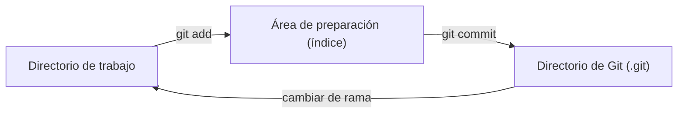

La flecha de vuelta, cambiar de rama, la verás en la sección 1.4.

Sobre ese dibujo se leen los tres estados de un archivo: confirmado, modificado y preparado [h01-217]. Si su versión está en el directorio de Git, está confirmada [h01-230]. Si ha cambiado desde que salió del repositorio y la has llevado al área de preparación, está preparada; si no la has preparado, modificada [h01-231, h01-232]. Fuera quedan los archivos sin rastrear: no estaban en la última instantánea ni están en el área de preparación [h01-233, h01-235], y Git no los mete en un commit salvo que se lo pidas con `git add` [h01-241, h01-242].

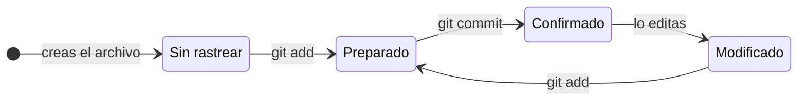

Preparas lo modificado, confirmas lo preparado y vuelta a empezar [h01-237].

Recorre el ciclo en `facturas`, ahora desde el primer paso: el ejemplo crea el repositorio de cero con una versión mínima de `README.md` y `factura.py`. Entre paso y paso consulta `git status -s`, la forma corta de `git status` [h01-248], que es la herramienta principal para saber en qué estado está cada archivo [h01-238].

<!-- ejemplo: ejemplos/cap-01/02-tres-estados.sh -->
```console
# Ejecutado con Bash 5.2.21, Git 2.43.0
$ git init facturas
Initialized empty Git repository in /tmp/ejemplo/facturas/.git/
$ cd facturas
$ echo "# facturas" > README.md
$ cat > factura.py <<'PY'
> IVA = 0.20
> def total(base, iva=IVA):
>     return base * (1 + iva)
> PY
$ git status -s
?? README.md
?? factura.py
$ git add README.md
$ git status -s
A  README.md
?? factura.py
$ git add factura.py
$ git commit -m "Primera versión de la factura"
[main (root-commit) 701842a] Primera versión de la factura
 2 files changed, 4 insertions(+)
 create mode 100644 README.md
 create mode 100644 factura.py
$ echo "IVA_REDUCIDO = 0.10" >> factura.py
$ git status -s
 M factura.py
$ git add factura.py
$ echo "IVA_SUPERREDUCIDO = 0.04" >> factura.py
$ git status -s
MM factura.py
$ git diff
diff --git a/factura.py b/factura.py
index 21c1b83..03f012b 100644
--- a/factura.py
+++ b/factura.py
@@ -2,3 +2,4 @@ IVA = 0.20
 def total(base, iva=IVA):
     return base * (1 + iva)
 IVA_REDUCIDO = 0.10
+IVA_SUPERREDUCIDO = 0.04
$ git diff --staged
diff --git a/factura.py b/factura.py
index 889ee08..21c1b83 100644
--- a/factura.py
+++ b/factura.py
@@ -1,3 +1,4 @@
 IVA = 0.20
 def total(base, iva=IVA):
     return base * (1 + iva)
+IVA_REDUCIDO = 0.10
```
<!-- /ejemplo -->

`git status -s` se lee en dos columnas: la izquierda es lo preparado y la derecha, lo que está sin preparar [h01-250]. Los archivos nuevos salen con `??`, sin rastrear [h01-249]. Tras `git add`, `README.md` pasa a `A` en la columna izquierda: rastreado y preparado [h01-243, h01-249]. Después del commit, una línea nueva deja `factura.py` en ` M`, con la marca a la derecha porque el cambio no está preparado [h01-249, h01-250]. Al `MM` del final vuelves enseguida.

Antes, mira el nombre del commit: lleva el mismo mensaje que `ce4f8a1`, pero se llama `701842a`, porque aquí `facturas` nace sin `.gitignore` y con otro texto. El nombre de un commit sale de su contenido, que incluye el árbol con el estado del proyecto [h01-214, h01-638, h01-213].

`git diff` y `git diff --staged` muestran los dos lados de ese `MM` como parches, con las líneas añadidas y quitadas [h01-255]. `git diff` a secas compara el directorio de trabajo con el área de preparación: solo enseña lo no preparado, la línea de `IVA_SUPERREDUCIDO` [h01-256, h01-259]. `git diff --staged`, o su sinónimo `--cached`, compara lo preparado con la última instantánea confirmada: enseña lo que iría en el próximo commit, la línea de `IVA_REDUCIDO` [h01-257, h01-258, h01-260].

¿Por qué funciona así? Porque preparar no es apuntar un nombre en una lista: Git guarda una copia del contenido del archivo tal como está al ejecutar `git add` [h01-405, h01-246]. `git status` compara por parejas: hay un cambio por confirmar si el índice difiere de la última instantánea confirmada, y uno sin preparar si el índice difiere del directorio de trabajo [h01-703, h01-715, h01-714]. Y el commit guarda una instantánea del área de preparación, no de tu disco [h01-262, h01-263].

Vuelve al `MM`. ¿Qué pasa si confirmas sin otro `git add`? `factura.py` está preparado y modificado a la vez [h01-245, h01-246]. El commit se llevaría `IVA_REDUCIDO` y dejaría fuera `IVA_SUPERREDUCIDO`, porque lo que cambias después de `git add` no entra hasta que lo vuelves a añadir [h01-247, h01-262, h01-263].

> **Error típico.** Confirmar trazas o archivos que genera tu sistema de compilación [h01-251]. Para lo que no quieres que Git añada, ni que aparezca como sin rastrear, crea un `.gitignore` con patrones al empezar el proyecto, y no confirmarás nada por accidente [h01-272, h01-251, h01-252]. Usa patrones *glob* (patrones de nombres de archivo) estándar, que se aplican de forma recursiva a todo el repositorio; un `!` delante niega un patrón [h01-253, h01-254].

> **Ojo con la versión.** Pro Git en español da `master` como rama por defecto [h01-410]. La documentación actual de `git init` dice que hoy la rama inicial se sigue llamando así si no indicas otro nombre, y que pasará a llamarse `main` con Git 3.0 [h01-276, h01-278]. Los ejemplos usan `main` porque su entorno lo fija con `init.defaultBranch` [h01-279]; para un solo repositorio está `git init -b` [h01-277]. `master` no tiene nada de especial: está en casi todos los repositorios solo porque `git init` la crea por defecto y casi nadie la renombra [h01-412, h01-413].
>
> Con el hash, algo parecido: `git init` usa SHA-1 salvo que pidas `--object-format=sha256`, si está habilitado [h01-280]. La sección 1.6 cuenta por qué Git busca un sucesor de SHA-1.

## 1.3 Leer y deshacer el historial

`git log` funciona como una consulta: puedes quedarte con los commits que añadieron o quitaron un texto, con los que tocaron un archivo o con los de un autor, y resumir cada uno en una línea [h01-301, h01-324, h01-325, h01-321, h01-310]. Deshacer casi nunca borra un commit, porque `git commit --amend` crea un commit que sustituye al último y `git restore` copia contenido de un sitio a otro; lo que sí puedes perder es lo que nunca confirmaste [h01-215, h01-334, h01-764, h01-346, h01-352, h01-345, h01-347].

Cada commit guarda el hash de sus padres: uno si es normal, varios si registra una fusión [h01-570, h01-404]. El historial es una cadena que se recorre hacia atrás, y `git log` la enseña con lo más reciente arriba [h01-302]. Tu punto de partida será casi siempre `HEAD`, que señala la última instantánea confirmada, la que será padre del próximo commit [h01-703]; la sección 1.4 cuenta qué es exactamente.

Desde ahí retrocedes con `~<n>`, que sube n generaciones por el primer padre: `HEAD~1` es el padre; `HEAD~2`, el abuelo [h01-826, h01-828]. `HEAD^` también es el primer padre, así que equivale a `HEAD~` [h01-822, h01-825]. Con un número detrás se separan: `HEAD^2` es el segundo padre, que solo tiene un commit de fusión, y `HEAD~3` equivale a `HEAD^^^` [h01-828, h01-823, h01-824, h01-827].

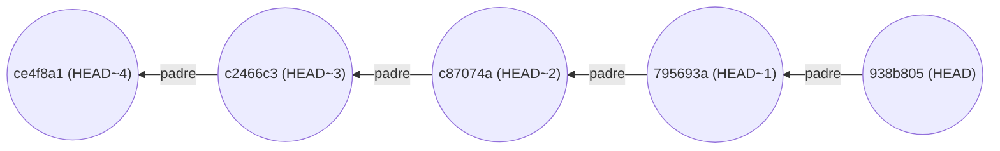

Así se leen el `HEAD~4` de «El problema», cuatro generaciones atrás, y su `HEAD~2`, el abuelo; y también el `HEAD~1^{tree}` de la sección 1.2, el árbol del padre [h01-826, h01-828, h01-829].

`facturas` tiene ya los cinco commits del dibujo. El commit del IVA no se llama `d382532`, como en la sección 1.2, porque ahora tiene otro padre y otro árbol: antes de él hay un commit que añade al README un ejemplo de uso [h01-570, h01-638, h01-214]. Este ejemplo monta, además, una variante de `facturas` en la que los tests los escribió tu compañera Marta Ruiz, para enseñarte la diferencia entre autor y confirmador. Desde la sección 1.5 ese commit es tuyo y, como el autor entra en el cálculo del hash, allí se llama `7971f23` y no `795693a`; el que le sigue también cambia de nombre, porque guarda el hash de su padre [h01-639, h01-647, h01-570, h01-571]. El ejemplo le hace cinco consultas.

<!-- ejemplo: ejemplos/cap-01/04-leer-historial.sh -->
```console
# Ejecutado con Bash 5.2.21, Git 2.43.0
$ git log --oneline
938b805 Documenta el IVA en el README
795693a Añade tests de total
c87074a Cambia el tipo de IVA al 21 %
c2466c3 Añade un ejemplo de uso al README
ce4f8a1 Primera versión de la factura
$ git log --stat -1
commit 938b8051e8da371c0d510280521d4cff1343fa6f
Author: devOC <devoc@ejemplo.dev>
Date:   Thu Jan 1 12:00:00 2026 +0100

    Documenta el IVA en el README

 README.md | 1 +
 1 file changed, 1 insertion(+)
$ git log -S "0.21" --oneline
c87074a Cambia el tipo de IVA al 21 %
$ git log --oneline -- README.md
938b805 Documenta el IVA en el README
c2466c3 Añade un ejemplo de uso al README
ce4f8a1 Primera versión de la factura
$ git log --format=fuller -1 HEAD~1
commit 795693a3558a7d3086daa5692c61635643e96470
Author:     Marta Ruiz <marta@ejemplo.dev>
AuthorDate: Thu Jan 1 12:00:00 2026 +0100
Commit:     devOC <devoc@ejemplo.dev>
CommitDate: Thu Jan 1 12:00:00 2026 +0100

    Añade tests de total
```
<!-- /ejemplo -->

`--oneline` abrevia `--pretty=oneline --abbrev-commit` [h01-820]: una línea por commit y, en vez del hash de 40 caracteres, un prefijo que lo identifica sin ambigüedad [h01-310, h01-815, h01-821]. Por defecto son siete caracteres, más si hace falta para que siga siendo único [h01-818]; por eso `ce4f8a1` tiene siete. Tú también puedes escribir un prefijo en tus comandos: Git lo acepta si tiene al menos cuatro caracteres y ningún otro objeto del repositorio empieza igual [h01-816, h01-817].

`-1` muestra solo el último commit, como `-<n>` los n últimos [h01-306], y sin `--oneline` sale la entrada entera: hash, autor con su correo, fecha y mensaje [h01-303]. `--stat` añade los archivos tocados y cuántas líneas se añadieron y quitaron en cada uno [h01-308, h01-309].

`-S "0.21"` deja los commits que añadieron o quitaron esa cadena en el código [h01-324]: solo `c87074a`, el del IVA, y lo has encontrado sin abrir un archivo. Para buscar en los mensajes está `--grep` [h01-322]. Una ruta, al final y por lo general detrás de `--`, limita la salida a los commits que cambiaron ese archivo [h01-325, h01-326]: tres de los cinco tocaron `README.md`.

La última consulta mira `HEAD~1` con `--format=fuller`. `fuller` es uno de los formatos que admiten `--pretty` y `--format`, y enseña el autor y el confirmador, cada uno con su fecha [h01-838, h01-839]. Son dos papeles: el autor escribió el trabajo, y el confirmador lo aplicó [h01-316, h01-317]. Si envías un parche a un proyecto y alguien del equipo lo aplica, el reconocimiento es para los dos [h01-318]. Con `--author` filtras por el primero [h01-321]. Y si la salida va a leerla otro programa, fija tú el formato con `format:<cadena>`: así sabes que no cambiará en futuras versiones de Git [h01-312, h01-313, h01-838].

Hasta aquí solo has mirado. Deshacer es otra cosa: es una de las pocas áreas en las que Git puede perder parte de tu trabajo si te equivocas [h01-327, h01-328].

Uno de los casos más comunes es confirmar antes de tiempo, con un archivo olvidado o un mensaje equivocado [h01-329]. Lo rehaces con `git commit --amend`, que confirma lo que haya en el área de preparación [h01-330, h01-331]. En el ejemplo redondeas el total, escribes su test y solo preparas `factura.py`.

<!-- ejemplo: ejemplos/cap-01/05-amend.sh -->
```console
# Ejecutado con Bash 5.2.21, Git 2.43.0
$ git add factura.py
$ git commit -m "Redondea el total y lo prueba"
[main 552d7cd] Redondea el total y lo prueba
 1 file changed, 1 insertion(+), 1 deletion(-)
$ git status -s
?? tests/
$ git log --oneline -1
552d7cd Redondea el total y lo prueba
$ git add tests/test_factura.py
$ git commit --amend --no-edit
[main 3ddacd5] Redondea el total y lo prueba
 Date: Thu Jan 1 12:00:00 2026 +0100
 2 files changed, 4 insertions(+), 1 deletion(-)
 create mode 100644 tests/test_factura.py
$ git log --oneline
3ddacd5 Redondea el total y lo prueba
c87074a Cambia el tipo de IVA al 21 %
c2466c3 Añade un ejemplo de uso al README
ce4f8a1 Primera versión de la factura
$ git reflog
3ddacd5 HEAD@{0}: commit (amend): Redondea el total y lo prueba
552d7cd HEAD@{1}: commit: Redondea el total y lo prueba
c87074a HEAD@{2}: commit: Cambia el tipo de IVA al 21 %
c2466c3 HEAD@{3}: commit: Añade un ejemplo de uso al README
ce4f8a1 HEAD@{4}: commit (initial): Primera versión de la factura
```
<!-- /ejemplo -->

`git status -s` delata el olvido: `tests/` sigue sin rastrear [h01-249]. Tras prepararlo y repetir con `--amend`, `git log` muestra un solo commit con ese mensaje: el segundo ha reemplazado al primero [h01-334]. Pero ya no se llama `552d7cd`, sino `3ddacd5`.

`--amend` no edita nada: los commits son inmutables, y «editar» el historial es crear commits nuevos y mover las referencias hacia ellos [h01-763, h01-764]. `3ddacd5` es otro commit, con otra instantánea y el mismo padre, `c87074a`, y `main` apunta ahora a él [h01-331, h01-764]. Su nombre cambia porque sale de su contenido [h01-214, h01-638]; Pro Git pide cuidado con `--amend` justo porque puede cambiar el SHA-1 del commit [h01-539]. Por qué importa si ya lo habías compartido lo verás en la sección 1.5.

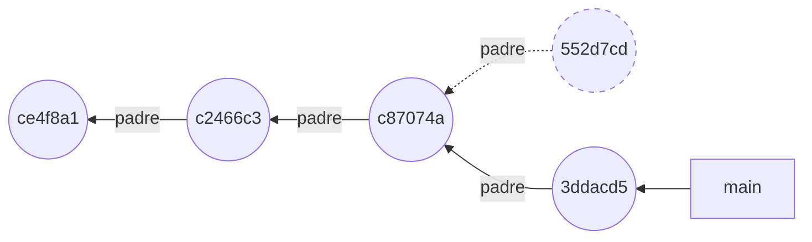

El commit de borde discontinuo es el sustituido: ninguna rama apunta ya a él [h01-764]. Si no has preparado nada, `--amend` deja la instantánea igual y solo cambia el mensaje [h01-332]. Normalmente abre el editor con el mensaje anterior [h01-333]; con `--no-edit`, como en el ejemplo, conserva ese mensaje sin abrir el editor [h01-831, h01-832].

Las otras dos formas habituales de deshacer tocan archivos, no commits: sacar un cambio del área de preparación y descartarlo del directorio de trabajo. El propio `git status` te recuerda cómo [h01-335, h01-350]. El ejemplo prepara una línea nueva en `factura.py` y deshace los dos pasos.

<!-- ejemplo: ejemplos/cap-01/06-restore.sh -->
```console
# Ejecutado con Bash 5.2.21, Git 2.43.0
$ echo "IVA_REDUCIDO = 0.10" >> factura.py
$ git add factura.py
$ git status
On branch main
Changes to be committed:
  (use "git restore --staged <file>..." to unstage)
	modified:   factura.py
$ git restore --staged factura.py
$ git status -s
 M factura.py
$ git restore factura.py
$ git status -s
```
<!-- /ejemplo -->

`git restore` restaura rutas con contenido que copia de una fuente [h01-352]. Con `--staged`, el destino es el índice y la fuente, por defecto, `HEAD` [h01-354, h01-356]: `factura.py` pasa de `M ` a ` M` y tu línea sigue en disco, porque tocar también el directorio de trabajo exige añadir `--worktree` [h01-250, h01-355]. Sin opciones, el destino es el directorio de trabajo y la fuente, el índice [h01-357, h01-360]: `git restore factura.py` borra tu línea y el estado queda limpio.

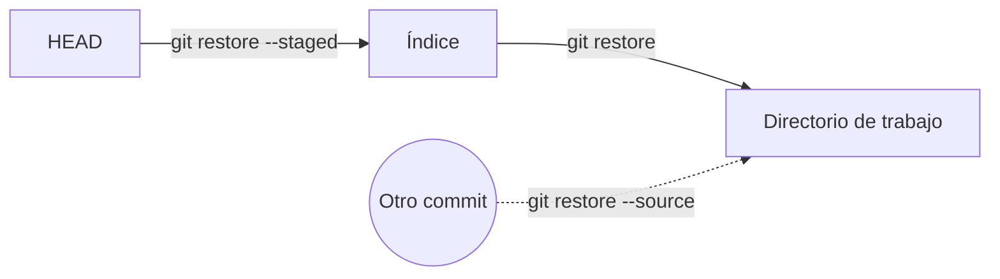

Es el camino de `git add` y `git commit` recorrido al revés [h01-710, h01-711, h01-356, h01-357]. Con `--source` copias desde otro commit, que puedes nombrar por su hash, por una rama o por una etiqueta [h01-358, h01-359].

Los dos pasos no pesan igual: `git restore --staged` no toca tu directorio de trabajo [h01-354, h01-355], y `git restore <archivo>` descarta cambios [h01-772].

Vuelve al ejemplo 05. ¿Dónde está `552d7cd`? `git log` ya no lo enseña, pero `git reflog` lo lista en su segunda línea. Esa orden lee unos registros locales que anotan cuándo se movieron las puntas de las ramas y de otras referencias [h01-774]. Sin argumentos muestra el de `HEAD` [h01-777], y esos registros se actualizan con cada commit [h01-786]. Hasta los commits sustituidos con `--amend` se pueden recuperar [h01-346]; cómo, lo verás en la sección 1.7.

> **Error típico.** Usar `git restore <archivo>`, o el antiguo `git checkout -- <archivo>`, para «limpiar» y descubrir después que querías ese cambio. El archivo se sobrescribe con otra versión y lo que le hubieras hecho desaparece [h01-342, h01-352]. Pro Git llama peligroso a `git checkout -- <archivo>` y pide no usarlo salvo que estés completamente seguro de que ya no quieres el archivo [h01-341, h01-343]. Si dudas, confirma antes [h01-345, h01-347].

> **Ojo con la versión.** Pro Git en español saca un archivo del área de preparación con `git reset HEAD <archivo>`, que es lo que sugiere su `git status` [h01-336], y descarta cambios con `git checkout -- <archivo>` [h01-340, h01-341]. El `git status` de Git 2.43 del ejemplo 06 sugiere ya `git restore --staged`. La documentación actual de `git restore` dice que devolver un archivo del índice a la versión de `HEAD` equivale a usar `git reset`, y que restaurar a la vez el índice y el directorio de trabajo equivale a usar `git checkout` [h01-361, h01-362]. El libro usa la forma que te sugiere tu propio Git.

## 1.4 Las ramas son punteros

Una rama es un archivo de `.git` con el hash de un commit, y `HEAD` es otro archivo que dice en qué rama estás; al confirmar, Git añade un commit cuyo padre es el que señalaba `HEAD` y adelanta esa rama [h01-424, h01-664, h01-668, h01-420]. Fusionar es adelantar un puntero, si tu commit es ancestro directo del que fusionas, o crear un commit con dos padres a partir del ancestro común; y el conflicto aparece cuando los dos lados han cambiado la misma zona de un archivo [h01-434, h01-440, h01-442, h01-445, h01-448].

Separa el grafo en dos clases de piezas. Los commits no se mueven: cada uno guarda el hash de sus padres y, como viste con `--amend`, no se pueden editar [h01-570, h01-763]. Las ramas sí se mueven: son punteros que pueden pasar a señalar otro commit [h01-409, h01-766]. Y `HEAD` es un puntero a un puntero: señala la rama en la que estás [h01-416, h01-664].

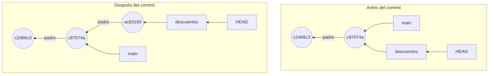

De un dibujo a otro solo se ha movido una flecha, la de `descuentos` [h01-420, h01-664].

Compruébalo en `facturas`, con los tres primeros commits de la sección 1.3: el ejemplo crea la rama `descuentos`, lee los archivos de las ramas y el de `HEAD`, cambia de rama y confirma un cambio.

<!-- ejemplo: ejemplos/cap-01/07-rama-es-un-archivo.sh -->
```console
# Ejecutado con Bash 5.2.21, Git 2.43.0
$ git branch descuentos
$ cat .git/refs/heads/main
c87074a060dbf507d64ec3e5e304398bd8e17de3
$ cat .git/refs/heads/descuentos
c87074a060dbf507d64ec3e5e304398bd8e17de3
$ cat .git/HEAD
ref: refs/heads/main
$ git switch descuentos
Switched to branch 'descuentos'
$ cat .git/HEAD
ref: refs/heads/descuentos
$ git add factura.py
$ git commit -m "Empieza los descuentos"
[descuentos ac83193] Empieza los descuentos
 1 file changed, 2 insertions(+), 2 deletions(-)
$ git log --oneline --decorate --graph --all
* ac83193 (HEAD -> descuentos) Empieza los descuentos
* c87074a (main) Cambia el tipo de IVA al 21 %
* c2466c3 Añade un ejemplo de uso al README
* ce4f8a1 Primera versión de la factura
```
<!-- /ejemplo -->

`git branch descuentos` no imprime nada ni te cambia de rama: solo crea un puntero nuevo en el commit en el que estás [h01-415, h01-417]. Cada rama es un archivo de `.git/refs/heads` con los 40 caracteres del hash de su commit, y los dos guardan el mismo [h01-424, h01-652]. Crear una rama cuesta lo que escribir 41 bytes en un archivo, y es instantáneo; en otros sistemas supone copiar el proyecto entero a otro directorio [h01-425, h01-426]. Es aquel objetivo de diseño de la sección 1.1, miles de ramas en paralelo [h01-130].

El tercer `cat` cierra lo que la sección 1.3 dejó a medias. `.git/HEAD` no guarda un hash, sino `ref: refs/heads/main`: es una referencia simbólica, que enlaza con otra referencia en lugar de con un commit [h01-664, h01-665, h01-666]. `HEAD` apunta a la rama actual y la rama, a su último commit [h01-705]. Así sabe Git cuál es la última instantánea confirmada, la que será padre del próximo commit [h01-663, h01-703].

`git switch descuentos` cambia de rama, y `HEAD` pasa a decir `ref: refs/heads/descuentos` [h01-471, h01-664]. Al cambiar, Git añade, quita y modifica archivos para que tu copia de trabajo quede como la rama en su último commit [h01-432, h01-472]. Es la flecha «cambiar de rama» del diagrama de los tres lugares, en la sección 1.2.

El `git log` final, con `--oneline --decorate --graph --all`, enseña dónde apunta cada rama [h01-423]: `ac83193` lleva `HEAD -> descuentos`, el puntero a puntero del dibujo, y `main` se ha quedado en `c87074a`.

¿Qué ha cambiado en el repositorio con ese commit? Dos cosas importan. Entre `git add` y `git commit`, Git ha escrito objetos nuevos: el contenido de los archivos modificados, los árboles y el commit, enlazado con el anterior [h01-643]. Ese anterior es el que señalaba `HEAD` [h01-668]. Además, la rama a la que apunta `HEAD` avanza: su archivo guarda ahora el hash del commit nuevo, y las demás ramas se quedan donde estaban [h01-411, h01-420, h01-424]. `HEAD` no cambia, porque sigues en la misma rama [h01-664].

Esa es la respuesta corta a qué es una rama: un nombre que cambia de commit, sobre un grafo de commits que no cambian [h01-765, h01-766, h01-763]. Una rama señala la cabeza de una línea de trabajo [h01-659]; el resto de la línea se alcanza siguiendo los padres hacia atrás, porque cada commit guarda los suyos [h01-570].

Tarde o temprano, el trabajo de una rama vuelve a `main`. Para fusionar, te colocas en la rama que recibe los cambios y lanzas `git merge` con la otra [h01-433]. Lo que haga Git depende de la forma del grafo.

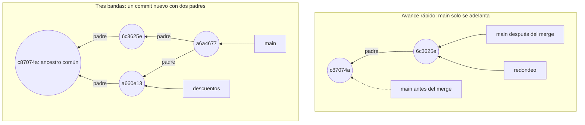

Arriba basta con adelantar `main` [h01-434]; abajo, las dos ramas han avanzado desde `c87074a` y hace falta un commit con dos padres [h01-440, h01-445]. `HEAD`, que no se dibuja, señala `main` en los dos casos.

Empieza por el caso fácil, un arreglo urgente. El ejemplo crea la rama `redondeo` y se cambia a ella en un paso con `git switch -c` [h01-473], confirma el redondeo del total, vuelve a `main` y fusiona.

<!-- ejemplo: ejemplos/cap-01/08-avance-rapido.sh -->
```console
# Ejecutado con Bash 5.2.21, Git 2.43.0
$ git switch -c redondeo
Switched to a new branch 'redondeo'
$ git add factura.py
$ git commit -m "Redondea el total a dos decimales"
[redondeo 6c3625e] Redondea el total a dos decimales
 1 file changed, 1 insertion(+), 1 deletion(-)
$ git switch main
Switched to branch 'main'
$ git merge redondeo
Updating c87074a..6c3625e
Fast-forward
 factura.py | 2 +-
 1 file changed, 1 insertion(+), 1 deletion(-)
$ git branch -d redondeo
Deleted branch redondeo (was 6c3625e).
$ git log --oneline --graph
* 6c3625e Redondea el total a dos decimales
* c87074a Cambia el tipo de IVA al 21 %
* c2466c3 Añade un ejemplo de uso al README
* ce4f8a1 Primera versión de la factura
```
<!-- /ejemplo -->

`Updating c87074a..6c3625e` da la punta anterior de `main` y la de `redondeo`. `6c3625e` está directamente por delante de `c87074a`, así que no hay trabajo divergente que combinar: Git se limita a avanzar el puntero, sin crear ningún commit de fusión [h01-434, h01-435, h01-497]. Es lo que se llama *fast-forward* (avance rápido) [h01-435]. Después, `git branch -d` borra `redondeo`, que ya no hace falta porque señala el mismo commit que `main` [h01-437]. Has borrado un nombre, no un commit [h01-424].

Si quieres que la fusión quede registrada aunque se pudiera avanzar, `git merge --no-ff` crea un commit de fusión en todos los casos [h01-498].

Ahora el caso de abajo. En `descuentos` has añadido un descuento a `total()` y en `main` has redondeado su resultado, así que ninguna de las dos puntas es ancestro de la otra. Git hace entonces una fusión a tres bandas, con la instantánea de cada punta y la del ancestro común [h01-440, h01-441, h01-442]. Con el resultado crea una instantánea nueva y un commit que apunta a ella, el commit de fusión, que tiene más de un padre [h01-443, h01-444, h01-445]. Pero si los dos lados han cambiado de forma distinta la misma porción de un archivo, no puede fusionarlos directamente [h01-448]. Es lo que pasa con la línea `return` de `total()`. El ejemplo provoca el conflicto, lo aborta, lo repite y lo resuelve.

<!-- ejemplo: ejemplos/cap-01/09-conflicto.sh -->
```console
# Ejecutado con Bash 5.2.21, Git 2.43.0
$ git log --oneline --graph --all
* a660e13 Aplica un descuento al total
| * 6c3625e Redondea el total a dos decimales
|/  
* c87074a Cambia el tipo de IVA al 21 %
* c2466c3 Añade un ejemplo de uso al README
* ce4f8a1 Primera versión de la factura
$ git merge descuentos
Auto-merging factura.py
CONFLICT (content): Merge conflict in factura.py
Automatic merge failed; fix conflicts and then commit the result.
$ git status
On branch main
You have unmerged paths.
  (fix conflicts and run "git commit")
  (use "git merge --abort" to abort the merge)

Unmerged paths:
  (use "git add <file>..." to mark resolution)
	both modified:   factura.py

no changes added to commit (use "git add" and/or "git commit -a")
$ git merge --abort
$ git status -s
$ git merge descuentos
Auto-merging factura.py
CONFLICT (content): Merge conflict in factura.py
Automatic merge failed; fix conflicts and then commit the result.
$ cat factura.py
IVA = 0.21
def total(base, iva=IVA, descuento=0):
    """Calcula el total de una factura."""
<<<<<<< HEAD
    return round(base * (1 + iva), 2)
=======
    return base * (1 + iva) * (1 - descuento)
>>>>>>> descuentos
$ cat > factura.py <<'PY'
> IVA = 0.21
> def total(base, iva=IVA, descuento=0):
>     """Calcula el total de una factura."""
>     return round(base * (1 + iva) * (1 - descuento), 2)
> PY
$ git add factura.py
$ git commit --no-edit
[main a6a4677] Merge branch 'descuentos'
$ git log --oneline --graph
*   a6a4677 Merge branch 'descuentos'
|\  
| * a660e13 Aplica un descuento al total
* | 6c3625e Redondea el total a dos decimales
|/  
* c87074a Cambia el tipo de IVA al 21 %
* c2466c3 Añade un ejemplo de uso al README
* ce4f8a1 Primera versión de la factura
$ git cat-file -p HEAD
tree 385c27e65b91457544ca1fd1d4815107d5aeb2d2
parent 6c3625ec7e97da8cf33b156f12063e9647bfc66c
parent a660e13464f9b3cdb0e2043b9ec4b8334ab3ec5b
author devOC <devoc@ejemplo.dev> 1767265200 +0100
committer devOC <devoc@ejemplo.dev> 1767265200 +0100

Merge branch 'descuentos'

# Conflicts:
#	factura.py
```
<!-- /ejemplo -->

El primer log dibuja la bifurcación: dos puntas que salen de `c87074a` [h01-314]. La fusión automática falla, y Git no crea el commit de fusión: se detiene a esperar que resuelvas [h01-449, h01-450, h01-488]. `git status` lista `factura.py` entre las rutas sin fusionar, modificado por ambos lados [h01-451, h01-452].

Esa misma salida te ofrece la vía de escape, `git merge --abort`, que intenta reconstruir el estado anterior a la fusión [h01-489]; `git status -s` sale vacío. Fíjate en el «intenta»: si empezaste con cambios sin confirmar, a veces no podrá devolvértelos, y por eso la documentación recomienda confirmarlos o apartarlos antes de fusionar [h01-490, h01-491].

En el segundo intento, `cat factura.py` enseña la zona en conflicto entre los marcadores `<<<<<<<`, `=======` y `>>>>>>>` [h01-453, h01-493]. Encima de `=======` está la versión de `HEAD`, la rama en la que estabas al fusionar; debajo, la del otro lado, `descuentos` [h01-454, h01-494]. Git no elige uno al azar: te deja lo que hizo cada lado en esa zona para que lo resuelvas tú [h01-492]. La línea `def`, que solo cambió `descuentos`, ya trae `descuento=0` y queda fuera: los marcadores encierran solo la zona donde chocan los dos cambios [h01-493].

Pro Git plantea la resolución como elegir a mano el contenido de un lado o del otro [h01-455]. El ejemplo escribe una tercera versión, que redondea y aplica el descuento, y la prepara con `git add`: marcar un archivo como preparado le dice a Git que su conflicto está resuelto [h01-456, h01-457]. `git commit` termina la fusión [h01-460]; con `--no-edit`, usa sin abrir el editor el mensaje que Git propone por defecto, «Merge branch 'descuentos'» [h01-831, h01-461].

El grafo final se cierra en `a6a4677`, y `git cat-file -p HEAD` enseña lo que lo hace distinto: dos líneas `parent`, una por cada punta [h01-404, h01-570]. La primera es `6c3625e`, la punta de `main`, y la segunda, `a660e13`, la de `descuentos`: el primer padre es la rama en la que estabas al fusionar, y el segundo, la que fusionaste [h01-841]. Por eso `HEAD^2` nombra `a660e13`; la sintaxis de la sección 1.3 solo sirve en commits de fusión [h01-823, h01-824]. Las demás líneas las verás en la sección 1.6.

¿Cómo encuentra Git la tercera banda? Gracias a que cada commit guarda sus padres: con ellos, encontrar la base de la fusión es automático y, por lo general, sencillo [h01-427]. Git elige él mismo el mejor ancestro común; en CVS o Subversion tiene que hacerlo el desarrollador [h01-446, h01-447].

> **Bajo el capó.** Los marcadores normales te enseñan dos de las tres bandas de la fusión: tu lado y el del otro [h01-494, h01-442]. Si pones la variable de configuración `merge.conflictStyle` a `diff3` o a `zdiff3`, Git usa un estilo alternativo [h01-495]. `diff3` añade antes de `=======` un marcador `|||||||` seguido del texto original [h01-496]. Es la tercera banda, la del ancestro común [h01-442]. Compárala con cada lado y sabrás quién cambió qué.

Hasta aquí, `HEAD` siempre ha señalado una rama, que es lo normal [h01-480]. A veces, sin embargo, te interesa colocarte en un commit que no es la punta de ninguna rama, o incluso crear uno que ninguna rama referencie [h01-481]. Para eso está `git switch --detach`: te lleva a un commit para inspeccionarlo o para hacer experimentos que puedes tirar [h01-474].

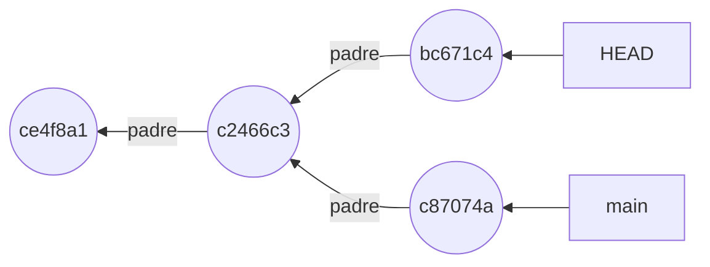

En el dibujo, el experimento ya está confirmado y solo `HEAD` señala su commit [h01-483, h01-484]. ¿Qué será de `bc671c4` cuando vuelvas a `main`?

El ejemplo se desacopla en `HEAD~1`, confirma un experimento con el IVA de Canarias, vuelve a `main` y rescata el experimento.

<!-- ejemplo: ejemplos/cap-01/10-head-desacoplado.sh -->
```console
# Ejecutado con Bash 5.2.21, Git 2.43.0
$ git switch --detach HEAD~1
HEAD is now at c2466c3 Añade un ejemplo de uso al README
$ cat .git/HEAD
c2466c3069368f441ff3f5b77e633c6f1d89ec71
$ git commit -m "Experimento: IVA de Canarias"
[detached HEAD bc671c4] Experimento: IVA de Canarias
 1 file changed, 1 insertion(+)
$ git switch main
Warning: you are leaving 1 commit behind, not connected to
any of your branches:

  bc671c4 Experimento: IVA de Canarias

Switched to branch 'main'
$ git log --oneline --all
c87074a Cambia el tipo de IVA al 21 %
c2466c3 Añade un ejemplo de uso al README
ce4f8a1 Primera versión de la factura
$ git reflog -4
c87074a HEAD@{0}: checkout: moving from bc671c4c1729981859fb461f6b0c345319ab1e57 to main
bc671c4 HEAD@{1}: commit: Experimento: IVA de Canarias
c2466c3 HEAD@{2}: checkout: moving from main to HEAD~1
c87074a HEAD@{3}: commit: Cambia el tipo de IVA al 21 %
$ git branch experimento HEAD@{1}
$ git log --oneline --all
bc671c4 Experimento: IVA de Canarias
c87074a Cambia el tipo de IVA al 21 %
c2466c3 Añade un ejemplo de uso al README
ce4f8a1 Primera versión de la factura
```
<!-- /ejemplo -->

Ahora `cat .git/HEAD` no dice `ref:`; guarda un hash, el de `c2466c3`. `HEAD` apunta al commit y no a una rama: es el estado de *detached HEAD* (HEAD desacoplado) [h01-482, h01-483]. Hasta la salida de `git commit` lo indica, con `[detached HEAD bc671c4]`, y ese commit solo lo referencia `HEAD` [h01-484].

Al volver a `main`, Git avisa de que dejas atrás un commit sin rama, y `git log --oneline --all` ya no lo muestra. Es el caso que describe la documentación de `git checkout`: cuando nada referencia el commit, la recolección de basura de Git acabará eliminándolo, salvo que antes crees una referencia [h01-485].

Si no te hubieras movido, bastaría con ponerle nombre allí mismo con `git switch -c`, `git branch` o `git tag` [h01-475, h01-486]. Como ya te has ido, primero tienes que recuperar su hash, normalmente con `git reflog` [h01-487]. El reflog de `HEAD` anota también los cambios de rama [h01-778], y el experimento sigue en la lista como `HEAD@{1}`. `HEAD@{2}` es donde estaba `HEAD` dos movimientos antes, así que `HEAD@{1}` es un movimiento atrás [h01-775]. `git branch experimento HEAD@{1}` crea una rama en ese commit, y el último log vuelve a enseñarlo [h01-788, h01-789].

> **Error típico.** Borrar con `-D` una rama que no has fusionado. `git branch -d` da un error si la rama tiene trabajo sin fusionar [h01-468], y `git branch --no-merged` te dice cuáles están así [h01-467]. `-D` fuerza el borrado aunque pierdas ese trabajo [h01-469]. Con los cambios sin confirmar, Git es más cauto: cambiar de rama no exige tenerlo todo limpio, pero se aborta si fuera a perder cambios locales, salvo que lo pidas con `--discard-changes` [h01-476]. Aun así, conviene llegar limpio [h01-431].

> **Ojo con la versión.** Pro Git en español cambia de rama con `git checkout`, y crea una rama y salta a ella con `git checkout -b` [h01-418, h01-428, h01-429]. La documentación actual tiene `git switch` y `git switch -c` [h01-471, h01-473], y explica que `git checkout` hace dos trabajos: cambiar de rama y restaurar otra versión de un archivo [h01-479]. El libro usa `git switch` para lo primero y, desde la sección 1.3, `git restore` para lo segundo. Y `checkout` asoma aunque no lo uses: el reflog del ejemplo 10 anota tus cambios de rama como `checkout`.
>
> Con las fusiones pasa algo parecido. Al fusionar una sola rama, la estrategia de fusión predeterminada es hoy `ort` [h01-801], escrita para reemplazar a `recursive` [h01-801, h01-803], que lo fue hasta Git 2.33.0 [h01-806]. Desde Git 2.50.0, `recursive` es solo otro nombre de `ort` [h01-804, h01-805]; si la ves en un texto antiguo, es la estrategia de antes.

## 1.5 Rebase y reescribir historia

Rebase no mueve commits: vuelve a aplicar los cambios de cada uno sobre otra base y crea commits nuevos, con hashes nuevos [h01-503, h01-520, h01-570, h01-214]. La instantánea final es la misma que daría un merge y solo cambia el historial; por eso es inofensivo con commits que nunca has compartido y dañino con los que otros ya tienen, y para deshacer algo publicado tienes `git revert` [h01-510, h01-529, h01-591, h01-594].

En la rama `exportar-csv` has escrito la exportación a CSV en dos commits y, mientras tanto, `main` ha recibido los tests. Ya sabes integrarlas con una fusión a tres bandas [h01-501, h01-502]. Rebase es la otra forma: Git va al ancestro común, saca las diferencias que introduce cada commit de tu rama, las guarda en archivos temporales, lleva tu rama al commit de la otra y aplica de nuevo esas diferencias, en el mismo orden [h01-503, h01-504, h01-505, h01-506, h01-507, h01-508, h01-514].

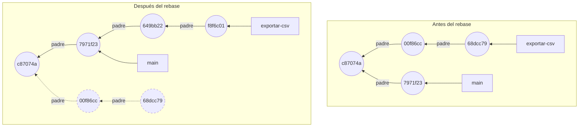

Las copias no conservan el hash porque tienen otro padre: cada commit guarda el SHA-1 de sus padres, y su nombre sale de su contenido [h01-570, h01-214]. Es lo que viste con `--amend` en la sección 1.3, aplicado a una fila entera.

El ejemplo hace rebase de `exportar-csv` sobre `main`, con `-q` para silenciar su salida [h01-842], y luego fusiona desde `main`.

<!-- ejemplo: ejemplos/cap-01/11-rebase.sh -->
```console
# Ejecutado con Bash 5.2.21, Git 2.43.0
$ git switch exportar-csv
Switched to branch 'exportar-csv'
$ git log --oneline --graph --all
* 68dcc79 Añade la cabecera al CSV
* 00f86cc Añade exportación a CSV
| * 7971f23 Añade tests de total
|/  
* c87074a Cambia el tipo de IVA al 21 %
* c2466c3 Añade un ejemplo de uso al README
* ce4f8a1 Primera versión de la factura
$ git rebase -q main
$ git log --oneline --graph --all
* f8f6c01 Añade la cabecera al CSV
* 649bb22 Añade exportación a CSV
* 7971f23 Añade tests de total
* c87074a Cambia el tipo de IVA al 21 %
* c2466c3 Añade un ejemplo de uso al README
* ce4f8a1 Primera versión de la factura
$ git switch main
Switched to branch 'main'
$ git merge exportar-csv
Updating 7971f23..f8f6c01
Fast-forward
 exportar.py | 3 +++
 1 file changed, 3 insertions(+)
 create mode 100644 exportar.py
```
<!-- /ejemplo -->

El primer log dibuja la bifurcación; el segundo, una sola línea [h01-511]. Los mensajes son los mismos, pero los hashes no, y el padre de `649bb22` ya es `7971f23`, la punta de `main`. Como `exportar-csv` queda por delante, el merge final es un avance rápido [h01-509, h01-434]. Por eso se suele hacer rebase antes de proponer tu trabajo: a quien mantiene el proyecto le basta con avanzar [h01-512, h01-513].

¿Y `00f86cc` y `68dcc79`? Rebase los abandona y crea otros [h01-520]: ninguna rama los alcanza ya, como le pasaba a `552d7cd` en la sección 1.3. Es la respuesta a la segunda pregunta de «El problema»: tus commits «desaparecidos» se han quedado sin rama, y la sección 1.7 los recupera con el reflog [h01-783, h01-784].

¿Qué has ganado frente al merge? El ejemplo integra lo mismo de las dos maneras: copia `exportar-csv` en `con-merge` y en `con-rebase`, fusiona `main` en la primera y hace rebase de la segunda.

<!-- ejemplo: ejemplos/cap-01/12-misma-foto.sh -->
```console
# Ejecutado con Bash 5.2.21, Git 2.43.0
$ git switch con-merge
Switched to branch 'con-merge'
$ git merge main -m "Integra main en con-merge"
Merge made by the 'ort' strategy.
 tests/test_factura.py | 3 +++
 1 file changed, 3 insertions(+)
 create mode 100644 tests/test_factura.py
$ git switch con-rebase
Switched to branch 'con-rebase'
$ git rebase -q main
$ git diff con-merge con-rebase
$ git cat-file -p con-merge | head -n 1
tree e7e3ac802fb69892ddda0dcff783da904beca5ac
$ git cat-file -p con-rebase | head -n 1
tree e7e3ac802fb69892ddda0dcff783da904beca5ac
$ git log --oneline --graph con-merge
*   4b2e63c Integra main en con-merge
|\  
| * 7971f23 Añade tests de total
* | 68dcc79 Añade la cabecera al CSV
* | 00f86cc Añade exportación a CSV
|/  
* c87074a Cambia el tipo de IVA al 21 %
* c2466c3 Añade un ejemplo de uso al README
* ce4f8a1 Primera versión de la factura
$ git log --oneline --graph con-rebase
* f8f6c01 Añade la cabecera al CSV
* 649bb22 Añade exportación a CSV
* 7971f23 Añade tests de total
* c87074a Cambia el tipo de IVA al 21 %
* c2466c3 Añade un ejemplo de uso al README
* ce4f8a1 Primera versión de la factura
```
<!-- /ejemplo -->

`git diff` con dos commits enseña los cambios entre ellos [h01-843], y entre las dos puntas no imprime nada; la línea `tree` de ambas es la misma, `e7e3ac8`. Un commit contiene el árbol con el estado del proyecto [h01-638], así que los dos dicen lo mismo de tus archivos [h01-510]. Lo que cambia es el grafo: `con-merge` termina en `4b2e63c`, que combina las dos puntas con dos padres, y `con-rebase` es una línea [h01-515, h01-404, h01-511].

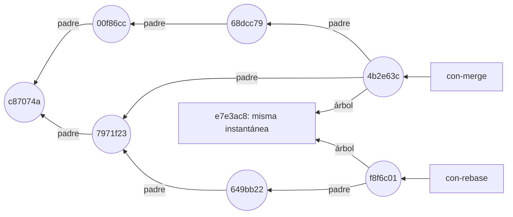

Rebase sirve también para limpiar. Git no tiene una orden para modificar commits antiguos, pero el rebase interactivo, `git rebase -i`, hace ese papel [h01-540, h01-542]. Es la primera orden del asistente de «El problema»: `git rebase -i HEAD~4` reescribe todos los commits del rango `HEAD~4..HEAD`, cambies algo en ellos o no [h01-543].

Git te da primero una lista de tareas, una línea por commit con una acción delante, y la ejecuta de arriba abajo, en orden inverso al de `git log`; puedes reordenar sus líneas [h01-547, h01-589, h01-546, h01-553]. `pick` usa el commit; `reword` cambia su mensaje; `edit` se detiene para que lo modifiques; `squash` lo funde con el anterior, y `fixup` hace lo mismo pero descarta su mensaje [h01-548, h01-549, h01-550, h01-551, h01-552]. `drop`, o borrar la línea, descarta el commit [h01-580].

La lista se edita con el editor que fija `sequence.editor`, y la variable de entorno `GIT_SEQUENCE_EDITOR` se impone a esa configuración [h01-807, h01-808]. El ejemplo la usa dos veces: con un comando que solo imprime la lista y con otro que pone `fixup` en las líneas 2 y 3 y `drop` en la 4.

<!-- ejemplo: ejemplos/cap-01/13-rebase-interactivo.sh -->
```console
# Ejecutado con Bash 5.2.21, Git 2.43.0
$ git log --oneline
3238d41 Prueba descartada
0963eaa oops, falta la cabecera
c5fefdb WIP
f0130ce Añade exportación a CSV
ce4f8a1 Primera versión de la factura
$ GIT_SEQUENCE_EDITOR="grep '^[a-z]'" git rebase -q -i HEAD~4
pick f0130ce Añade exportación a CSV
pick c5fefdb WIP
pick 0963eaa oops, falta la cabecera
pick 3238d41 Prueba descartada
$ GIT_SEQUENCE_EDITOR="sed -i -e '2,3s/^pick/fixup/' -e '4s/^pick/drop/'" git rebase -q -i HEAD~4
$ git log --oneline
7c3a467 Añade exportación a CSV
ce4f8a1 Primera versión de la factura
$ git commit --fixup HEAD~1
[exportar-csv 3b1e951] fixup! Añade exportación a CSV
 1 file changed, 1 insertion(+)
$ git log --oneline -3
3b1e951 fixup! Añade exportación a CSV
dda4199 Exporta también a JSON
7c3a467 Añade exportación a CSV
$ GIT_SEQUENCE_EDITOR="grep '^[a-z]'" git rebase -q -i --autosquash HEAD~3
pick 7c3a467 Añade exportación a CSV
fixup 3b1e951 fixup! Añade exportación a CSV
pick dda4199 Exporta también a JSON
$ git log --oneline -2
312cf8b Exporta también a JSON
c023b78 Añade exportación a CSV
```
<!-- /ejemplo -->

La lista empieza por el más antiguo, `f0130ce`, y acaba en el primero que enseña `git log`. Tras la limpieza queda uno solo sobre `ce4f8a1`, `7c3a467`, con el mensaje del primero: `fixup` ha fundido «WIP» y «oops» descartando sus mensajes, y `drop` ha quitado «Prueba descartada» [h01-581, h01-582, h01-580]. La segunda parte automatiza la limpieza: `git commit --fixup` marca el commit nuevo con `fixup!`, y `--autosquash` lo funde con el que corrige [h01-590, h01-588, h01-587].

¿Cuándo reescribir, entonces? Pro Git describe dos maneras de ver el historial. Para unos es el registro de lo que pasó, y cambiarlo es mentir sobre ello [h01-531, h01-532]. Para otros es la historia de cómo se hizo el proyecto, contada de la mejor manera para quien la lea después [h01-533, h01-534]. Su propuesta aprovecha las dos: haz rebase de tu trabajo local antes de compartirlo y nunca de lo que ya has compartido [h01-535, h01-519]. Con commits que nunca fueron públicos no tendrás problemas [h01-529]; con una rama en la que otros ya basan su trabajo, sí [h01-591].

Para deshacer algo ya publicado no reescribes: `git revert` registra commits nuevos que deshacen el efecto de otros anteriores, y exige un árbol de trabajo limpio [h01-535, h01-594, h01-595]. El ejemplo revierte en `main` el cambio del IVA.

<!-- ejemplo: ejemplos/cap-01/15-revert.sh -->
```console
# Ejecutado con Bash 5.2.21, Git 2.43.0
$ git log --oneline
9af4ac5 Documenta el IVA en el README
7971f23 Añade tests de total
c87074a Cambia el tipo de IVA al 21 %
c2466c3 Añade un ejemplo de uso al README
ce4f8a1 Primera versión de la factura
$ git revert --no-edit HEAD~2
[main 15aa51f] Revert "Cambia el tipo de IVA al 21 %"
 Date: Thu Jan 1 12:00:00 2026 +0100
 1 file changed, 1 insertion(+), 1 deletion(-)
$ git log --oneline
15aa51f Revert "Cambia el tipo de IVA al 21 %"
9af4ac5 Documenta el IVA en el README
7971f23 Añade tests de total
c87074a Cambia el tipo de IVA al 21 %
c2466c3 Añade un ejemplo de uso al README
ce4f8a1 Primera versión de la factura
$ git log --stat -1
commit 15aa51f420656ff18a7e13bf447aabf8b38922ae
Author: devOC <devoc@ejemplo.dev>
Date:   Thu Jan 1 12:00:00 2026 +0100

    Revert "Cambia el tipo de IVA al 21 %"
    
    This reverts commit c87074a060dbf507d64ec3e5e304398bd8e17de3.

 factura.py | 2 +-
 1 file changed, 1 insertion(+), 1 deletion(-)
```
<!-- /ejemplo -->

`15aa51f` deshace la línea que cambió `c87074a`, y `c87074a` sigue en el log [h01-594]. No se ha reescrito nada: `main` solo ha ganado un commit. Un commit de fusión no se revierte sin más: con `-m` indicas qué padre es la línea principal [h01-598].

Caso límite: una de las copias choca con la base. En el ejemplo, las dos ramas añaden una línea al final del README.

<!-- ejemplo: ejemplos/cap-01/14-rebase-conflicto.sh -->
```console
# Ejecutado con Bash 5.2.21, Git 2.43.0
$ git switch exportar-csv
Switched to branch 'exportar-csv'
$ git log --oneline --graph --all
* cfbac44 Documenta la exportación en el README
* 00f86cc Añade exportación a CSV
| * 42dd13a Documenta cómo ejecutar los tests
|/  
* c87074a Cambia el tipo de IVA al 21 %
* c2466c3 Añade un ejemplo de uso al README
* ce4f8a1 Primera versión de la factura
$ git rebase main
Rebasing (1/2)
Rebasing (2/2)
Auto-merging README.md
CONFLICT (content): Merge conflict in README.md
error: could not apply cfbac44... Documenta la exportación en el README
hint: Resolve all conflicts manually, mark them as resolved with
hint: "git add/rm <conflicted_files>", then run "git rebase --continue".
hint: You can instead skip this commit: run "git rebase --skip".
hint: To abort and get back to the state before "git rebase", run "git rebase --abort".
Could not apply cfbac44... Documenta la exportación en el README
$ git status
interactive rebase in progress; onto 42dd13a
Last commands done (2 commands done):
   pick 00f86cc Añade exportación a CSV
   pick cfbac44 Documenta la exportación en el README
No commands remaining.
You are currently rebasing branch 'exportar-csv' on '42dd13a'.
  (fix conflicts and then run "git rebase --continue")
  (use "git rebase --skip" to skip this patch)
  (use "git rebase --abort" to check out the original branch)

Unmerged paths:
  (use "git restore --staged <file>..." to unstage)
  (use "git add <file>..." to mark resolution)
	both modified:   README.md

no changes added to commit (use "git add" and/or "git commit -a")
$ git rebase --abort
$ git log --oneline --graph --all
* cfbac44 Documenta la exportación en el README
* 00f86cc Añade exportación a CSV
| * 42dd13a Documenta cómo ejecutar los tests
|/  
* c87074a Cambia el tipo de IVA al 21 %
* c2466c3 Añade un ejemplo de uso al README
* ce4f8a1 Primera versión de la factura
```
<!-- /ejemplo -->

El primer commit se aplica; el segundo, `cfbac44`, choca, y Git se detiene con el conflicto en `README.md`. Tienes tres salidas: resolver el conflicto y seguir con `git rebase --continue`, saltarte ese commit con `--skip` o volver atrás con `--abort` [h01-574, h01-576, h01-575]. Tras `--abort`, el log enseña `00f86cc` y `cfbac44`, los hashes de antes: la rama vuelve a su estado original [h01-575].

> **Error típico.** Hacer rebase de una rama que otros ya tienen y subirla con `git push --force`, que sobrescribe el registro del servidor [h01-522]. Es el final de «El problema». Tu compañera había basado su trabajo en commits que tu rebase abandonó [h01-520, h01-523]. Al traer tus cambios, `git pull` creó una fusión con las dos líneas del historial, la vieja y la reescrita, y su `git log` enseña dos commits con el mismo autor, fecha y mensaje [h01-523, h01-524]: tus commits repetidos. Ahora ella tiene que arreglar su historial a mano, y también quien dependa de su rama [h01-591, h01-593]. La regla que lo evita: no hagas rebase de commits que hayas enviado a un repositorio público [h01-519]. Las órdenes intermedias, `git reset --soft` y `git commit`, las verás en la sección 1.7.

> **Bajo el capó.** Además del SHA-1, Git calcula para cada commit un `patch-id`, una suma basada en el parche que introduce [h01-525]. Con él, si tu compañera hace rebase de su trabajo sobre tus commits nuevos, Git puede reconocer qué parte era suya y aplicar solo esa, siempre que los parches viejos y nuevos sean muy parecidos [h01-526, h01-527]. `git pull --rebase` simplifica el proceso, y Pro Git aconseja que todo el equipo lo use si alguna vez hay que reescribir algo compartido [h01-528, h01-530].

> **Ojo con la versión.** Pro Git en español enseña `pick`, `reword`, `edit`, `squash` y `fixup`, y descarta un commit borrando su línea [h01-548, h01-549, h01-550, h01-551, h01-552, h01-554]. La documentación actual añade, entre otras, `drop`, `break` y la variante `fixup -c` [h01-580, h01-578, h01-582]. El ejemplo 13 usa `drop` con Git 2.43.

> PENDIENTE: falta fuente para «En un proyecto real» (cómo integran sus PR gentle-shell y FastAPI); llegará con las guías de contribución del capítulo 2.

## 1.6 Bajo el capó: objetos y referencias

Por debajo, Git es un almacén de clave y valor: le das un contenido y te devuelve una clave, su hash, para recuperarlo cuando quieras [h01-615, h01-616, h01-619]. Ahí guarda cuatro tipos de objeto que no cambian, y encima pone referencias que sí cambian; cada comando de Git añade objetos y añade o mueve referencias [h01-673, h01-766, h01-768].

Pro Git lo describe como un sistema de archivos direccionable por contenido con una interfaz de control de versiones construida encima [h01-601]. Sus comandos son de dos familias: los de porcelana, más amigables, y los de fontanería, de bajo nivel, pensados muchas veces para scripts más que para teclearlos a mano [h01-602, h01-603, h01-604]. Con los de fontanería vas a confirmar el modelo que has ido montando.

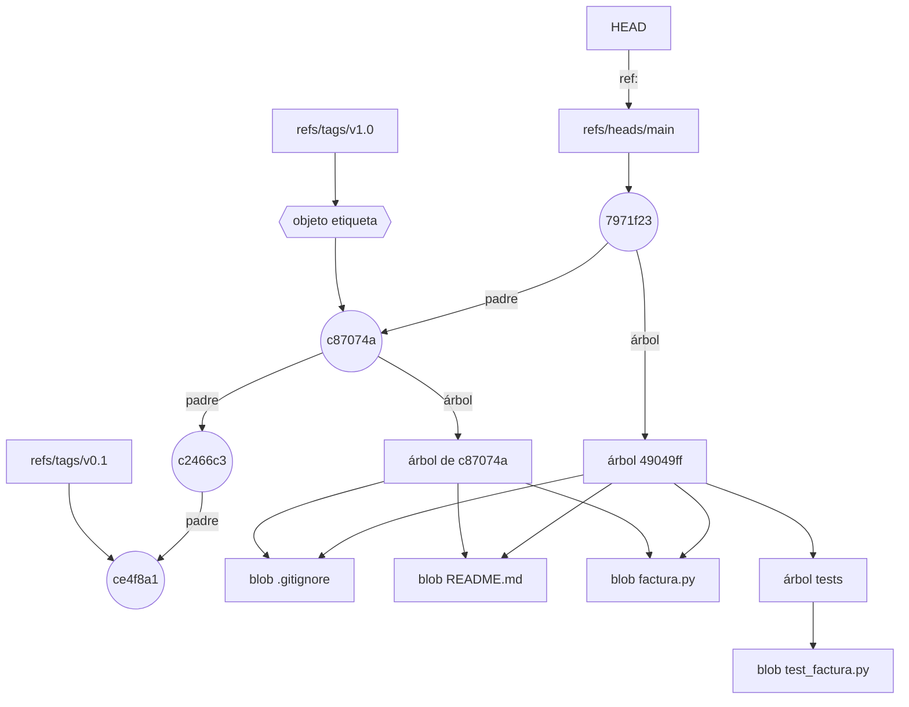

`7971f23` es el commit «Añade tests de total» de la sección 1.5. El árbol de su padre no tiene `tests/` y apunta a los mismos tres archivos, porque no cambiaron [h01-204].

Empieza por el almacén vacío: el ejemplo crea un repositorio, mira dentro de `.git`, guarda `hola` con `git hash-object` y lo recupera con `git cat-file`.

<!-- ejemplo: ejemplos/cap-01/16-dentro-de-git.sh -->
```console
# Ejecutado con Bash 5.2.21, Git 2.43.0
$ git init facturas
Initialized empty Git repository in /tmp/ejemplo/facturas/.git/
$ cd facturas
$ ls .git
HEAD
branches
config
description
hooks
info
objects
refs
$ find .git/objects -type f
$ echo 'hola' | git hash-object -w --stdin
5c1b14949828006ed75a3e8858957f86a2f7e2eb
$ find .git/objects -type f
.git/objects/5c/1b14949828006ed75a3e8858957f86a2f7e2eb
$ git cat-file -t 5c1b14949828006ed75a3e8858957f86a2f7e2eb
blob
$ git cat-file -p 5c1b14949828006ed75a3e8858957f86a2f7e2eb
hola
```
<!-- /ejemplo -->

De lo que lista `ls .git`, cuatro entradas importan: los archivos `HEAD` e `index` y las carpetas `objects` y `refs` [h01-610]. `index`, el del área de preparación, aún no aparece [h01-614]. `objects` guarda el contenido de la base de datos, y `refs`, los punteros a los commits [h01-611, h01-612]. El primer `find` no encuentra nada.

`git hash-object` es un comando de fontanería que guarda datos en `.git` y te devuelve su clave, una suma de 40 caracteres [h01-617, h01-619]. `--stdin` le dice que lea de la entrada estándar, y `-w`, que guarde el objeto; sin `-w`, solo te diría qué clave tendría [h01-845, h01-618]. El segundo `find` enseña dónde ha ido: un archivo por objeto, en una subcarpeta con los dos primeros caracteres del hash, `5c`, y los 38 restantes como nombre [h01-621, h01-622]. `cat-file -t` te da el tipo de un objeto a partir de su clave, y `-p`, su contenido [h01-625, h01-624]. El tipo es *blob* (objeto binario grande): guarda solo el contenido, sin nombre de archivo [h01-626, h01-627].

¿De dónde sale exactamente `5c1b149`? Git antepone al contenido una cabecera: el tipo de objeto, un espacio, el tamaño del contenido y un byte nulo [h01-645, h01-646]. Calcula el SHA-1 del conjunto y lo comprime todo con zlib [h01-620, h01-647, h01-648]. El ejemplo hace el cálculo en Python, lo compara con Git y descomprime el archivo guardado.

<!-- ejemplo: ejemplos/cap-01/17-hash-a-mano.py -->
```python
# Ejecutado con Python 3.13.18, Git 2.43.0
import hashlib
import subprocess
import zlib

contenido = b"hola\n"
subprocess.run(["git", "init", "-q", "repo"], check=True)

cabecera = b"blob %d\0" % len(contenido)
a_mano = hashlib.sha1(cabecera + contenido).hexdigest()
git = subprocess.run(["git", "hash-object", "-w", "--stdin"], cwd="repo", input=contenido,
                     capture_output=True, check=True).stdout.decode().strip()
print("a mano:", a_mano)
print("git:   ", git)
print("iguales:", a_mano == git)

ruta = f"repo/.git/objects/{git[:2]}/{git[2:]}"
with open(ruta, "rb") as archivo:
    descomprimido = zlib.decompress(archivo.read())
print("archivo:", ruta)
print("contenido:", descomprimido)
```

```text
a mano: 5c1b14949828006ed75a3e8858957f86a2f7e2eb
git:    5c1b14949828006ed75a3e8858957f86a2f7e2eb
iguales: True
archivo: repo/.git/objects/5c/1b14949828006ed75a3e8858957f86a2f7e2eb
contenido: b'blob 5\x00hola\n'
```
<!-- /ejemplo -->

Los dos hashes coinciden. `hola` y su salto de línea ocupan cinco bytes; de ahí `blob 5` [h01-646]. Descomprimido, el archivo es la cabecera, con su byte nulo (`\x00`), y el contenido [h01-646, h01-648]. Árboles y commits se guardan igual, con `tree` o `commit` en la cabecera [h01-649, h01-650]; detrás, un blob admite casi cualquier cosa, y un árbol o un commit siguen un formato interno concreto [h01-651].

Mira ese formato en `facturas` con cuatro commits: el ejemplo baja del commit de `HEAD` a su árbol, al subárbol `tests` y al blob del test.

<!-- ejemplo: ejemplos/cap-01/18-arbol-y-commit.sh -->
```console
# Ejecutado con Bash 5.2.21, Git 2.43.0
$ git cat-file -p HEAD
tree 49049ff53a78a6c89a52640220800608fc6140d5
parent c87074a060dbf507d64ec3e5e304398bd8e17de3
author devOC <devoc@ejemplo.dev> 1767265200 +0100
committer devOC <devoc@ejemplo.dev> 1767265200 +0100

Añade tests de total
$ git cat-file -p HEAD^{tree}
100644 blob 7a60b85e148f80966a550e5ab6a762a907c69ca6	.gitignore
100644 blob 866692569556ca36d04daf1b94ed88ee9e03606f	README.md
100644 blob 8ff14bec51fd28b8c6601ab9bcafa262cae0cbdb	factura.py
040000 tree e11b3b861512536ee23c90a2742f7f968593a4a7	tests
$ git cat-file -p e11b3b861512536ee23c90a2742f7f968593a4a7
100644 blob 549689f79d442dbb2706af1b1c4bf69f0cbc3ef3	test_factura.py
$ git cat-file -p 549689f79d442dbb2706af1b1c4bf69f0cbc3ef3
from factura import total
def test_total_con_iva_general():
    assert total(100) == 121.0
```
<!-- /ejemplo -->

El commit guarda el árbol con el estado del proyecto, su padre, el autor y el confirmador, una línea en blanco y el mensaje [h01-638, h01-570, h01-640]. `1767265200 +0100` es la marca de tiempo que acompaña al nombre y al correo [h01-639].

El árbol guarda los nombres y agrupa los archivos; corresponde a una carpeta [h01-628, h01-629]. La entrada `tests` es de tipo `tree`, no `blob`: apunta a otro árbol, y así se anidan las carpetas [h01-630, h01-632].

`.gitignore` y `factura.py` tienen los mismos hashes que en el ejemplo 03, aunque allí el historial era otro: el hash solo depende de cabecera y contenido, así que el mismo contenido da el mismo blob en cualquier parte [h01-647, h01-294].

Con estas piezas puedes hacer un commit sin `git commit`. Git suele crear los árboles a partir del índice, y `git write-tree` escribe el área de preparación como un objeto árbol [h01-633, h01-634]. `git commit-tree` crea un commit a partir del hash de un árbol y de los commits que lo preceden, si los hay [h01-637]. `git update-ref` actualiza una referencia de forma segura, y `git symbolic-ref HEAD` te dice a qué apunta `HEAD` [h01-658, h01-670]. El ejemplo construye así dos commits en un repositorio nuevo.

<!-- ejemplo: ejemplos/cap-01/19-commit-a-mano.sh -->
```console
# Ejecutado con Bash 5.2.21, Git 2.43.0
$ git init facturas
Initialized empty Git repository in /tmp/ejemplo/facturas/.git/
$ cd facturas
$ echo "# facturas" > README.md
$ git add README.md
$ git write-tree
6da4eda05f1f7094dbbecc3d77f7cc59e42595c8
$ c1=$(git commit-tree $(git write-tree) -m "Primer commit a mano")
$ echo "$c1"
c822fbeff82dceab815e144ddab961ede9401744
$ echo "Calcula el total de una factura con IVA." >> README.md
$ git add README.md
$ c2=$(git commit-tree $(git write-tree) -p $c1 -m "Segundo commit a mano")
$ echo "$c2"
0b2b7d119be47c00b785c2f8ce741b335b9fdebe
$ git update-ref refs/heads/main $c2
$ git symbolic-ref HEAD
refs/heads/main
$ git log --oneline
0b2b7d1 Segundo commit a mano
c822fbe Primer commit a mano
$ git commit-tree $(git write-tree) -p $c1 -m "Segundo commit a mano"
0b2b7d119be47c00b785c2f8ce741b335b9fdebe
```
<!-- /ejemplo -->

`write-tree` imprime el hash del árbol, y cada `commit-tree`, el de su commit: el primero sin padre y el segundo con `$c1` como anterior [h01-637, h01-641]. Ninguna rama los alcanza hasta que `update-ref` escribe en `refs/heads/main` el hash del segundo, que es como Pro Git crea una rama a mano [h01-660, h01-652]. `symbolic-ref` confirma que `HEAD` ya apuntaba allí [h01-670]. Es lo que la sección 1.4 te contó de `git add` y `git commit`: objetos nuevos y una rama que avanza [h01-643, h01-712].

> **Bajo el capó.** La última orden del ejemplo 19 repite el segundo `commit-tree` y obtiene el mismo hash, `0b2b7d1`. El hash se calcula sobre todo lo que guarda el commit: árbol, padres, autor y confirmador con su marca de tiempo, y mensaje [h01-638, h01-570, h01-639, h01-640, h01-647, h01-649]. Los ejemplos del libro fijan autor y fecha, así que el mismo árbol, el mismo padre y el mismo mensaje dan el mismo commit; por eso cada commit de los ejemplos cambia algo. En tu máquina cambian autor y fecha, y con ellos los hashes de los commits [h01-639, h01-647].

Te falta el cuarto tipo de objeto, la etiqueta [h01-673]. Marca un commit como una rama que nunca se mueve [h01-675]. La ligera es solo una referencia; la anotada, que se crea con `git tag -a`, es una referencia a un objeto etiqueta con quien la creó, la fecha, el mensaje y un enlace al commit [h01-677, h01-680, h01-679, h01-674]. En el diagrama, `v0.1` es ligera y `v1.0`, anotada.

Caso límite: dos archivos con nombres distintos e idéntico contenido. Son un solo blob, porque Git guarda un archivo por pieza de contenido, nombrado por su hash, y el nombre va en el árbol [h01-621, h01-626, h01-630]. El árbol tendrá dos entradas con el mismo hash.

> **Error típico.** Editar a mano `.git/HEAD` o los archivos de `.git/refs`. Técnicamente basta con escribir un hash en un archivo de `refs/heads` [h01-655], pero no es conveniente: usa `git update-ref` y `git symbolic-ref`, que son más seguros [h01-657, h01-658, h01-669]. `symbolic-ref`, por ejemplo, no te deja fijar una referencia simbólica fuera de `refs` [h01-672].

> **Ojo con la versión.** ¿Por qué busca Git un sucesor de SHA-1? El 23 de febrero de 2017, el ataque SHAttered demostró una colisión práctica de SHA-1 [h01-288]. Desde la 2.13.0, Git usa por defecto una implementación reforzada que lo resiste, pero SHA-1 sigue siendo débil y se considera prudente dejarlo atrás [h01-289, h01-290, h01-291]. A finales de 2018 el proyecto eligió SHA-256 entre varios candidatos [h01-292]. Aun así, `git init` sigue usando SHA-1 por defecto y los dos formatos no interoperan por ahora [h01-280, h01-283]: el cálculo del ejemplo 17 es el de tus repositorios [h01-294].

## 1.7 reset sin miedo

`git reset` mueve la rama a la que apunta `HEAD` y después puede copiar ese commit al índice y el índice al directorio de trabajo: `--soft` se para tras el primer paso, `--mixed` tras el segundo y `--hard` da los tres [h01-717, h01-718, h01-720, h01-724, h01-725, h01-728, h01-729]. Solo `--hard` es peligroso, porque sobrescribe tus archivos, y aun así lo confirmado se recupera, normalmente con el *reflog* (registro de referencias) [h01-730, h01-731, h01-345, h01-784, h01-774].

Pro Git explica `reset` con tres árboles, entendidos como colecciones de archivos [h01-701, h01-702]. Ya los conoces: `HEAD`, la última instantánea confirmada; el índice, la que propones para el próximo commit, y el directorio de trabajo, los archivos reales que editas [h01-703, h01-704, h01-708].

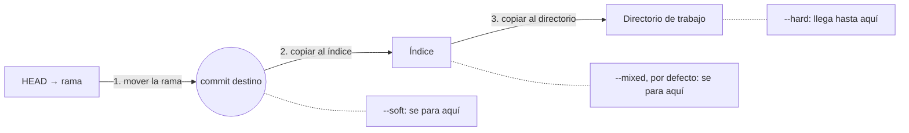

El primer paso no cambia `HEAD`, que sigue señalando la misma rama: lo que se mueve es la rama [h01-718]. El ejemplo suma a los dos commits de la sección 1.2 uno que redondea el total y prueba los tres modos con `HEAD~`; entre uno y otro reconfirma el redondeo sin enseñarlo.

<!-- ejemplo: ejemplos/cap-01/21-reset-tres-modos.sh -->
```console
# Ejecutado con Bash 5.2.21, Git 2.43.0
$ git log --oneline
0fdde2b Redondea el total a dos decimales
d382532 Cambia el tipo de IVA al 21 %
ce4f8a1 Primera versión de la factura
$ git reset --soft HEAD~
$ git status -s
M  factura.py
$ git reset HEAD~
Unstaged changes after reset:
M	factura.py
$ git status -s
 M factura.py
$ git reset --hard HEAD~
HEAD is now at d382532 Cambia el tipo de IVA al 21 %
$ git status -s
$ cat factura.py
IVA = 0.21
def total(base, iva=IVA):
    """Calcula el total de una factura."""
    return base * (1 + iva)
$ git log --oneline
d382532 Cambia el tipo de IVA al 21 %
ce4f8a1 Primera versión de la factura
```
<!-- /ejemplo -->

Tras `--soft`, `main` vuelve a `d382532`, pero el índice y el directorio de trabajo conservan el redondeo [h01-720, h01-722]. Como el índice ya no coincide con `HEAD`, `git status -s` lo da como preparado, `M ` [h01-715, h01-250]. Has deshecho el último commit y nada más [h01-721]; si retocas el índice y confirmas, logras lo mismo que con `--amend` [h01-723].

El reset sin opción es `--mixed` [h01-726]: tras mover la rama, copia al índice la instantánea de `d382532` y se para [h01-724, h01-725]. Deshace el commit y saca todo del área de preparación [h01-727]. El cambio queda en ` M`, solo en disco [h01-714].

`--hard` da el tercer paso: el directorio de trabajo se iguala al índice [h01-728]. `git status -s` sale vacío, porque los tres árboles coinciden [h01-713], y `cat` enseña la versión sin redondeo. Ha deshecho el commit, el `git add` previo y lo que tenías en el directorio de trabajo [h01-729]. Los otros modos se deshacen con facilidad; este no, porque sobrescribe a la fuerza tus archivos [h01-731].

Con una ruta, `reset` se salta el primer paso y aplica el resto solo a esos archivos [h01-734]. Tiene sentido: `HEAD` es un puntero y no puede señalar un trozo de un commit y otro trozo de otro [h01-735]. `git reset factura.py` abrevia `git reset --mixed HEAD factura.py`: copia el archivo de `HEAD` al índice, lo que en la práctica lo saca del área de preparación [h01-736, h01-737, h01-738]. Es exactamente lo contrario de `git add` [h01-739], y equivale al `git restore --staged` de la sección 1.3 [h01-361]. El ejemplo lo comprueba y después pide la versión de un commit concreto [h01-740].

<!-- ejemplo: ejemplos/cap-01/22-reset-con-ruta.sh -->
```console
# Ejecutado con Bash 5.2.21, Git 2.43.0
$ echo "IVA_REDUCIDO = 0.10" >> factura.py
$ git add factura.py
$ git reset factura.py
Unstaged changes after reset:
M	factura.py
$ git status -s
 M factura.py
$ git add factura.py
$ git restore --staged factura.py
$ git status -s
 M factura.py
$ git reset HEAD~2 factura.py
Unstaged changes after reset:
M	factura.py
$ git status -s
MM factura.py
$ git log --oneline
0fdde2b Redondea el total a dos decimales
d382532 Cambia el tipo de IVA al 21 %
ce4f8a1 Primera versión de la factura
```
<!-- /ejemplo -->

`git reset factura.py` y `git restore --staged factura.py` dejan el mismo ` M`. `git reset HEAD~2 factura.py` mete en el índice el `factura.py` de `ce4f8a1`, con el IVA del 20 %, sin tocar el disco ni la rama [h01-740, h01-759]. El índice difiere de `HEAD` y del directorio de trabajo, de ahí el `MM` [h01-715, h01-714], y `git log` sigue empezando en `0fdde2b`.

`--soft` tiene otro uso: aplastar en uno commits como «WIP» u «oops» [h01-773]. `git reset --soft HEAD~2` lleva la rama al primer commit que quieres conservar, y un `git commit` confirma de una vez lo que sigue en el índice [h01-741, h01-742, h01-755]. Es la alternativa al `fixup` de la sección 1.5.

Cambiar de rama también actualiza los tres árboles [h01-716]. Pro Git compara `git checkout <rama>`, el cambio de rama que hoy hace `git switch`, con `git reset --hard <rama>` [h01-744, h01-479, h01-471]. Hay dos diferencias. `checkout` comprueba que no pisa archivos con cambios, igual que `git switch`, y `reset --hard` lo reemplaza todo sin mirar [h01-745, h01-476, h01-746]. Además, `reset` mueve la rama a la que apunta `HEAD`, y `checkout` mueve `HEAD` a otra rama [h01-747]. El ejemplo parte de `develop`, un commit por delante de `main`.

<!-- ejemplo: ejemplos/cap-01/23-reset-frente-a-switch.sh -->
```console
# Ejecutado con Bash 5.2.21, Git 2.43.0
$ cat .git/HEAD
ref: refs/heads/develop
$ git log --oneline --all --decorate
7971f23 (HEAD -> develop) Añade tests de total
c87074a (main) Cambia el tipo de IVA al 21 %
c2466c3 Añade un ejemplo de uso al README
ce4f8a1 Primera versión de la factura
$ git reset main
$ cat .git/HEAD
ref: refs/heads/develop
$ git log --oneline --all --decorate
c87074a (HEAD -> develop, main) Cambia el tipo de IVA al 21 %
c2466c3 Añade un ejemplo de uso al README
ce4f8a1 Primera versión de la factura
$ git switch main
Switched to branch 'main'
$ cat .git/HEAD
ref: refs/heads/main
$ git log --oneline --all --decorate
7971f23 (develop) Añade tests de total
c87074a (HEAD -> main) Cambia el tipo de IVA al 21 %
c2466c3 Añade un ejemplo de uso al README
ce4f8a1 Primera versión de la factura
```
<!-- /ejemplo -->

`git reset main` deja `.git/HEAD` igual, pero `develop` pasa a `c87074a`, el commit de `main`, y `7971f23` se queda sin rama [h01-748]. Con `develop` devuelta a `7971f23` sin enseñarlo, `git switch main` no la toca: lo que cambia es `.git/HEAD` [h01-749].

En la tabla, la columna «Mueve» dice si el comando mueve la rama a la que apunta `HEAD` o el propio `HEAD` [h01-753]; si la última dice «no», piénsalo antes de ejecutar [h01-754].

| Comando | Mueve | Índice | Directorio de trabajo | Protege el directorio de trabajo |
| --- | --- | --- | --- | --- |
| `git reset --soft <commit>` | la rama | no | no | sí [h01-755] |
| `git reset <commit>` | la rama | sí | no | sí [h01-756] |
| `git reset --hard <commit>` | la rama | sí | sí | no [h01-757] |
| `git checkout <commit>` | `HEAD` | sí | sí | sí [h01-758] |
| `git reset [<commit>] <archivo>` | nada | sí | no | sí [h01-759] |
| `git checkout [<commit>] <archivo>` | nada | sí | sí | no [h01-760] |

Fíjate en la última fila. Con ruta, `checkout` tampoco mueve `HEAD`, pero copia el archivo al índice y también al directorio de trabajo, sin proteger tus cambios [h01-750, h01-751, h01-752].

La sección 1.4 rescató con el reflog un experimento; ahora toca el caso típico que cita Pro Git, un `reset --hard` que abandona commits [h01-781].

<!-- ejemplo: ejemplos/cap-01/24-recuperar-con-reflog.sh -->
```console
# Ejecutado con Bash 5.2.21, Git 2.43.0
$ git reset --hard HEAD~2
HEAD is now at c87074a Cambia el tipo de IVA al 21 %
$ git log --oneline
c87074a Cambia el tipo de IVA al 21 %
c2466c3 Añade un ejemplo de uso al README
ce4f8a1 Primera versión de la factura
$ git reflog
c87074a HEAD@{0}: reset: moving to HEAD~2
9af4ac5 HEAD@{1}: commit: Documenta el IVA en el README
7971f23 HEAD@{2}: commit: Añade tests de total
c87074a HEAD@{3}: commit: Cambia el tipo de IVA al 21 %
c2466c3 HEAD@{4}: commit: Añade un ejemplo de uso al README
ce4f8a1 HEAD@{5}: commit (initial): Primera versión de la factura
$ git branch recuperada HEAD@{1}
$ git log --oneline recuperada
9af4ac5 Documenta el IVA en el README
7971f23 Añade tests de total
c87074a Cambia el tipo de IVA al 21 %
c2466c3 Añade un ejemplo de uso al README
ce4f8a1 Primera versión de la factura
$ git branch -D recuperada
Deleted branch recuperada (was 9af4ac5).
$ rm -rf .git/logs
$ git fsck --full
dangling commit 9af4ac5a6255e33eac352d96f4dcfb0c3fc89886
```
<!-- /ejemplo -->

Tras el reset, `git log` ha perdido `9af4ac5` y `7971f23`, porque ninguna rama los alcanza [h01-782]. Para recuperarlos hay que localizar el hash y ponerle una rama, y el reflog suele ser la vía más rápida [h01-783, h01-784]. Cubre todas las acciones recientes [h01-778]: su primera línea es el propio reset, y `HEAD@{1}`, la posición anterior, `9af4ac5` [h01-775]. `git branch recuperada HEAD@{1}` le pone nombre, y el log vuelve a enseñar los dos commits [h01-788, h01-789].

¿Y si el reflog ya no lo tiene? Sus entradas caducan, por defecto a los 90 días [h01-779, h01-780]. El final del ejemplo borra la rama y el reflog, que vive en `.git/logs/`, y aún queda `git fsck --full`: el commit perdido aparece tras `dangling commit` y se recupera igual, con una rama [h01-790, h01-791, h01-792, h01-793].

> **Error típico.** Lanzar `git reset --hard` con cambios sin confirmar. Es la única forma peligrosa de `reset` y no comprueba nada [h01-730, h01-746]. En el ejemplo 21 el redondeo estaba confirmado y el reflog lo recuerda [h01-786, h01-732]; si no lo hubieras confirmado, sería irrecuperable [h01-733]. Confirma antes lo que quieras conservar [h01-345].

> **Ojo con la versión.** La tabla de Pro Git usa `checkout` para las dos cosas que hoy hacen `git switch` y `git restore` (sección 1.4) [h01-479]. Su última fila es lo que hoy escribes como `git restore --source <commit> --staged --worktree <archivo>` [h01-358, h01-355, h01-362].

Ya puedes cerrar «El problema». `git rebase -i HEAD~4` creó commits nuevos (sección 1.5). `git reset --soft HEAD~2` llevó tu rama dos commits atrás sin tocar el índice ni el directorio de trabajo: los cambios de esos commits quedaron preparados [h01-741, h01-755, h01-828, h01-715]. El `git commit` siguiente los confirmó juntos, y dos commits pasaron a ser uno [h01-742, h01-773]. Y `git push --force` sobrescribió la historia del servidor [h01-522]. Ningún commit se borró: los que quedaron sin rama siguen localizables en tu reflog [h01-768, h01-774, h01-783, h01-784].

En la revisión, defiende el modelo: `reset --soft` solo movió tu rama, y lo confirmado se puede recuperar [h01-718, h01-720, h01-345]; lo que rompió el trabajo de tu compañera fue reescribir una rama sobre la que ella ya trabajaba [h01-591]. Para deshacer algo publicado, la próxima vez, `git revert` [h01-535, h01-594].

## El proyecto avanza: Arqueología de un PR

La misión de esta parte: reimplementar sin mirar el diff un PR ya integrado en gentle-shell y comparar tu versión con la real. Aquí solo preparas la excavación, sin escribir código.

1. Clona gentle-shell y elige el PR. Sin abrir su diff, localiza el commit que lo integró.
2. Averigua cómo se integró: con un commit de fusión, con un solo commit que lo aplasta o con sus commits reaplicados en línea. Mira sus líneas `parent` con `git cat-file -p` y el grafo con `git log --graph`. No des nada por hecho: anota en `arqueologia.md` las pruebas que te deciden.
3. Identifica la base sobre la que trabajó el autor y crea en ella la rama `arqueologia/pr-NNN`. Comprueba con `cat .git/HEAD` y con el log que estás donde crees.
4. Dibuja en Mermaid el grafo alrededor del PR: la base, sus commits y el punto de integración.
5. Anota qué archivos tocó y cuántas líneas, solo con la vista resumida de `git log --stat` [h01-308, h01-309]. Será tu único plano cuando lo reimplementes en el capítulo 5.

Repite los pasos 1 a 4 con un PR de FastAPI.

## Resumen

- Un commit guarda una instantánea completa del proyecto, sus padres y sus metadatos, y se nombra por el hash de su contenido [h01-203, h01-638, h01-570, h01-639, h01-214].
- Los commits son inmutables: `--amend` y rebase crean commits nuevos, y cambiar uno cambia el hash de todos los que lo siguen [h01-763, h01-764, h01-571].
- Una rama es un archivo con el hash de un commit; `HEAD`, una referencia a la rama en la que estás. Al confirmar, solo avanza esa rama [h01-424, h01-664, h01-411, h01-420].
- Merge y rebase dan la misma instantánea y distinto historial; no reescribas lo que otros ya tienen y deshaz lo publicado con `git revert` [h01-510, h01-535, h01-591, h01-594].
- `reset` mueve la rama y, según el modo, copia al índice y al directorio de trabajo; solo `--hard` destruye datos, y solo los que no confirmaste [h01-718, h01-720, h01-725, h01-728, h01-730, h01-733, h01-345].

## Ejercicios

Las soluciones están en `soluciones.md` de la Parte I.

**Comprobación**

1. `main` apunta a C3; `descuentos`, a C2, padre de C3, y `HEAD`, a `descuentos`. Haces un commit. Dibuja el grafo y di qué archivos de `.git` cambian y cuáles no.
2. Explica cada columna de estas líneas de `git status -s`: `??`, `A `, ` M` y `MM`. Escribe qué comandos llevan a cada estado desde un repositorio sin cambios.

**Aplicación**

3. En `facturas`, encuentra con `git log`, sin abrir archivos, el commit que cambió el IVA. Recupera el `factura.py` anterior a ese commit sin mover la rama y confírmalo como commit nuevo. Explica por qué no usas `reset`.
4. Crea tres commits «WIP» seguidos. Aplástalos con `git reset --soft`; después, desde el mismo punto de partida, con rebase interactivo y `fixup`. Compara árbol y hash de ambos resultados y explica la diferencia.

**Construir sin IA**

5. Crea un repo, tres ramas, provoca un conflicto, resuélvelo y limpia el historial con rebase interactivo. Dibuja el grafo antes y después.

**Reto**

6. Escribe en Python un `git log --oneline` mínimo que no llame a `git`. Lee `.git/HEAD`, sigue la referencia hasta el commit, descomprime cada objeto con `zlib` y recorre los padres hasta el primer commit, mostrando el hash y el mensaje de cada uno [h01-664, h01-652, h01-648, h01-570]. Pruébalo en un repositorio nuevo con pocos commits y compáralo con Git.

## Preguntas de examen

**Explicar.** ¿Qué es realmente una rama y qué cambia en el repositorio cuando haces un commit?

**Defender**

1. Un merge y un rebase de las mismas ramas dejan la misma instantánea [h01-510]. ¿Por qué no son intercambiables y con qué criterio eliges?
2. ¿Qué pasaría si haces rebase de una rama que tu compañera ya tiene y la subes con `--force`? ¿Qué verá ella al traer los cambios?
3. Corriges con rebase interactivo el mensaje de un commit de hace diez commits, y cambian los hashes de todos los posteriores [h01-543, h01-570, h01-571]. ¿Por qué?
4. ¿Qué hace `git reset HEAD~` en los tres árboles, y por qué no pierdes trabajo [h01-726, h01-731]?
5. ¿Qué pasaría si ejecutas `git reset --hard HEAD~2` con cambios sin confirmar? ¿Qué recuperarías, cómo y qué no?
6. Has subido un commit defectuoso a `main`, que comparte todo el equipo. ¿Por qué lo deshaces con `revert` y no con `reset`?
