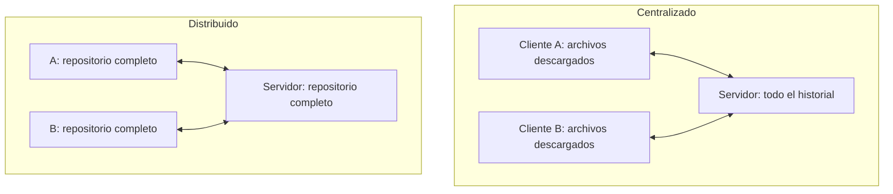
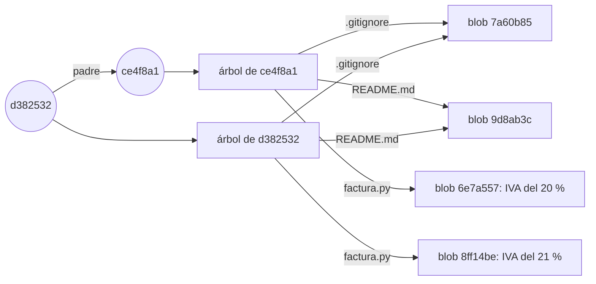
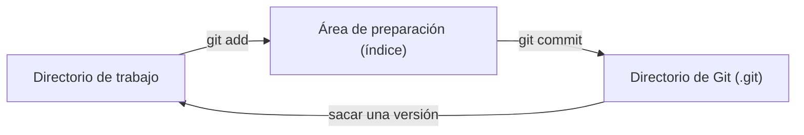
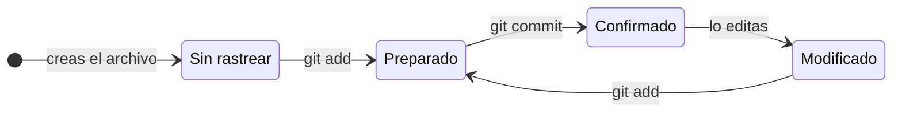

# Capítulo 1. Git por dentro

## Lo que podrás hacer al terminar

1. Explicar qué guarda un *commit* (confirmación): una *snapshot* (instantánea) del proyecto, sus padres y sus metadatos; y por qué tocar un commit antiguo cambia el *hash* (resumen) que da nombre a todos los que vienen detrás [h01-402, h01-403, h01-404, h01-638, h01-570, h01-571, h01-647].
2. Dibujar el grafo de commits, ramas y `HEAD` antes y después de un commit, de un *merge* (fusión) por avance rápido o a tres bandas, de un *rebase* (reorganización: reaplicar commits sobre otra base) y de un `git reset`, y comprobar el dibujo con `git log --graph` y con los archivos de `.git` [h01-761, h01-435, h01-441, h01-503, h01-314, h01-652, h01-663].
3. Elegir entre merge y rebase, y decidir cuándo no reescribir, según si otros ya tienen esos commits; y deshacer un commit sin reescribir nada con `git revert` [h01-510, h01-535, h01-591, h01-594].
4. Predecir qué hacen `git reset --soft`, `--mixed` y `--hard` con `HEAD`, el índice y el directorio de trabajo; recuperar con el *reflog* (registro de referencias) un commit que parecía perdido, y saber cuánto tiempo lo guarda el reflog [h01-701, h01-717, h01-720, h01-725, h01-728, h01-783, h01-784, h01-870, h01-872].
5. Construir sin ayuda un repositorio con tres ramas, provocar un conflicto y resolverlo, y limpiar el historial con un rebase interactivo, dibujando el grafo antes y después [h01-542, h01-580, h01-448, h01-456].

## Lo que necesitas antes

- Capítulos previos: ninguno.
- Git 2.43 o posterior y una terminal. Los ejemplos se han ejecutado con Git 2.43.0.
- Tu nombre y tu correo, que Git apunta en cada commit junto con una marca de tiempo [h01-639, h01-812]. Se fijan una sola vez con `git config --global user.name` y `git config --global user.email` [h01-811, h01-813].
- La rama inicial llamada `main`, para que tus nombres de rama coincidan con los del libro: dale ese valor a la variable `init.defaultBranch` con `git config --global` [h01-279, h01-811]. El «Ojo con la versión» de la sección 1.2 explica por qué.
- Los hashes de tus commits no coincidirán con los del libro: en cada uno entran tu nombre, tu correo y la hora [h01-639, h01-647]. La sección 1.6 cuenta qué hashes sí te saldrán iguales.

## El problema

Tu rama `exportar-csv` de `facturas` tiene cuatro commits: dos con la exportación a CSV, uno que arregla el segundo y una prueba que sobra. Antes de abrir el *pull request* (PR, la petición para que integren tu rama), le pides a un asistente de IA que te la deje limpia.

Te da cuatro órdenes: `git rebase -i HEAD~4`, con una lista que funde el arreglo con su commit y quita la prueba; `git reset --soft HEAD~2`; `git commit -m "Añade la exportación a CSV"`, y `git push --force`. Las ejecutas, nada protesta y la rama queda con un solo commit.

Al día siguiente te escribe Marta Ruiz, tu compañera, que había empezado su rama a partir de la tuya. Al intentar traer tus cambios, Git le dice que su copia y la del servidor han divergido, y se detiene. Cuando le obliga a fusionar, su historial enseña tus commits viejos junto al nuevo: los mismos cambios, dos veces. Ahora tiene que arreglar su rama a mano.

En la revisión te harán tres preguntas. ¿Qué hizo exactamente cada orden? ¿Dónde están los commits que «desaparecieron» de tu rama? ¿Cómo defiendes lo que pasó? Este capítulo construye el modelo que responde a las tres.

## 1.1 Qué es el control de versiones

Un sistema de control de versiones guarda la historia de tus archivos para que puedas volver a cualquier versión anterior, de un archivo o del proyecto entero [h01-101, h01-102, h01-103]. En Git cada clon trae esa historia completa, y por eso casi todo lo que haces ocurre en tu disco [h01-120, h01-121, h01-206, h01-207].

Imagina `facturas` antes de Git: una carpeta con `factura.py` y `README.md` y, al lado, sus copias, `facturas_v2`, `facturas_v2_final` y `facturas_v2_final_DEFINITIVO`. Duplicar la carpeta es un método habitual [h01-105], y también una fuente de errores: pierdes la cuenta de qué copia tienes abierta, guardas en la que no era o pisas un archivo que querías conservar [h01-106, h01-107]. A un control de versiones le pides justo lo contrario: que cada versión anterior siga ahí y puedas volver a ella [h01-102, h01-103].

Así se ve `facturas` con Git. El ejemplo parte de un repositorio con tres commits en la rama `main`. Lista su historial, una línea por commit; después lo clona en la carpeta `copia` y repite la consulta dentro del clon.

<!-- ejemplo: ejemplos/cap-01/01-clon-completo.sh -->

Las dos listas son idénticas: tres commits, en el mismo orden y con los mismos nombres, `ce4f8a1`, `c2466c3` y `c87074a`. `git clone` no se ha traído solo los archivos de la última versión, sino el repositorio entero, con todo su historial [h01-120, h01-121]. Qué son esos nombres lo verás en la sección 1.2.

Esa salida responde a la pregunta que separa unos sistemas de otros: ¿dónde vive el historial? En la carpeta de copias, solo en tu disco. En un sistema centralizado, como Subversion, en un único servidor del que cada persona descarga los archivos con los que trabaja; nació para que pudiera colaborar gente desde máquinas distintas [h01-110, h01-111, h01-112]. En uno distribuido, como Git, cada máquina guarda una réplica completa del repositorio [h01-119, h01-120].

Las flechas son las mismas en los dos dibujos; lo que cambia es qué guarda cada máquina [h01-112, h01-120].

Con todo el historial dentro de `copia`, la mayoría de las operaciones de Git no necesitan nada que esté fuera de tu disco, y por eso responden casi al instante [h01-206, h01-207]. Puedes seguir confirmando cambios sin conexión y enviarlos cuando vuelvas a tener red [h01-208].

Lleva el caso al extremo: el disco del servidor se estropea y nadie tenía copia de seguridad. En un sistema centralizado el servidor es un punto único de fallo, y con su disco se va el historial del proyecto; solo quedan las versiones sueltas que cada persona tuviera en su máquina [h01-116, h01-118]. Con Git, cualquier clon puede copiarse al servidor para restaurarlo, con lo que ese clon tuviera [h01-121, h01-122]. Lo que nadie llegó a confirmar no está en ningún clon, y puede que no vuelvas a verlo [h01-347].

Git nació en 2005 en la comunidad del *kernel* (núcleo) de Linux, cuando BitKeeper, la herramienta que usaban, dejó de ser gratuita [h01-126, h01-127, h01-128, h01-809]. Entre sus objetivos estaban la velocidad y soportar miles de ramas en paralelo; los dos reaparecen en la sección 1.4 [h01-129, h01-130].

## 1.2 Fotos, no diferencias; los tres estados

Cada commit guarda una foto completa del proyecto, y lo que no cambió desde la foto anterior no se copia otra vez: se reutiliza [h01-203, h01-204]. Cada pieza se nombra por el hash de su contenido, y la foto no se toma de tu disco, sino de una zona intermedia, el *staging area* (área de preparación) [h01-214, h01-226, h01-263].

Empieza por un experimento. El ejemplo parte de un `facturas` con dos commits en `main`: el primero de la sección 1.1 y otro que sube el IVA del 20 % al 21 %, esta vez sin el commit del README entre medias. Pide la diferencia entre los dos commits y después la lista de archivos que guarda cada uno.

<!-- ejemplo: ejemplos/cap-01/03-fotos-no-diferencias.sh -->

`HEAD` señala el último commit de la rama y `HEAD~1`, su padre [h01-663, h01-703, h01-826]; la sección 1.3 cuenta esta notación. Según `git diff`, entre los dos commits solo cambia una línea de `factura.py` [h01-843, h01-255]. ¿Qué ha guardado Git, entonces? ¿Solo esa línea?

Mira los dos listados. `git cat-file -p` enseña un objeto de Git de forma legible, y `^{tree}` detrás de un commit designa su árbol (*tree*), el listado de archivos de esa foto [h01-623, h01-624, h01-829, h01-631, h01-629]. Cada línea del árbol lleva el modo (`100644` es un archivo normal), el tipo, un hash y el nombre del archivo [h01-630, h01-635]. El tipo `blob` (de *binary large object*, objeto binario grande) es el objeto que guarda el contenido de un archivo, sin su nombre [h01-627].

Los dos árboles nombran los tres archivos, también los que no cambiaron. `.gitignore` y `README.md` tienen el mismo hash en ambos; `factura.py`, no.

Cada commit tiene su foto completa, pero lo que no cambió apunta al contenido que ya estaba guardado, y el nombre de cada archivo vive en el árbol, no en el blob [h01-203, h01-204, h01-627, h01-630]. `git diff` te enseña los cambios entre dos commits cualesquiera [h01-843], pero lo que Git guarda son fotos, no listas de cambios [h01-401, h01-205].

Piensa en un álbum: cada página es un commit con la foto de lo que tenías preparado, y lo que no cambió se pega de la página anterior en vez de revelarse otra vez [h01-203, h01-204, h01-263].

Esos nombres de 40 caracteres son hashes SHA-1, cadenas hexadecimales calculadas a partir del contenido [h01-211, h01-212, h01-213, h01-630]. Git comprueba cada cosa con ese cálculo antes de guardarla y la guarda por su hash, no por su nombre de archivo; por eso `.gitignore` se llama igual en los dos árboles [h01-209, h01-213, h01-214]. `ce4f8a1` y `d382532` son prefijos: `--oneline` enseña solo el principio del hash, lo justo para identificar el commit [h01-820, h01-821].

El commit del IVA no se llama como en la sección 1.1, `c87074a`, porque su padre y su README son otros, y un commit guarda el hash de su padre y apunta a su árbol [h01-570, h01-407, h01-638, h01-294]. La sección 1.6 hace el cálculo.

Como el nombre sale del contenido, no puedes cambiar un archivo sin que Git lo note: si se corrompe un solo bit, el hash del contenido dañado ya no coincide con su nombre [h01-210, h01-287]. Y como casi todo lo que haces en Git solo añade información a su base de datos, lo que has confirmado es muy difícil de perder [h01-215, h01-216].

Queda la pregunta del principio: ¿de dónde sale la foto? Git trabaja con tres lugares [h01-221]:

- El directorio de trabajo: los archivos que ves y editas, una versión del proyecto que Git saca de su base de datos y deja en tu disco [h01-224, h01-225].
- El área de preparación, que también se llama índice (*index*): un archivo, normalmente dentro de `.git`, con lo que irá en el próximo commit [h01-226, h01-706, h01-614].
- El directorio de Git, la carpeta `.git`: guarda los objetos, como los blobs y los árboles que acabas de ver, y los metadatos del proyecto [h01-222, h01-627]. Cuando clonas desde otra máquina, esto es lo que te llevas [h01-223].

`git add` copia contenido del directorio de trabajo al índice, y `git commit` convierte lo que hay en el índice en una foto permanente dentro de `.git` [h01-710, h01-711, h01-229]. La flecha de vuelta saca una versión de `.git` a tu disco [h01-225]; la sección 1.7 cuenta que, al cambiar de rama, ese camino pasa también por el índice [h01-716].

Recorre ahora esos lugares. Este ejemplo no parte de ningún `facturas`: crea el repositorio desde cero, con una versión mínima de `README.md` y `factura.py`, y entre paso y paso consulta `git status -s`. Es la forma corta de la orden que te dice en qué estado está cada archivo [h01-248, h01-238].

<!-- ejemplo: ejemplos/cap-01/02-tres-estados.sh -->

Cada línea de `git status -s` tiene dos columnas: la izquierda habla de lo preparado y la derecha, de lo que no [h01-250].

- `??`: sin rastrear; Git ve el archivo, pero no estaba en la última foto ni está preparado [h01-235, h01-249].
- `A `: `README.md`, rastreado y preparado tras `git add` [h01-243, h01-249].
- ` M`: `factura.py`, con una línea nueva sin preparar [h01-249, h01-250].
- `MM`: preparaste `IVA_REDUCIDO` y luego escribiste `IVA_SUPERREDUCIDO`; a la izquierda, el cambio preparado; a la derecha, el posterior [h01-246, h01-250].

El commit se llama `701842a`, no `ce4f8a1`: sin `.gitignore` y con otros archivos, la foto es otra [h01-214, h01-638].

Las marcas corresponden a los estados de un archivo. Uno rastreado estaba en la última foto, y puede estar confirmado, modificado o preparado [h01-217, h01-233, h01-234]. Uno sin rastrear no entra en ningún commit hasta que lo añades con `git add` [h01-235, h01-241, h01-242].

Cada lado del `MM` tiene su `git diff`. Sin opciones, compara tu disco con el índice y enseña lo que no has preparado, la línea de `IVA_SUPERREDUCIDO` [h01-256, h01-259]. Con `--staged`, o su sinónimo `--cached`, compara el índice con el último commit y enseña lo que entraría en el próximo, la de `IVA_REDUCIDO` [h01-257, h01-258, h01-260]. Los dos dan el parche: las líneas que se añaden y las que se quitan [h01-255]. Fíjate en `21c1b83`: cierra la línea `index` de una salida y abre la de la otra. Encaja con lo anterior, porque las dos comparaciones comparten un extremo, el índice [h01-256, h01-258].

¿Por qué hay dos lados? Porque `git add` no apunta un nombre en una lista: copia el contenido del archivo tal como está en ese momento, y lo que edites después queda fuera de esa copia [h01-405, h01-246, h01-247]. `git status` compara por parejas: el índice con el último commit, para los cambios por confirmar, y tu disco con el índice, para los cambios sin preparar [h01-703, h01-715, h01-714].

Vuelve al `MM` y confirma sin otro `git add`. El commit se lleva `IVA_REDUCIDO`, que es lo preparado, mientras que `IVA_SUPERREDUCIDO` se queda en tu disco sin preparar [h01-246, h01-250, h01-262, h01-263, h01-714]. Para que entrara, tendrías que haber vuelto a ejecutar `git add` [h01-247].

> **Error típico.** Confirmar sin querer trazas o archivos que genera tu compilación [h01-251]. Un `.gitignore` lista patrones de archivos que Git no debe añadir ni enseñar como sin rastrear [h01-251, h01-272]. Créalo al empezar el proyecto, como el de `facturas`, y evitarás confirmar por accidente lo que no quieres [h01-252]. Usa la sintaxis *glob* (de comodines) estándar; por defecto, cada patrón se aplica de forma recursiva en todo el repositorio, y un `!` delante lo niega [h01-253, h01-254].

> **Ojo con la versión.** Pro Git en español da `master` como rama por defecto, y explica que está en casi cualquier repositorio porque `git init` la crea así y casi nadie le cambia el nombre [h01-410, h01-412, h01-413]. La documentación actual de `git init` dice que ese sigue siendo el nombre por defecto y que pasará a ser `main` con Git 3.0 [h01-278]. Los ejemplos usan `main` porque su entorno lo fija con `init.defaultBranch` [h01-279]; para un solo repositorio tienes `git init -b` [h01-277].
>
> Con el hash pasa algo parecido: por defecto `git init` usa SHA-1 y, con `--object-format=sha256`, si tu Git lo tiene habilitado, SHA-256 [h01-280]. La sección 1.6 cuenta por qué Git busca un sucesor de SHA-1.
