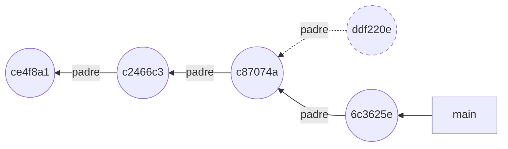
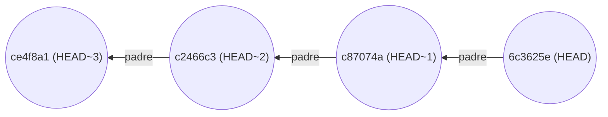
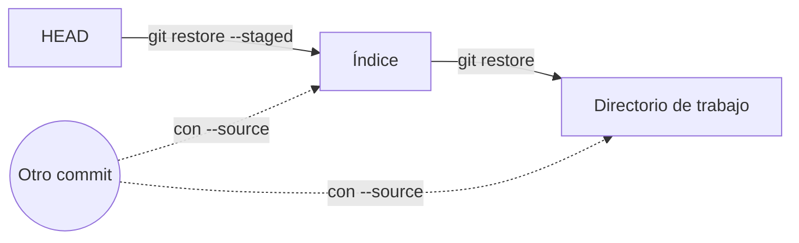
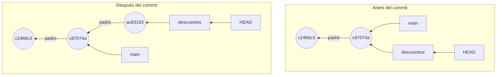
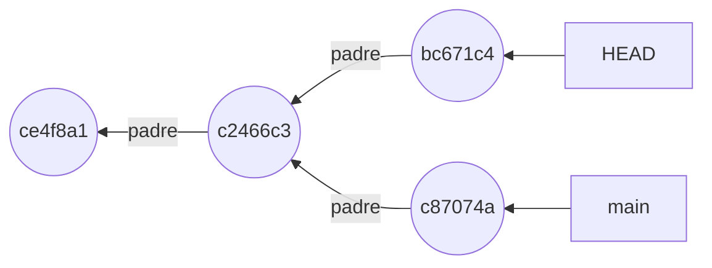
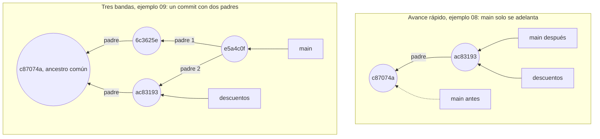

## 1.3 Leer y deshacer el historial

Deshacer en Git casi nunca borra: o crea un commit nuevo o copia contenido de un lugar a otro, y solo pierdes lo que nunca llegaste a confirmar. Para elegir qué deshacer, antes tienes que encontrarlo, y `git log` es una consulta sobre el historial.

Casi todo lo que haces en Git añade información a su base de datos y no quita la que había [h01-215]. Corregir un commit tampoco lo modifica: Git escribe otro y mueve la rama hacia él [h01-764]. Lo confirmado se puede recuperar [h01-345]. El riesgo está en tu disco: si deshaces un cambio que no llegó a entrar en ningún commit, puede que no haya forma de traerlo de vuelta [h01-327, h01-347].

Empieza por el error más pequeño, un mensaje que no dice lo que hace el commit. El ejemplo parte de `facturas` con tres commits en `main`. Una línea de preparación oculta cambia `factura.py` para que redondee el total. Lo confirmas con un mensaje vago, lo corriges con `git commit --amend -m` y lees los dos commits con el `git cat-file -p` de la sección 1.2.

<!-- ejemplo: ejemplos/cap-01/05-amend.sh -->
```console
# Ejecutado con Bash 5.2.21, Git 2.43.0
$ git add factura.py
$ git commit -m "Cambia la función total"
[main ddf220e] Cambia la función total
 1 file changed, 1 insertion(+), 1 deletion(-)
$ git commit --amend -m "Redondea el total a dos decimales"
[main 6c3625e] Redondea el total a dos decimales
 Date: Thu Jan 1 12:00:00 2026 +0100
 1 file changed, 1 insertion(+), 1 deletion(-)
$ git cat-file -p HEAD
tree 146d547efe65a31174617d8c41ccd8dac9fa38ee
parent c87074a060dbf507d64ec3e5e304398bd8e17de3
author devOC <devoc@ejemplo.dev> 1767265200 +0100
committer devOC <devoc@ejemplo.dev> 1767265200 +0100

Redondea el total a dos decimales
$ git cat-file -p HEAD@{1}
tree 146d547efe65a31174617d8c41ccd8dac9fa38ee
parent c87074a060dbf507d64ec3e5e304398bd8e17de3
author devOC <devoc@ejemplo.dev> 1767265200 +0100
committer devOC <devoc@ejemplo.dev> 1767265200 +0100

Cambia la función total
$ git reflog -2
6c3625e HEAD@{0}: commit (amend): Redondea el total a dos decimales
ddf220e HEAD@{1}: commit: Cambia la función total
```
<!-- /ejemplo -->

Compara las dos lecturas. Árbol (`146d547`), padre (`c87074a`) y autor coinciden. Solo difiere el mensaje, y con él el nombre: el commit vago es `ddf220e` y el corregido, `6c3625e`.

Eso es lo que hace `--amend`: no retoca la punta de tu rama, la sustituye por un commit nuevo que hereda sus padres y su autor [h01-846, h01-847, h01-848]. Un commit ya escrito no se puede cambiar [h01-763]. El mensaje forma parte del objeto y el hash se calcula sobre todo su contenido, así que otro mensaje da otro nombre [h01-640, h01-647]. Como no habías preparado nada más, solo cambia el mensaje [h01-332]; un archivo preparado antes del `--amend` habría entrado en la foto nueva [h01-331].



En el dibujo, `ddf220e`, con borde discontinuo, sigue en el repositorio, pero ninguna rama lo señala ya [h01-764, h01-766].

¿Y si el commit que quieres corregir no es el último? Para nombrarlo tienes que moverte por el historial, que es un grafo de commits [h01-761]. Cada commit guarda el hash de su padre, o de sus padres si tiene varios [h01-570]. Por eso solo se puede recorrer en un sentido, de cada commit a su padre, y `git log` lo hace desde la punta: lo más reciente sale arriba [h01-302].

No hace falta copiar hashes. Puedes nombrar un commit por su distancia a otro. `HEAD^` es el primer padre de `HEAD`, y `HEAD~` también [h01-822, h01-825]. Con un número, `~` sube ese número de generaciones siguiendo siempre el primer padre, así que `HEAD~2` es el abuelo [h01-826, h01-828]. En el `facturas` del ejemplo 05 quedan así:



No confundas `HEAD~1` con el `HEAD@{1}` del ejemplo. `HEAD~1` es el padre, `c87074a`. `HEAD@{1}` es el sitio donde estaba `HEAD` un movimiento antes [h01-775]: el commit vago, `ddf220e`, que no es padre de nadie. Uno mira el grafo; el otro, la lista de tus movimientos.

Con más commits, `git log` sirve para hacer preguntas. Este ejemplo monta `facturas` con cinco commits en `main`: a los tres de siempre se suman los tests que escribió Marta Ruiz y una nota sobre el IVA en el README.

<!-- ejemplo: ejemplos/cap-01/04-leer-historial.sh -->
```console
# Ejecutado con Bash 5.2.21, Git 2.43.0
$ git log --oneline
938b805 Documenta el IVA en el README
795693a Añade tests de total
c87074a Cambia el tipo de IVA al 21 %
c2466c3 Añade un ejemplo de uso al README
ce4f8a1 Primera versión de la factura
$ git log --stat -1
commit 938b8051e8da371c0d510280521d4cff1343fa6f
Author: devOC <devoc@ejemplo.dev>
Date:   Thu Jan 1 12:00:00 2026 +0100

    Documenta el IVA en el README

 README.md | 1 +
 1 file changed, 1 insertion(+)
$ git log -S "0.21" --oneline
c87074a Cambia el tipo de IVA al 21 %
$ git log --oneline -- README.md
938b805 Documenta el IVA en el README
c2466c3 Añade un ejemplo de uso al README
ce4f8a1 Primera versión de la factura
$ git log --format=fuller -1 HEAD~1
commit 795693a3558a7d3086daa5692c61635643e96470
Author:     Marta Ruiz <marta@ejemplo.dev>
AuthorDate: Thu Jan 1 12:00:00 2026 +0100
Commit:     devOC <devoc@ejemplo.dev>
CommitDate: Thu Jan 1 12:00:00 2026 +0100

    Añade tests de total
```
<!-- /ejemplo -->

¿Qué tocó el último commit? `-1` limita la lista al más reciente [h01-306], y `--stat` añade debajo los archivos que cambió y cuántas líneas ganó o perdió cada uno [h01-308, h01-309]. Aquí, una línea más en `README.md`.

¿Cuándo pasó el IVA al 21 %? `-S "0.21"` se queda con los commits cuyo cambio añadió o quitó esa cadena del código [h01-324]. Sale uno solo, `c87074a`.

¿Qué commits tocaron el README? Pones la ruta al final, detrás de `--`, y la lista se reduce a los commits que cambiaron ese archivo [h01-325, h01-326]. Son tres de los cinco.

¿Quién escribió los tests? Son el penúltimo commit, `HEAD~1`, y `--format=fuller` enseña más campos que el formato habitual [h01-838, h01-839]. Aparecen dos personas. En `Author` está Marta y en `Commit`, devOC: ella escribió el cambio y tú lo aplicaste [h01-316, h01-317].

Si lees esta salida desde un programa, como en el reto del final del capítulo, usa `--format` con un formato escrito por ti: no cambiará en futuras versiones de Git [h01-312, h01-313].

Las otras formas de deshacer no tocan commits, sino los tres lugares de la sección 1.2. El ejemplo vuelve a `facturas` con tres commits: preparas una línea nueva en `factura.py` y das marcha atrás en dos pasos, mirando `git status -s` tras cada uno.

<!-- ejemplo: ejemplos/cap-01/06-restore.sh -->
```console
# Ejecutado con Bash 5.2.21, Git 2.43.0
$ echo "IVA_REDUCIDO = 0.10" >> factura.py
$ git add factura.py
$ git status
On branch main
Changes to be committed:
  (use "git restore --staged <file>..." to unstage)
	modified:   factura.py
$ git status -s
M  factura.py
$ git restore --staged factura.py
$ git status -s
 M factura.py
$ git restore factura.py
$ git status -s
```
<!-- /ejemplo -->

El `git status` largo ya te sugiere cómo sacar el archivo del área de preparación [h01-350]. En la versión corta, `M ` lleva la marca en la columna izquierda: el cambio está preparado [h01-250].

`git restore --staged factura.py` copia en el índice la versión de `HEAD`, que es la fuente por defecto con esa opción [h01-354, h01-356]. No toca nada más que el índice [h01-849]. Por eso la marca salta a la columna derecha, ` M`: tu línea sigue en el disco, pero ya no está preparada.

`git restore factura.py`, sin opciones, escribe en tu directorio de trabajo; sin `--staged`, la fuente pasa a ser el índice [h01-357, h01-850]. El índice ya tenía la versión de `HEAD`, así que el archivo vuelve a ella y `git status -s` no imprime nada.



Las dos órdenes recorren al revés el camino de `git add` y `git commit` [h01-710, h01-711, h01-356, h01-357]. Con `--source` cambias la fuente por otro commit, que puedes nombrar por su hash, por una rama o por una etiqueta [h01-358, h01-359].

> **Error típico.** Lanzar `git restore factura.py` para «limpiar» y darte cuenta después de que querías ese cambio. La orden reemplaza el contenido del archivo por el del índice [h01-352, h01-357]. Si lo que había en el disco no estaba preparado ni confirmado, puede que no lo recuperes nunca [h01-347]. La forma que enseña Pro Git, `git checkout -- <archivo>`, también copia desde el índice, y el propio libro la llama peligrosa [h01-852, h01-341, h01-342]. La documentación actual la mantiene como uno de los dos modos de `git checkout` [h01-479]. Si dudas, confirma antes [h01-345].

Queda un cabo suelto del ejemplo 05. ¿Dónde está `ddf220e`? `git log` ya no lo enseña, pero sale en la segunda línea de `git reflog -2`. El *reflog* (registro de referencias) anota, en tu repositorio, cada vez que se movió la punta de una rama o de otra referencia [h01-774]. Sin argumentos, `git reflog` enseña el de `HEAD` [h01-777], y cada commit o cambio de rama le añade una entrada [h01-786]. Un commit sustituido con `--amend` se puede recuperar, y para eso lo primero es tener su hash [h01-346, h01-783]. Cuánto dura esa red y cómo se rescata un commit lo verás en la sección 1.7.

> **Ojo con la versión.** Pro Git en español saca un archivo del área de preparación con `git reset HEAD <archivo>`, que es lo que sugiere su `git status`, y descarta cambios con `git checkout -- <archivo>` [h01-336, h01-340]. El `git status` de Git 2.43, en el ejemplo 06, ya sugiere `git restore --staged` [h01-350]. Hoy, `git restore --staged <archivo>` hace lo mismo que `git reset <archivo>` [h01-361, h01-901]. `git checkout -- <archivo>` copia la versión del índice, igual que `git restore <archivo>` [h01-852, h01-357]. Y `git checkout <commit> -- <archivo>` pone la versión de ese commit en el archivo y en el índice [h01-853], que es lo que hace `git restore` con `--source`, `--staged` y `--worktree` a la vez [h01-358, h01-362, h01-851].

## 1.4 Las ramas son punteros

Una rama es un archivo que guarda el hash de un commit, y `HEAD` es otro archivo que dice en qué rama estás o, a veces, en qué commit. Confirmar adelanta una rama; fusionar adelanta un puntero o crea un commit con dos padres, y hay conflicto cuando los dos lados cambian de forma distinta la misma zona de un archivo.

Busca las ramas donde Git las guarda. El ejemplo parte de `facturas` con tres commits en `main`. Crea la rama `descuentos`, lee los archivos de las dos ramas y el de `HEAD`, se cambia a `descuentos` y confirma. Antes del `git add`, una línea de preparación oculta añade a `total` un parámetro `descuento`. Al final vuelve a leer los dos archivos de rama.

<!-- ejemplo: ejemplos/cap-01/07-rama-es-un-archivo.sh -->
```console
# Ejecutado con Bash 5.2.21, Git 2.43.0
$ git branch descuentos
$ cat .git/refs/heads/main
c87074a060dbf507d64ec3e5e304398bd8e17de3
$ cat .git/refs/heads/descuentos
c87074a060dbf507d64ec3e5e304398bd8e17de3
$ cat .git/HEAD
ref: refs/heads/main
$ git switch descuentos
Switched to branch 'descuentos'
$ cat .git/HEAD
ref: refs/heads/descuentos
$ git add factura.py
$ git commit -m "Empieza los descuentos"
[descuentos ac83193] Empieza los descuentos
 1 file changed, 2 insertions(+), 2 deletions(-)
$ cat .git/refs/heads/main
c87074a060dbf507d64ec3e5e304398bd8e17de3
$ cat .git/refs/heads/descuentos
ac83193a06c714aa6bc5936ce733ee5853d3c887
$ git log --oneline --decorate --graph --all
* ac83193 (HEAD -> descuentos) Empieza los descuentos
* c87074a (main) Cambia el tipo de IVA al 21 %
* c2466c3 Añade un ejemplo de uso al README
* ce4f8a1 Primera versión de la factura
```
<!-- /ejemplo -->

Justo después de `git branch descuentos`, los dos archivos contienen lo mismo: el hash completo de `c87074a`. Has creado un puntero nuevo al commit en el que estabas, pero sigues en `main` [h01-415, h01-417]. Ese puntero es un archivo de `.git/refs/heads` con los 40 caracteres del hash [h01-424, h01-655].

`.git/HEAD` no lleva un hash, sino `ref: refs/heads/main`, el nombre de otra referencia. Es una referencia simbólica que señala la rama en la que estás [h01-664, h01-665]. Tras `git switch descuentos`, esa línea dice `descuentos`.

Después del commit, el archivo de `main` sigue igual y el de `descuentos` guarda el hash nuevo, `ac83193`. Confirmar ha escrito objetos nuevos y ha movido la rama que señalaba `HEAD`, y ninguna otra [h01-643, h01-420]. Esa es la respuesta corta a qué cambia en el repositorio cuando haces un commit; la sección 1.6 cuenta esos objetos uno a uno. El último `git log` dibuja lo mismo, con cada rama junto a su commit [h01-423].

El modelo cabe en una frase: los commits no se mueven y los nombres sí. Un commit no cambia después de escrito y guarda el hash de su padre [h01-763, h01-570]. Una referencia, en cambio, puede pasar a señalar otro commit [h01-766]. `HEAD` señala la rama en la que estás [h01-416].



Entre los dos dibujos solo ha cambiado una flecha, la de `descuentos`.

¿Cuánto cuesta una rama? Escribir un archivo de 41 bytes: los 40 caracteres del hash y un fin de línea [h01-425]. No se copia ningún archivo del proyecto, y la operación es instantánea [h01-426]. Es el soporte para miles de ramas en paralelo que Git se puso como objetivo, el que viste en la sección 1.1 [h01-130].

¿Y si `HEAD` no lleva el nombre de una rama? El siguiente ejemplo vuelve a `facturas` con tres commits. Se coloca en `HEAD~1`, el segundo commit, con `git switch --detach`. Una preparación oculta añade a `factura.py` una línea con el IVA de Canarias y la prepara. El ejemplo confirma ese experimento, vuelve a `main` y lo rescata.

<!-- ejemplo: ejemplos/cap-01/10-head-desacoplado.sh -->
```console
# Ejecutado con Bash 5.2.21, Git 2.43.0
$ git switch --detach HEAD~1
HEAD is now at c2466c3 Añade un ejemplo de uso al README
$ cat .git/HEAD
c2466c3069368f441ff3f5b77e633c6f1d89ec71
$ git commit -m "Experimento: IVA de Canarias"
[detached HEAD bc671c4] Experimento: IVA de Canarias
 1 file changed, 1 insertion(+)
$ git switch main
Warning: you are leaving 1 commit behind, not connected to
any of your branches:

  bc671c4 Experimento: IVA de Canarias

Switched to branch 'main'
$ git log --oneline --all
c87074a Cambia el tipo de IVA al 21 %
c2466c3 Añade un ejemplo de uso al README
ce4f8a1 Primera versión de la factura
$ git reflog -4
c87074a HEAD@{0}: checkout: moving from bc671c4c1729981859fb461f6b0c345319ab1e57 to main
bc671c4 HEAD@{1}: commit: Experimento: IVA de Canarias
c2466c3 HEAD@{2}: checkout: moving from main to HEAD~1
c87074a HEAD@{3}: commit: Cambia el tipo de IVA al 21 %
$ git branch experimento HEAD@{1}
$ git log --oneline --all
bc671c4 Experimento: IVA de Canarias
c87074a Cambia el tipo de IVA al 21 %
c2466c3 Añade un ejemplo de uso al README
ce4f8a1 Primera versión de la factura
```
<!-- /ejemplo -->

Ahora `.git/HEAD` guarda un hash, el de `c2466c3`, y no una línea `ref:`. `--detach` sirve para ir a un commit a inspeccionarlo o a probar algo que puedes tirar [h01-474]. Funciona como cambiar de rama, salvo que `HEAD` señala el commit y no una rama [h01-482]. Este estado se llama *detached HEAD* (HEAD desacoplado) [h01-483].

El experimento, `bc671c4`, tiene como padre `c2466c3`, y solo `HEAD` lo señala [h01-484]. Al volver a `main`, Git avisa de que dejas atrás un commit que no está conectado a ninguna rama, y `git log --all` ya no lo enseña.



El dibujo es el momento justo antes de volver. Cuando `HEAD` pase a `main`, a `bc671c4` no le llegará ninguna flecha.

No se ha perdido. `git reflog -4` lo enseña en `HEAD@{1}`, la posición de `HEAD` un movimiento antes [h01-775]. Con ese nombre, `git branch experimento HEAD@{1}` le pone una rama, y el último `git log --all` vuelve a enseñarlo [h01-487, h01-788]. Si aún no te hubieras movido, bastaba con crear la rama allí mismo, con `git branch` o con `git switch -c` [h01-486].

¿Y si no lo rescatas? La documentación de `git checkout` lo cuenta con su propio ejemplo: un commit al que nada referencia acabará eliminado por la recolección de basura de Git [h01-485]. Hasta entonces, el reflog conserva su entrada, y las entradas que ya no son alcanzables caducan por defecto a los 30 días [h01-779, h01-871, h01-872].

Si una rama es un archivo, fusionar se entiende mirando qué archivo cambia. El ejemplo parte del punto en que terminó el 07: tres commits en `main` y `descuentos` con uno más, `ac83193`. Estás en `main`.

<!-- ejemplo: ejemplos/cap-01/08-avance-rapido.sh -->
```console
# Ejecutado con Bash 5.2.21, Git 2.43.0
$ cat .git/refs/heads/main
c87074a060dbf507d64ec3e5e304398bd8e17de3
$ cat .git/refs/heads/descuentos
ac83193a06c714aa6bc5936ce733ee5853d3c887
$ git merge descuentos
Updating c87074a..ac83193
Fast-forward
 factura.py | 4 ++--
 1 file changed, 2 insertions(+), 2 deletions(-)
$ cat .git/refs/heads/main
ac83193a06c714aa6bc5936ce733ee5853d3c887
```
<!-- /ejemplo -->

Para fusionar te colocas en la rama que recibe los cambios y le pasas la otra a `git merge` [h01-433]. Git contesta con un *fast-forward* (avance rápido): el archivo de `main` pasa de `c87074a` a `ac83193`, el mismo hash que `descuentos`. No hay commit nuevo. `ac83193` estaba justo por delante de `c87074a` y en `main` no había trabajo propio, así que a Git le basta con adelantar el puntero [h01-434, h01-435]. Es lo que hace `git merge --ff`: si se puede avanzar, actualiza la rama y no crea un commit de fusión [h01-497]. Aquí lo ha hecho sin pedírselo. Si quieres ese commit de todos modos, tienes `--no-ff` [h01-498].

¿Y si `main` también ha avanzado? Entonces el commit en el que estás no es antepasado directo del que fusionas, y adelantar no basta [h01-440]. Git hace una fusión a tres bandas. Toma las fotos de las dos puntas y la de su ancestro común, crea una foto nueva y la guarda en un commit con dos padres [h01-441, h01-442, h01-443, h01-445]. Buscar ese ancestro no te exige nada, porque cada commit sabe quiénes son sus padres [h01-427]. Lo que haga Git depende, por tanto, de la forma del grafo [h01-434, h01-440].



El último ejemplo monta ese segundo caso en una carpeta nueva. `facturas` tiene tres commits, `descuentos` tiene su commit `ac83193` y `main` avanza con otro que redondea el total, `6c3625e`. Ese nombre ya salió en el ejemplo 05: coinciden árbol, padre, autor, fecha y mensaje, y el hash sale de todo eso; la sección 1.6 lo explica [h01-638, h01-570, h01-639, h01-640, h01-647]. El ejemplo fusiona `descuentos` en `main`, resuelve el conflicto y lee el commit que resulta.

<!-- ejemplo: ejemplos/cap-01/09-conflicto.sh -->
```console
# Ejecutado con Bash 5.2.21, Git 2.43.0
$ git log --oneline --graph --all
* ac83193 Empieza los descuentos
| * 6c3625e Redondea el total a dos decimales
|/  
* c87074a Cambia el tipo de IVA al 21 %
* c2466c3 Añade un ejemplo de uso al README
* ce4f8a1 Primera versión de la factura
$ git merge descuentos
Auto-merging factura.py
CONFLICT (content): Merge conflict in factura.py
Automatic merge failed; fix conflicts and then commit the result.
$ git status
On branch main
You have unmerged paths.
  (fix conflicts and run "git commit")
  (use "git merge --abort" to abort the merge)

Unmerged paths:
  (use "git add <file>..." to mark resolution)
	both modified:   factura.py

no changes added to commit (use "git add" and/or "git commit -a")
$ cat factura.py
IVA = 0.21
def total(base, iva=IVA, descuento=0):
    """Calcula el total de una factura."""
<<<<<<< HEAD
    return round(base * (1 + iva), 2)
=======
    return base * (1 + iva) * (1 - descuento)
>>>>>>> descuentos
$ cat > factura.py <<'PY'
> IVA = 0.21
> def total(base, iva=IVA, descuento=0):
>     """Calcula el total de una factura."""
>     return round(base * (1 + iva) * (1 - descuento), 2)
> PY
$ git add factura.py
$ git commit -m "Fusiona los descuentos con el redondeo"
[main e5a4c0f] Fusiona los descuentos con el redondeo
$ git log --oneline --graph
*   e5a4c0f Fusiona los descuentos con el redondeo
|\  
| * ac83193 Empieza los descuentos
* | 6c3625e Redondea el total a dos decimales
|/  
* c87074a Cambia el tipo de IVA al 21 %
* c2466c3 Añade un ejemplo de uso al README
* ce4f8a1 Primera versión de la factura
$ git cat-file -p HEAD
tree 385c27e65b91457544ca1fd1d4815107d5aeb2d2
parent 6c3625ec7e97da8cf33b156f12063e9647bfc66c
parent ac83193a06c714aa6bc5936ce733ee5853d3c887
author devOC <devoc@ejemplo.dev> 1767265200 +0100
committer devOC <devoc@ejemplo.dev> 1767265200 +0100

Fusiona los descuentos con el redondeo
$ git log --oneline -1 HEAD^2
ac83193 Empieza los descuentos
```
<!-- /ejemplo -->

La primera salida dibuja la divergencia: dos líneas que salen de `c87074a`. Esta vez `git merge` se para con `CONFLICT (content)` y avisa de que la fusión automática ha fallado [h01-449]. No crea el commit de fusión, sino que deja el proceso a medias hasta que resuelvas [h01-450]. `git status` te dice dónde está el problema: `factura.py` aparece entre las rutas sin fusionar [h01-451, h01-452]. También te ofrece una salida, `git merge --abort`, que intenta dejarlo todo como antes de fusionar [h01-488, h01-489]. Esa vuelta atrás quizá no recupere cambios que no hubieras confirmado al empezar, y por eso la documentación recomienda confirmarlos o guardarlos antes de fusionar [h01-490, h01-491].

Ahora mira `factura.py`. La línea `def` ya trae el parámetro `descuento`. Solo la cambió `descuentos`, y lo que cambia un único lado entra tal cual en el resultado [h01-855]. Los marcadores encierran solo la línea `return`, que las dos ramas modificaron de forma distinta [h01-448, h01-453, h01-493]. Encima de `=======` va la versión de `HEAD`, la de `main` con el redondeo; debajo, la que llega de `descuentos` [h01-454, h01-494]. Si las dos ramas hubieran escrito la misma línea, no habría conflicto [h01-856].

Git no elige un lado al azar: te deja los dos y espera a que decidas [h01-492]. En el ejemplo, la decisión es combinar ambos cambios en un `return` que aplica el descuento y redondea. `git add` marca el archivo como resuelto [h01-456, h01-457], y `git commit -m` cierra la fusión con el mensaje que eliges [h01-460].

El `git log --graph` final enseña las dos líneas reunidas en `e5a4c0f`. `git cat-file -p HEAD` explica el dibujo: ese commit tiene dos líneas `parent` [h01-404]. La primera, `6c3625e`, es la rama en la que estabas, `main`; la segunda, `ac83193`, es la que fusionaste [h01-841]. Por eso `HEAD^2`, el segundo padre, nombra el commit de `descuentos` [h01-823]. Ese número detrás de `^` solo tiene sentido en un commit de fusión, el único con dos padres o más [h01-824].

> **Error típico.** Borrar una rama cuyo trabajo no has fusionado. `git branch --no-merged` te dice qué ramas están así, y `git branch -d` se niega a borrarlas [h01-467, h01-468]. Con `-D`, Git la borra igualmente [h01-469]. Sus commits solo vuelven si los rescatas del reflog, como el experimento de antes [h01-346]. Algo parecido protege tus archivos al cambiar de rama: si el cambio fuera a pisar modificaciones que no has confirmado, Git aborta la operación [h01-476].

> **Bajo el capó.** Los marcadores del ejemplo enseñan tu versión y la del otro lado, pero no qué decía esa zona antes de que nadie la tocara [h01-857]. Si fijas `merge.conflictStyle` en `diff3` o en `zdiff3`, Git añade un tercer bloque: tras un marcador `|||||||` pone el texto original, antes del `=======` [h01-495, h01-858]. En el ejemplo, ese bloque mostraría el `return` del ancestro común, `c87074a`, que ni redondeaba ni descontaba [h01-442, h01-858].

> **Ojo con la versión.** Pro Git cambia de rama con `git checkout <rama>` y crea una rama y salta a ella en un paso con `git checkout -b` [h01-418, h01-428]. Este libro usa `git switch` para cambiar de rama y `git switch -c` para crearla y cambiar a ella [h01-471, h01-473]. La documentación actual sigue describiendo `git checkout`, con dos modos: cambiar de rama y restaurar otra versión de un archivo [h01-479]. Para lo segundo tienes `git restore`, de la sección 1.3.
