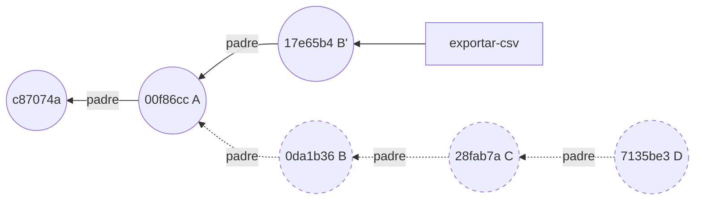
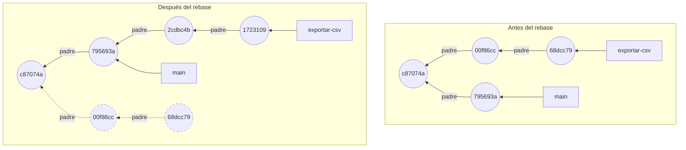
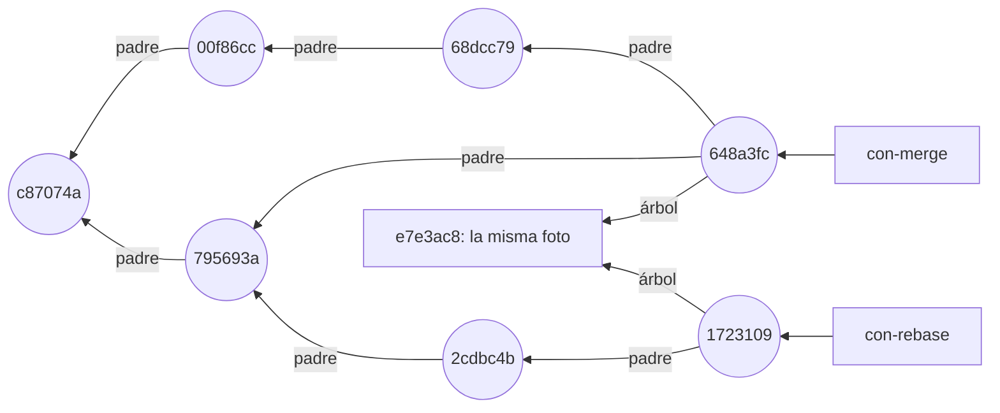
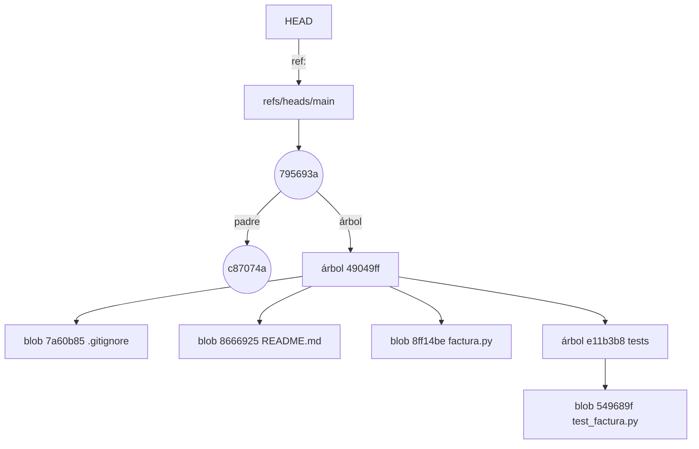

## 1.5 Rebase y reescribir historia

Rebase reaplica tus commits uno a uno sobre una base y, a partir del primero que cambia, todos los que salen son commits nuevos, con hashes nuevos; los antiguos se quedan sin rama [h01-859, h01-860, h01-764, h01-570]. La foto final puede coincidir con la de un merge, pero el historial es otro, y eso perjudica a quien ya trabajaba sobre los commits antiguos [h01-510, h01-520, h01-591].

### Lo que hizo la primera orden del asistente

La primera orden de «El problema» fue `git rebase -i HEAD~4`. La `-i` pide el modo interactivo, que es la herramienta de Git para modificar commits que ya no están en la punta [h01-540, h01-542]. Antes de ejecutar nada, Git te enseña una lista de tareas para que la edites [h01-547, h01-807].

El ejemplo parte de `facturas` con tres commits en `main` y `exportar-csv` con los cuatro de «El problema»: A añade la exportación, B pone una cabecera con el separador equivocado, C la corrige y D es la prueba que sobra. En vez de abrir un editor, usa el comando de la variable `GIT_SEQUENCE_EDITOR`, que manda sobre la configuración `sequence.editor` [h01-807, h01-808]. La primera vez solo imprime la lista; la segunda pone `fixup` en la línea 3 y `drop` en la 4, como el asistente. `-q` silencia el rebase [h01-842]. La preparación cambia la fecha de confirmación antes de los rebases: un hash que se conserva prueba que Git no tocó ese commit [h01-639, h01-647].

<!-- ejemplo: ejemplos/cap-01/13-rebase-interactivo.sh -->
```console
# Ejecutado con Bash 5.2.21, Git 2.43.0
$ git log --oneline
7135be3 Prueba el formato con punto y coma
28fab7a Corrige el separador de la cabecera
0da1b36 Añade la cabecera al CSV
00f86cc Añade exportación a CSV
c87074a Cambia el tipo de IVA al 21 %
c2466c3 Añade un ejemplo de uso al README
ce4f8a1 Primera versión de la factura
$ GIT_SEQUENCE_EDITOR="grep '^[a-z]'" git rebase -q -i HEAD~4
pick 00f86cc Añade exportación a CSV
pick 0da1b36 Añade la cabecera al CSV
pick 28fab7a Corrige el separador de la cabecera
pick 7135be3 Prueba el formato con punto y coma
$ git log --oneline
7135be3 Prueba el formato con punto y coma
28fab7a Corrige el separador de la cabecera
0da1b36 Añade la cabecera al CSV
00f86cc Añade exportación a CSV
c87074a Cambia el tipo de IVA al 21 %
c2466c3 Añade un ejemplo de uso al README
ce4f8a1 Primera versión de la factura
$ GIT_SEQUENCE_EDITOR="sed -i -e '3s/^pick/fixup/' -e '4s/^pick/drop/'" git rebase -q -i HEAD~4
$ git log --oneline
17e65b4 Añade la cabecera al CSV
00f86cc Añade exportación a CSV
c87074a Cambia el tipo de IVA al 21 %
c2466c3 Añade un ejemplo de uso al README
ce4f8a1 Primera versión de la factura
```
<!-- /ejemplo -->

Mira la lista. Cada línea es un commit con una acción delante, y el orden es el contrario al de `git log`, con el más antiguo arriba. Git la ejecuta de arriba abajo [h01-546, h01-553]. Cada línea reaplica su commit, uno detrás de otro [h01-859].

Con la lista intacta, los cuatro hashes no cambian. Por defecto, cuando un commit quedaría igual, Git avanza sobre él sin reescribirlo [h01-860]. Solo con `--no-ff` los reaplicaría todos y la rama entera estaría hecha de commits nuevos [h01-860, h01-861].

Con la lista del asistente, A conserva `00f86cc`. En su lugar, B pasa a ser `17e65b4`, un B' que ya lleva dentro la corrección: `fixup` fundió C con B y tiró su mensaje, y `drop` quitó D [h01-552, h01-580]. B' es nuevo porque su contenido cambió. Si hubieras tocado la línea 1, los cuatro serían nuevos: cada commit guarda el hash de su padre, así que un padre distinto da un hijo distinto [h01-570, h01-764]. Hay más acciones, entre otras `reword` (cambiar el mensaje), `edit` (detenerse en el commit) y `squash` (fundir sin tirar el mensaje) [h01-549, h01-550, h01-551, h01-552].



B, C y D, en discontinuo, siguen existiendo, pero ninguna rama los señala: el rebase no los editó, creó B' y movió `exportar-csv` hasta él [h01-763, h01-764]. Es la misma idea que viste con `--amend` en la sección 1.3: no se edita, se sustituye.

### Rebase sobre otra rama

`git rebase main` hace la misma reaplicación, pero sobre otra base. Git apunta los commits de tu rama que `main` no tiene, se coloca en la punta de `main` con `HEAD` desacoplado (sección 1.4), los reaplica uno a uno y, al final, mueve tu rama al último [h01-859].

El ejemplo parte de la rama ya limpia: `exportar-csv` con A y B' sobre el tercer commit, y `main` con un commit más, los tests de Marta. B' tiene aquí otro hash, `68dcc79`, porque la preparación lo crea con otra fecha; el contenido es el mismo [h01-639, h01-647].

<!-- ejemplo: ejemplos/cap-01/11-rebase.sh -->
```console
# Ejecutado con Bash 5.2.21, Git 2.43.0
$ git switch exportar-csv
Switched to branch 'exportar-csv'
$ git log --oneline --graph --all
* 68dcc79 Añade la cabecera al CSV
* 00f86cc Añade exportación a CSV
| * 795693a Añade tests de total
|/  
* c87074a Cambia el tipo de IVA al 21 %
* c2466c3 Añade un ejemplo de uso al README
* ce4f8a1 Primera versión de la factura
$ git rebase -q main
$ git log --oneline --graph --all
* 1723109 Añade la cabecera al CSV
* 2cdbc4b Añade exportación a CSV
* 795693a Añade tests de total
* c87074a Cambia el tipo de IVA al 21 %
* c2466c3 Añade un ejemplo de uso al README
* ce4f8a1 Primera versión de la factura
$ git switch main
Switched to branch 'main'
$ git merge exportar-csv
Updating 795693a..1723109
Fast-forward
 exportar.py | 3 +++
 1 file changed, 3 insertions(+)
 create mode 100644 exportar.py
```
<!-- /ejemplo -->

Antes del rebase, las dos ramas salen de `c87074a`. Después, el historial es una sola línea, y los dos commits de la exportación cuelgan de `795693a`, el de Marta [h01-503, h01-511]. Esta vez cambian los dos, A incluido (`2cdbc4b` y `1723109`), porque el primero ya tiene otro padre y arrastra al segundo [h01-570, h01-571]. La fusión final desde `main` es un avance rápido: `main` solo tiene que avanzar [h01-509, h01-434]. Pro Git aconseja reorganizar así antes de enviar tu trabajo al proyecto principal: a quien lo mantiene le basta, dice, «un avance rápido o una incorporación limpia» [h01-512, h01-513].



### Qué ganas frente a un merge

El ejemplo 12 parte del mismo estado que el 11, con dos ramas en la punta de `exportar-csv`: integra `main` en `con-merge` con una fusión y en `con-rebase` con un rebase.

<!-- ejemplo: ejemplos/cap-01/12-misma-foto.sh -->
```console
# Ejecutado con Bash 5.2.21, Git 2.43.0
$ git switch con-merge
Switched to branch 'con-merge'
$ git merge main -m "Integra main en con-merge"
Merge made by the 'ort' strategy.
 tests/test_factura.py | 3 +++
 1 file changed, 3 insertions(+)
 create mode 100644 tests/test_factura.py
$ git switch con-rebase
Switched to branch 'con-rebase'
$ git rebase -q main
$ git diff con-merge con-rebase
$ git cat-file -p con-merge | head -n 1
tree e7e3ac802fb69892ddda0dcff783da904beca5ac
$ git cat-file -p con-rebase | head -n 1
tree e7e3ac802fb69892ddda0dcff783da904beca5ac
$ git log --oneline --graph con-merge
*   648a3fc Integra main en con-merge
|\  
| * 795693a Añade tests de total
* | 68dcc79 Añade la cabecera al CSV
* | 00f86cc Añade exportación a CSV
|/  
* c87074a Cambia el tipo de IVA al 21 %
* c2466c3 Añade un ejemplo de uso al README
* ce4f8a1 Primera versión de la factura
$ git log --oneline --graph con-rebase
* 1723109 Añade la cabecera al CSV
* 2cdbc4b Añade exportación a CSV
* 795693a Añade tests de total
* c87074a Cambia el tipo de IVA al 21 %
* c2466c3 Añade un ejemplo de uso al README
* ce4f8a1 Primera versión de la factura
```
<!-- /ejemplo -->

`git diff` entre las dos puntas no imprime nada, y la línea `tree` de las dos es `e7e3ac8` [h01-843, h01-638]. Tus archivos quedan igual por los dos caminos [h01-510]. Cambia el grafo: `con-merge` acaba en `648a3fc`, un commit con dos padres que junta las dos puntas, y `con-rebase` es una línea recta [h01-404, h01-515, h01-511].



> **Ojo con la versión.** La fusión la hizo `ort`, la estrategia por defecto al fusionar una sola rama, que sustituyó a `recursive`, la de por defecto hasta Git 2.33.0 [h01-801, h01-803, h01-806]. La documentación actual dice que `recursive` es otro nombre de `ort`, pero eso llegó en Git 2.50.0; en tu Git 2.43 aún es una implementación distinta [h01-804, h01-805].

### Caso límite: un conflicto a mitad del rebase

Al reaplicar un commit, sus cambios pueden chocar con los de la nueva base. El ejemplo 14 parte de `facturas` con tres commits. En `exportar-csv` hay dos: A y otro que añade una línea al final del README. `main` tiene un cuarto commit que añade otra línea distinta en el mismo sitio.

<!-- ejemplo: ejemplos/cap-01/14-rebase-conflicto.sh -->
```console
# Ejecutado con Bash 5.2.21, Git 2.43.0
$ git switch exportar-csv
Switched to branch 'exportar-csv'
$ git log --oneline --graph --all
* cfbac44 Documenta la exportación en el README
* 00f86cc Añade exportación a CSV
| * 42dd13a Documenta cómo ejecutar los tests
|/  
* c87074a Cambia el tipo de IVA al 21 %
* c2466c3 Añade un ejemplo de uso al README
* ce4f8a1 Primera versión de la factura
$ git rebase main
Rebasing (1/2)
Rebasing (2/2)
Auto-merging README.md
CONFLICT (content): Merge conflict in README.md
error: could not apply cfbac44... Documenta la exportación en el README
hint: Resolve all conflicts manually, mark them as resolved with
hint: "git add/rm <conflicted_files>", then run "git rebase --continue".
hint: You can instead skip this commit: run "git rebase --skip".
hint: To abort and get back to the state before "git rebase", run "git rebase --abort".
Could not apply cfbac44... Documenta la exportación en el README
$ git status
interactive rebase in progress; onto 42dd13a
Last commands done (2 commands done):
   pick 00f86cc Añade exportación a CSV
   pick cfbac44 Documenta la exportación en el README
No commands remaining.
You are currently rebasing branch 'exportar-csv' on '42dd13a'.
  (fix conflicts and then run "git rebase --continue")
  (use "git rebase --skip" to skip this patch)
  (use "git rebase --abort" to check out the original branch)

Unmerged paths:
  (use "git restore --staged <file>..." to unstage)
  (use "git add <file>..." to mark resolution)
	both modified:   README.md

no changes added to commit (use "git add" and/or "git commit -a")
$ git rebase --abort
$ git log --oneline --graph --all
* cfbac44 Documenta la exportación en el README
* 00f86cc Añade exportación a CSV
| * 42dd13a Documenta cómo ejecutar los tests
|/  
* c87074a Cambia el tipo de IVA al 21 %
* c2466c3 Añade un ejemplo de uso al README
* ce4f8a1 Primera versión de la factura
```
<!-- /ejemplo -->

El rebase reaplica A y se detiene en el segundo commit, con el README en conflicto. `git status` te enseña las órdenes ya hechas, con el mismo `pick` de la lista interactiva. Tienes tres salidas. Puedes resolver el conflicto, prepararlo y seguir con `git rebase --continue` [h01-574]. Puedes saltarte ese commit con `--skip` [h01-576]. O puedes abandonar con `--abort`, que devuelve la rama a su estado original [h01-575]. El ejemplo elige la última, y el `git log` final es idéntico al del principio.

¿Por qué pone «interactive rebase in progress» si no escribiste `-i`? Git tiene dos *backends* (motores internos) para el rebase, `apply` y `merge`, y usa `merge` por defecto [h01-862, h01-863]. Ese motor se llamaba antes «interactive», y hoy se usa también en los rebases que no son interactivos [h01-908, h01-909].

> **Ojo con la versión.** Pro Git describe un rebase que guarda en archivos temporales las diferencias de cada commit y las aplica después sobre la otra rama [h01-504, h01-505, h01-506, h01-507, h01-508]. Esta sección sigue la documentación actual, la de los cuatro pasos y el *backend* `merge`, que es lo que enseña tu Git 2.43 [h01-859, h01-863].

### Vuelta a Marta

El rebase del asistente abandonó B, C y D, sobre los que ella había empezado su rama, y creó B', parecido pero distinto [h01-520]. Luego `push --force` sobrescribió lo que había en el servidor con tu rama nueva; los remotos llegan en el capítulo 2 [h01-522]. Desde ese momento, Marta tiene que arreglar su historial a mano [h01-591] y reorganizar sus commits sobre tu punta nueva [h01-593].

El problema no es que la foto final se parezca. Es que desaparecieron de la rama unos commits que otra persona usaba como base, y en su lugar hay otros [h01-520, h01-521]. De ahí la regla: reorganiza tu trabajo local mientras nadie más lo tenga, y no reorganices lo que ya has compartido [h01-535, h01-519, h01-529].

> **Ojo con la versión.** Pro Git cuenta que, tras un rebase publicado, `git pull` crea una fusión con las dos líneas del historial, y que `git log` enseña commits repetidos con el mismo autor, fecha y mensaje [h01-523, h01-524]. Según la documentación actual de `git pull`, si no eliges cómo reconciliar ramas que han divergido, solo hace avances rápidos y falla si la tuya ha divergido [h01-880, h01-881]. Con `--no-rebase` fusiona y con `--rebase` reorganiza [h01-882, h01-883], y puedes fijar tu preferencia con `pull.rebase` [h01-885]. Es lo que le pasó a Marta: Git se negó y, al forzar ella la fusión, aparecieron tus commits viejos junto al nuevo. Hace falta un remoto para verlo, así que este capítulo no lo ejecuta.

> **Bajo el capó.** ¿Puede Git ahorrarle trabajo a Marta? A veces. Además del hash, calcula para cada commit un `patch-id`, que sale solo de los cambios que introduce [h01-525]. Si Marta reorganiza su rama sobre tu commit nuevo, es posible que Git distinga qué cambios eran suyos y aplique solo esos, pero solo si tus parches viejos y los nuevos se parecen mucho [h01-526, h01-527]. Pro Git propone `git pull --rebase` para simplificarlo [h01-528, h01-530].

> PENDIENTE: «En un proyecto real» sobre cómo integran los PR gentle-shell o FastAPI (squash, rebase o merge); faltan sus guías de contribución, que llegan con el capítulo 2.

### Deshacer sin reescribir

Si el commit que quieres deshacer ya está en una rama compartida, la regla anterior te impide reescribirlo, y `git revert` no lo necesita. El ejemplo parte de `facturas` con cinco commits en `main` y deshace el del IVA, dos por debajo de la punta.

<!-- ejemplo: ejemplos/cap-01/15-revert.sh -->
```console
# Ejecutado con Bash 5.2.21, Git 2.43.0
$ git log --oneline
938b805 Documenta el IVA en el README
795693a Añade tests de total
c87074a Cambia el tipo de IVA al 21 %
c2466c3 Añade un ejemplo de uso al README
ce4f8a1 Primera versión de la factura
$ git revert --no-edit HEAD~2
[main bb7d784] Revert "Cambia el tipo de IVA al 21 %"
 Date: Thu Jan 1 12:00:00 2026 +0100
 1 file changed, 1 insertion(+), 1 deletion(-)
$ git log --oneline
bb7d784 Revert "Cambia el tipo de IVA al 21 %"
938b805 Documenta el IVA en el README
795693a Añade tests de total
c87074a Cambia el tipo de IVA al 21 %
c2466c3 Añade un ejemplo de uso al README
ce4f8a1 Primera versión de la factura
$ git log --stat -1
commit bb7d78477908485454edfb04000bbc5163a57b4f
Author: devOC <devoc@ejemplo.dev>
Date:   Thu Jan 1 12:00:00 2026 +0100

    Revert "Cambia el tipo de IVA al 21 %"
    
    This reverts commit c87074a060dbf507d64ec3e5e304398bd8e17de3.

 factura.py | 2 +-
 1 file changed, 1 insertion(+), 1 deletion(-)
```
<!-- /ejemplo -->

Los cinco commits conservan sus hashes y encima aparece `bb7d784`, que cambia una línea de `factura.py` y dice en su mensaje qué commit revierte. `git revert` registra un commit nuevo que anula el efecto de otro, sin tocar los anteriores [h01-594]. Necesita un directorio de trabajo sin cambios respecto a `HEAD` [h01-595]. Si el commit es una fusión, tienes que decirle con `-m` qué padre es la línea principal [h01-598].

## 1.6 Bajo el capó: objetos y referencias

En `.git` hay dos clases de piezas. Los objetos no cambian nunca y se nombran por el hash de su contenido: *blobs* (objetos binarios), árboles, commits y etiquetas anotadas. Las referencias, en cambio, sí cambian [h01-673, h01-627, h01-766, h01-214]. Todo lo que cambia un comando se reduce a añadir objetos y a añadir o mover referencias [h01-768].

La segunda pregunta de «El problema» era dónde están los commits que «desaparecieron». Para contestarla mira qué es un commit en disco. En la sección 1.2 asomaste a uno con `git cat-file -p`, y en la 1.4 viste que una rama es un archivo con un hash; ahora bajas del todo.

### De `HEAD` a un archivo

El ejemplo parte de `facturas` con cuatro commits, el último el de los tests de Marta, y estás en `main`. Baja de arriba abajo: `HEAD`, la rama, el commit, su árbol, el subárbol `tests` y un archivo.

<!-- ejemplo: ejemplos/cap-01/18-arbol-y-commit.sh -->
```console
# Ejecutado con Bash 5.2.21, Git 2.43.0
$ cat .git/HEAD
ref: refs/heads/main
$ cat .git/refs/heads/main
795693a3558a7d3086daa5692c61635643e96470
$ git cat-file -t $(cat .git/refs/heads/main)
commit
$ git cat-file -p $(cat .git/refs/heads/main)
tree 49049ff53a78a6c89a52640220800608fc6140d5
parent c87074a060dbf507d64ec3e5e304398bd8e17de3
author Marta Ruiz <marta@ejemplo.dev> 1767265200 +0100
committer devOC <devoc@ejemplo.dev> 1767265200 +0100

Añade tests de total
$ git cat-file -p HEAD^{tree}
100644 blob 7a60b85e148f80966a550e5ab6a762a907c69ca6	.gitignore
100644 blob 866692569556ca36d04daf1b94ed88ee9e03606f	README.md
100644 blob 8ff14bec51fd28b8c6601ab9bcafa262cae0cbdb	factura.py
040000 tree e11b3b861512536ee23c90a2742f7f968593a4a7	tests
$ git cat-file -p e11b3b861512536ee23c90a2742f7f968593a4a7
100644 blob 549689f79d442dbb2706af1b1c4bf69f0cbc3ef3	test_factura.py
$ git cat-file -p 549689f79d442dbb2706af1b1c4bf69f0cbc3ef3
from factura import total
def test_total_con_iva_general():
    assert total(100) == 121.0
$ ls .git/objects/54
9689f79d442dbb2706af1b1c4bf69f0cbc3ef3
```
<!-- /ejemplo -->

Léelo nivel a nivel:

- **`HEAD`** no tiene un hash, sino el nombre de la rama en la que estás: es una referencia simbólica [h01-664]. **La rama** es un archivo de `.git/refs` con un hash dentro, `795693a` [h01-652].
- **`git cat-file`** es de los comandos que Pro Git llama «de fontanería», muchos pensados más para scripts que para teclearlos, frente a los «de porcelana», más amigables [h01-603, h01-604]. Con `-t` te dice el tipo del objeto, `commit`, y con `-p` te enseña su contenido [h01-625, h01-624].
- **El commit** es un texto corto. `tree` señala la foto del proyecto [h01-638]. `parent` señala el commit anterior, `c87074a` [h01-570]. Siguen dos líneas con personas: la autora, Marta, y el confirmador, cada uno con su nombre, su correo y una marca de tiempo, el número `1767265200`. Tras una línea vacía va el mensaje [h01-639, h01-640].
- **El árbol** tiene una línea por entrada: modo, tipo, hash y nombre [h01-630]. `100644` es un archivo normal [h01-635]. `tests` no es un archivo, sino otro árbol: así guarda Git las carpetas [h01-632, h01-629]. Los nombres de archivo viven en los árboles [h01-628].
- **El archivo** se guarda como blob (el nombre viene de *binary large object*, objeto binario grande), que tiene el contenido y nada más; ni siquiera el nombre [h01-626, h01-627].
- **En disco**, en principio, cada objeto es un archivo dentro de `.git/objects`: la subcarpeta se llama como los dos primeros caracteres del hash, `54`, y el archivo, como los 38 restantes [h01-621, h01-622, h01-644].



### El nombre sale del contenido

En la sección 1.2 leíste que el hash sale del contenido; ahora lo compruebas. El ejemplo parte de `facturas` con tres commits, pide a Git el hash de `factura.py` de dos formas y lo calcula después en Python.

<!-- ejemplo: ejemplos/cap-01/17-hash-a-mano.sh -->
```console
# Ejecutado con Bash 5.2.21, Git 2.43.0, Python 3.13.18
$ git ls-tree HEAD factura.py
100644 blob 8ff14bec51fd28b8c6601ab9bcafa262cae0cbdb	factura.py
$ git hash-object factura.py
8ff14bec51fd28b8c6601ab9bcafa262cae0cbdb
$ python3 - <<'PY'
> import hashlib, zlib
> contenido = open("factura.py", "rb").read()
> cabecera = b"blob %d\0" % len(contenido)
> hash_a_mano = hashlib.sha1(cabecera + contenido).hexdigest()
> print("hash a mano:", hash_a_mano)
> ruta = f".git/objects/{hash_a_mano[:2]}/{hash_a_mano[2:]}"
> guardado = zlib.decompress(open(ruta, "rb").read())
> print("cabecera guardada:", guardado.split(b"\0")[0])
> print("contenido igual:", guardado == cabecera + contenido)
> PY
hash a mano: 8ff14bec51fd28b8c6601ab9bcafa262cae0cbdb
cabecera guardada: b'blob 108'
contenido igual: True
```
<!-- /ejemplo -->

La primera orden enseña la entrada de `factura.py` en el árbol de `HEAD`, con el hash `8ff14be` [h01-630]. Es el mismo que viste en el ejemplo 18: `factura.py` no cambió entre el tercer commit y el cuarto, así que Git reutilizó su blob [h01-204]. `git hash-object` sin `-w` calcula el hash del archivo sin guardar nada [h01-617, h01-618]. El bloque de Python antepone una cabecera al contenido (la palabra `blob`, un espacio, el tamaño y un byte nulo) y saca el SHA-1 del conjunto [h01-645, h01-646, h01-647, h01-294]. Le sale el mismo hash. Después abre el archivo de ese objeto y lo descomprime con zlib, porque Git guarda los objetos comprimidos [h01-648]. Dentro están la cabecera, `blob 108`, y el contenido exacto de `factura.py`.

Árboles y commits se guardan igual, con `tree` o `commit` en la cabecera, y su contenido sigue un formato fijo [h01-649, h01-650, h01-651]. Por eso el hash de un commit depende de su árbol, de sus padres, de quién lo hizo y cuándo, y del mensaje [h01-638, h01-639, h01-640, h01-647]. Si cambias un commit, cambia su hash, y con él el de todos los que lo tienen detrás, porque cada uno guarda el de su padre [h01-570, h01-571]. Es lo que viste en la sección 1.5: B' nuevo y A intacto.

> **Bajo el capó.** Cada ejemplo del capítulo se ejecuta en una carpeta nueva, y aun así el primer commit de `facturas` es siempre `ce4f8a1`. Es porque el entorno de los ejemplos fija el autor, el confirmador y la fecha, y esos datos entran en el hash del commit [h01-639, h01-647]. En tu máquina, con tu nombre y tu hora, los commits tendrán otros hashes. Los blobs y los árboles, no: si el contenido es idéntico, el hash también lo es [h01-294, h01-630]. Por eso `8ff14be` aparece igual en los ejemplos 17 y 18.

### Qué escribe un commit

El ejemplo 16 parte de `facturas` con cuatro commits. Cuenta los archivos de `.git/objects` y lee el de `main`, confirma una prueba nueva en `tests/test_factura.py` y repite las dos lecturas.

<!-- ejemplo: ejemplos/cap-01/16-dentro-de-git.sh -->
```console
# Ejecutado con Bash 5.2.21, Git 2.43.0
$ find .git/objects -type f | wc -l
15
$ cat .git/refs/heads/main
795693a3558a7d3086daa5692c61635643e96470
$ echo "def test_sin_iva():" >> tests/test_factura.py
$ echo "    assert total(100, iva=0) == 100" >> tests/test_factura.py
$ git add tests/test_factura.py
$ git commit -m "Prueba el total sin IVA"
[main d4b3b8a] Prueba el total sin IVA
 1 file changed, 2 insertions(+)
$ find .git/objects -type f | wc -l
19
$ cat .git/refs/heads/main
d4b3b8a8c2adb6cf899bbab2b2b324d52c078271
$ git rev-list --objects HEAD~1..HEAD
d4b3b8a8c2adb6cf899bbab2b2b324d52c078271
41ecff1245d291289fd7eb15964bbd89e2062b19 
e732f7f58e0ded9b1f7001ee934d1912d2ccae81 tests
cb2faffa743532d1cc34d41d3314f5c9d131ebb9 tests/test_factura.py
```
<!-- /ejemplo -->

Los objetos pasan de 15 a 19, y el archivo de `main` cambia de `795693a` a `d4b3b8a`. Los cuatro objetos nuevos son los que imprime la última orden. Hay un blob con el nuevo `test_factura.py` (`cb2faff`) y un árbol `tests` que lo contiene (`e732f7f`). Hay también un árbol raíz nuevo, la línea sin nombre (`41ecff1`), porque una de sus entradas cambió. Y está el commit, `d4b3b8a` [h01-643, h01-630, h01-647]. `README.md`, `.gitignore` y `factura.py` no se guardan otra vez: el árbol nuevo apunta a sus blobs de siempre [h01-204]. Cuatro objetos añadidos y una referencia movida: eso es un commit visto por dentro [h01-768, h01-766].

### Las otras referencias

Ya conoces las ramas y `HEAD`. Quedan las etiquetas, que en este capítulo caben en dos frases, y las remotas. Una etiqueta suele señalar un commit y, a diferencia de una rama, no se mueve; la ligera es solo esa referencia [h01-675, h01-677]. La anotada, que se crea con `git tag -a`, apunta a un cuarto tipo de objeto con su mensaje y una línea `tagger` con quién la creó y cuándo [h01-673, h01-679, h01-680, h01-875]. Las referencias remotas marcan dónde estaba cada rama de un remoto la última vez que hablaste con él; las verás en el capítulo 2 [h01-683, h01-687].

> **Error típico.** Como una rama es un archivo con un hash, es tentador editarlo a mano, y técnicamente funciona [h01-655]. No lo hagas: Pro Git lo desaconseja y propone `git update-ref`, que es mucho más seguro [h01-657, h01-658]. Para `HEAD` existe `git symbolic-ref`, que además no te deja apuntarlo fuera de `refs` [h01-669, h01-672].

> **Ojo con la versión.** Los hashes de este capítulo son SHA-1, el algoritmo por defecto de `git init`; con `--object-format=sha256`, si está habilitado, el repositorio usa SHA-256 [h01-280]. En 2017 el ataque SHAttered demostró una colisión práctica de SHA-1 [h01-288]. Desde Git 2.13.0 se usa una versión reforzada que resiste ese ataque, pero SHA-1 sigue siendo débil, y a finales de 2018 el proyecto eligió SHA-256 como sucesor [h01-289, h01-290, h01-292]. Por ahora los repositorios de un formato y del otro no interoperan [h01-283]. El cálculo del ejemplo 17 es el de tus repositorios, salvo que crees uno con SHA-256.

### Dónde están tus commits

Los commits que el asistente quitó de tu rama siguen en `.git/objects`: los objetos no cambian, y sus órdenes crearon commits nuevos y movieron la rama, pero no borraron los antiguos [h01-763, h01-764, h01-346]. Lo que ya no tienen es una referencia que llegue hasta ellos. Como viste en la sección 1.4, un commit al que nada señala acabará borrado por la recolección de basura [h01-485]. Hasta entonces, el reflog conserva por dónde pasó la rama [h01-774], y la sección 1.7 lo usa para recuperarlos.
