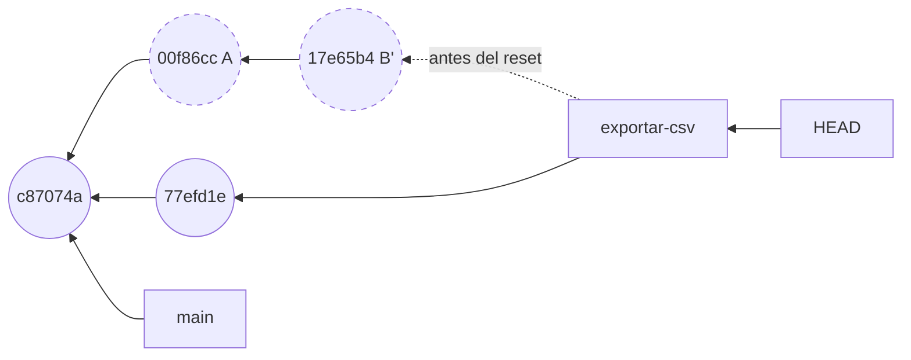
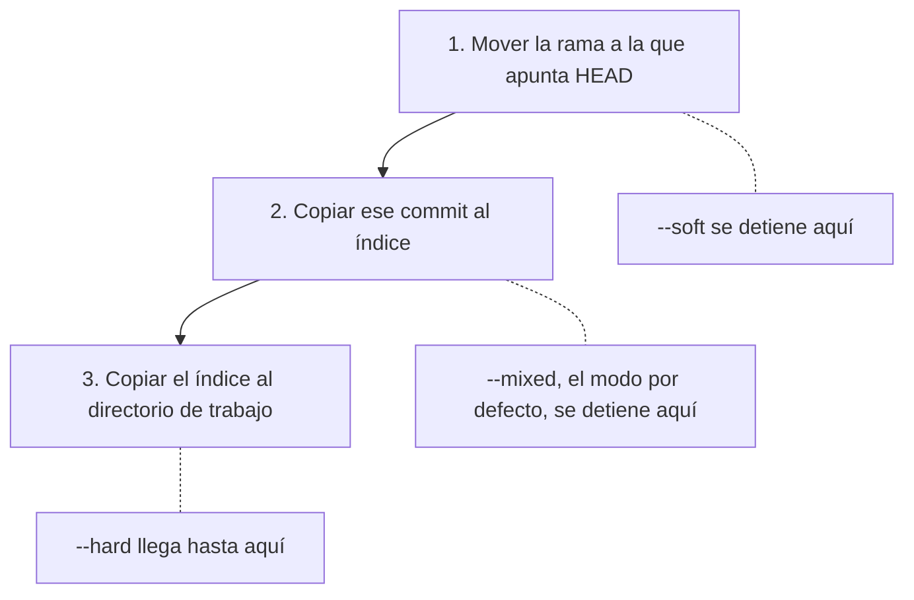

## 1.7 reset sin miedo

Sin ruta, `git reset` lleva la rama en la que estás a otro commit y, según el modo, copia además ese commit al índice y al directorio de trabajo [h01-718, h01-724, h01-728]. Lo confirmado sigue localizable en el reflog durante un tiempo; lo que `--hard` pisa sin que lo hubieras confirmado no vuelve [h01-774, h01-870, h01-872, h01-733].

### Lo que hizo el asistente

Tras el rebase interactivo de la sección 1.5, `exportar-csv` tiene dos commits propios, A y B', encima del tercer commit de `main`. El ejemplo 21 arranca ahí y ejecuta las órdenes 2 y 3 del asistente.

<!-- ejemplo: ejemplos/cap-01/21-reset-tres-modos.sh -->
```console
# Ejecutado con Bash 5.2.21, Git 2.43.0
$ git log --oneline
17e65b4 Añade la cabecera al CSV
00f86cc Añade exportación a CSV
c87074a Cambia el tipo de IVA al 21 %
c2466c3 Añade un ejemplo de uso al README
ce4f8a1 Primera versión de la factura
$ git reset --soft HEAD~2
$ git status -s
A  exportar.py
$ git log --oneline
c87074a Cambia el tipo de IVA al 21 %
c2466c3 Añade un ejemplo de uso al README
ce4f8a1 Primera versión de la factura
$ git commit -m "Añade la exportación a CSV"
[exportar-csv 77efd1e] Añade la exportación a CSV
 1 file changed, 3 insertions(+)
 create mode 100644 exportar.py
$ git log --oneline
77efd1e Añade la exportación a CSV
c87074a Cambia el tipo de IVA al 21 %
c2466c3 Añade un ejemplo de uso al README
ce4f8a1 Primera versión de la factura
$ git reflog -3
77efd1e HEAD@{0}: commit: Añade la exportación a CSV
c87074a HEAD@{1}: reset: moving to HEAD~2
17e65b4 HEAD@{2}: rebase (finish): returning to refs/heads/exportar-csv
```
<!-- /ejemplo -->

Tras `git reset --soft HEAD~2`, `git log` ya no enseña `17e65b4` ni `00f86cc`: la rama ha retrocedido dos commits, hasta `c87074a` [h01-718, h01-828]. Pero `git status -s` dice `A  exportar.py`: el contenido de B' sigue preparado. Ni el índice ni tu disco se han movido; solo la rama [h01-891, h01-720, h01-715]. Después, `git commit` guarda lo preparado en un único commit nuevo, `77efd1e`, hijo de `c87074a` [h01-711, h01-742, h01-570]. El `git reflog -3` del final lo resume visto desde `HEAD`: de abajo arriba, rebase, reset y commit [h01-775, h01-778].

La documentación actual de `git reset` propone esta misma pareja para juntar varios commits en uno, siempre que antes no tengas nada preparado [h01-892]. Pro Git la presenta como una de las formas de aplastar commits [h01-874]; en la sección 1.5 viste otra, el `fixup` de la lista del rebase [h01-552].



En el dibujo, `exportar-csv` deja de señalar a B' y pasa al commit nuevo. A y B' no se han borrado ni modificado, pero ya ninguna rama llega hasta ellos [h01-763, h01-764, h01-766].

### Los tres modos desde el mismo punto

¿Y si el asistente hubiera escrito otro modo? El ejemplo 25 parte del mismo estado y prueba los tres; entre uno y otro vuelve al punto de partida sin enseñarlo.

<!-- ejemplo: ejemplos/cap-01/25-tres-modos-mismo-punto.sh -->
```console
# Ejecutado con Bash 5.2.21, Git 2.43.0
$ git log --oneline
17e65b4 Añade la cabecera al CSV
00f86cc Añade exportación a CSV
c87074a Cambia el tipo de IVA al 21 %
c2466c3 Añade un ejemplo de uso al README
ce4f8a1 Primera versión de la factura
$ git reset --soft HEAD~2
$ git status -s
A  exportar.py
$ ls
README.md
exportar.py
factura.py
$ git reset HEAD~2
$ git status -s
?? exportar.py
$ ls
README.md
exportar.py
factura.py
$ git reset --hard HEAD~2
HEAD is now at c87074a Cambia el tipo de IVA al 21 %
$ git status -s
$ ls
README.md
factura.py
```
<!-- /ejemplo -->

La rama acaba siempre en `c87074a`; lo que cambia es dónde queda `exportar.py`. Con `--soft`, preparado y en el disco [h01-891]. Sin modo, que equivale a `--mixed` [h01-888], Git rehace el índice a partir de `c87074a`, que no tiene ese archivo, y por eso sale `??` aunque `ls` lo siga viendo [h01-889, h01-890]. Con `--hard`, desaparece del disco: estaba rastreado y no existe en el commit de destino, así que Git lo borra para que tu directorio coincida con él [h01-893, h01-895, h01-896].

### Tres pasos sobre tres lugares

Son los tres lugares de la sección 1.2, que Pro Git llama «tres árboles» en el sentido de colecciones de archivos [h01-701, h01-702, h01-703, h01-704]. Sin ruta, `reset` da como mucho tres pasos, y el modo decide en cuál se detiene [h01-717, h01-720, h01-725, h01-728].



El caso más corto se lee en el dibujo. Con `git reset --soft HEAD~`, la rama vuelve al padre y nada más cambia: has deshecho el último commit y sus cambios siguen preparados [h01-721, h01-722, h01-715].

### reset mueve la rama; switch mueve HEAD

En la sección 1.4 llegaste a un commit antiguo con `git switch --detach`. ¿Es lo mismo? El ejemplo 23 parte otra vez de A y B' y, tras cada orden, lee `.git/HEAD` y el archivo de la rama.

<!-- ejemplo: ejemplos/cap-01/23-reset-frente-a-switch.sh -->
```console
# Ejecutado con Bash 5.2.21, Git 2.43.0
$ cat .git/HEAD
ref: refs/heads/exportar-csv
$ cat .git/refs/heads/exportar-csv
17e65b42bd0b0bdad056437fdf0447a2b622df8f
$ git reset --soft HEAD~2
$ cat .git/HEAD
ref: refs/heads/exportar-csv
$ cat .git/refs/heads/exportar-csv
c87074a060dbf507d64ec3e5e304398bd8e17de3
$ git switch --detach HEAD~2
HEAD is now at c87074a Cambia el tipo de IVA al 21 %
$ cat .git/HEAD
c87074a060dbf507d64ec3e5e304398bd8e17de3
$ cat .git/refs/heads/exportar-csv
17e65b42bd0b0bdad056437fdf0447a2b622df8f
```
<!-- /ejemplo -->

Las dos órdenes te dejan en `c87074a`, pero por caminos distintos. Tras `reset --soft`, `.git/HEAD` sigue nombrando la rama y lo que cambia es el archivo de `exportar-csv` [h01-718, h01-747]. Tras `switch --detach`, la rama conserva `17e65b4…` y es `.git/HEAD` el que pasa a guardar un hash: HEAD desacoplado [h01-474, h01-483]. Hay otra diferencia. Cambiar de sitio se aborta si fuera a perder cambios locales [h01-476], y Pro Git dice lo mismo de `git checkout <rama>` [h01-745]; `reset --hard` lo sustituye todo sin comprobar [h01-746].

### Con una ruta, reset no mueve la rama

El ejemplo 22 parte de otro estado: `facturas` en `main`, con los tres primeros commits y uno que redondea el total.

<!-- ejemplo: ejemplos/cap-01/22-reset-con-ruta.sh -->
```console
# Ejecutado con Bash 5.2.21, Git 2.43.0
$ git log --oneline
6c3625e Redondea el total a dos decimales
c87074a Cambia el tipo de IVA al 21 %
c2466c3 Añade un ejemplo de uso al README
ce4f8a1 Primera versión de la factura
$ git reset HEAD~2 factura.py
Unstaged changes after reset:
M	factura.py
$ git status -s
MM factura.py
$ git restore --source=HEAD~2 --staged factura.py
$ git status -s
MM factura.py
$ git log --oneline -1
6c3625e Redondea el total a dos decimales
```
<!-- /ejemplo -->

El último `git log` sigue en `6c3625e`: la rama no se ha movido. `git reset HEAD~2 factura.py` ha copiado al índice el `factura.py` de `HEAD~2`, el del IVA del 20 %, y ha dejado tu archivo como estaba. De ahí el aviso «Unstaged changes after reset» y el `MM` [h01-899, h01-902, h01-714, h01-715]. Con ruta, `reset` se salta el primer paso, porque `HEAD` no puede apuntar a medio commit, y solo actualiza el índice [h01-734, h01-735, h01-902].

`git restore --source=HEAD~2 --staged factura.py` deja el mismo `MM` [h01-358, h01-849]. Sin commit, la forma con ruta es lo contrario de `git add` y equivale a `git restore --staged` [h01-900, h01-901]. Para llevar esa versión también al disco, la documentación de `reset` te manda a `git restore`, que lo hace con `--staged --worktree` [h01-903, h01-851].

### Qué toca cada orden

La última columna pregunta por el riesgo: si la orden puede borrar cambios de tu directorio que no habías confirmado.

| Orden | Qué cambia de sitio | Índice | Directorio de trabajo | ¿Puede pisar cambios sin confirmar? |
| --- | --- | --- | --- | --- |
| `git reset --soft <commit>` | la rama | no | no | no [h01-718, h01-891] |
| `git reset <commit>` | la rama | sí | no | no [h01-888, h01-889, h01-890] |
| `git reset --hard <commit>` | la rama | sí | sí | sí [h01-893, h01-896, h01-746, h01-912] |
| `git switch <rama>` o `git switch --detach <commit>` | `HEAD` | sí | sí | no: se aborta [h01-471, h01-472, h01-474, h01-476] |
| `git reset [<commit>] <archivo>` | nada | sí | no | no [h01-899, h01-902] |
| `git restore --staged [--source=<commit>] <archivo>` | nada | sí | no | no [h01-354, h01-356, h01-358, h01-849] |
| `git restore [--source=<commit>] <archivo>` | nada | no | sí | sí [h01-352, h01-357, h01-850, h01-772, h01-912] |

### Recuperar lo que el asistente abandonó

El ejemplo 24 parte de la secuencia completa del asistente (rebase, `reset --soft` y `commit`) y busca los commits originales.

<!-- ejemplo: ejemplos/cap-01/24-recuperar-con-reflog.sh -->
```console
# Ejecutado con Bash 5.2.21, Git 2.43.0
$ git log --oneline
77efd1e Añade la exportación a CSV
c87074a Cambia el tipo de IVA al 21 %
c2466c3 Añade un ejemplo de uso al README
ce4f8a1 Primera versión de la factura
$ git reflog exportar-csv
77efd1e exportar-csv@{0}: commit: Añade la exportación a CSV
c87074a exportar-csv@{1}: reset: moving to HEAD~2
17e65b4 exportar-csv@{2}: rebase (finish): refs/heads/exportar-csv onto c87074a060dbf507d64ec3e5e304398bd8e17de3
7135be3 exportar-csv@{3}: commit: Prueba el formato con punto y coma
28fab7a exportar-csv@{4}: commit: Corrige el separador de la cabecera
0da1b36 exportar-csv@{5}: commit: Añade la cabecera al CSV
00f86cc exportar-csv@{6}: commit: Añade exportación a CSV
c87074a exportar-csv@{7}: branch: Created from HEAD
$ git branch rescate exportar-csv@{3}
$ git log --oneline -4 rescate
7135be3 Prueba el formato con punto y coma
28fab7a Corrige el separador de la cabecera
0da1b36 Añade la cabecera al CSV
00f86cc Añade exportación a CSV
```
<!-- /ejemplo -->

`git log` solo ve el commit nuevo, pero `git reflog exportar-csv` enseña cada movimiento de la punta de esa rama [h01-774, h01-777]. Leído de abajo arriba, es «El problema» entero: la rama nace en `c87074a`, recibe tus cuatro commits, salta a `17e65b4` con el rebase, vuelve a `c87074a` con el reset y avanza a `77efd1e` con el commit.

`exportar-csv@{3}` es el valor que tenía la rama tres movimientos atrás: la punta de antes del rebase [h01-904, h01-905]. Basta con ponerle una rama. Tras `git branch rescate exportar-csv@{3}`, el `git log` de `rescate` enseña tus cuatro commits originales [h01-783, h01-788].

### Cuánto dura la red

Las entradas del reflog caducan. Por defecto, las que se alcanzan desde la punta actual de la rama se podan al pasar de 90 días, y las demás, al pasar de 30 [h01-868, h01-870, h01-871, h01-872]. Desde `77efd1e` no se llega a tus cuatro commits originales ni a B', así que sus entradas tienen el plazo corto [h01-871, h01-872]. La poda no la sueles lanzar tú: la página de `git reflog` remite a `git gc` [h01-873]. Sin entrada ni referencia, el commit queda a merced de la recolección de basura de la sección 1.4 [h01-485].

Como último recurso, Pro Git propone `git fsck --full`, que lista los objetos a los que nada apunta: un commit perdido aparece tras «dangling commit» y se rescata con una rama [h01-791, h01-792, h01-793]. Lo que nunca confirmaste, en cambio, es irrecuperable si `--hard` lo pisa [h01-733, h01-347].

> **Error típico.** Lanzar `git reset --hard` para «volver atrás» con cambios sin confirmar. Es la única forma peligrosa de `reset` y una de las raras ocasiones en las que Git borra datos de verdad, porque reescribe tu directorio sin mirar [h01-730, h01-746]. Lo confirmado se puede recuperar durante un tiempo, y la vía más rápida suele ser el reflog [h01-784, h01-872]; lo demás se pierde [h01-733]. Antes, mira `git status -s`, o cambia de sitio con `git switch`, que no pisa tus cambios [h01-476].

> **Bajo el capó.** El reflog es local y vive en `.git/logs/` [h01-774, h01-790]. Sin argumentos, `git reflog` enseña el de `HEAD`; con un nombre, el de esa referencia [h01-777]. `HEAD@{n}` es dónde estaba `HEAD` n movimientos atrás [h01-775], y `rama@{n}`, el valor que tenía esa rama; sin nombre, `@{n}` usa la rama actual [h01-904, h01-906, h01-907]. Como el de `HEAD` apunta también los cambios de rama, un mismo momento puede llevar un número distinto en cada reflog [h01-778].

> **Ojo con la versión.** Pro Git explica `git reset <archivo>` como abreviatura de `git reset --mixed HEAD <archivo>` [h01-736] y compara el reset con ruta con `git checkout <rama> <archivo>`, que además sobrescribe el archivo del disco [h01-751]. En la documentación actual, la forma con ruta solo actualiza el índice, equivale a `git restore --staged` y, para tocar también los archivos, remite a `git restore` [h01-902, h01-901, h01-903].

### Vuelta a «El problema»

**Qué hizo cada orden.** El rebase conservó A y creó commits nuevos desde el primero que cambió, B' (sección 1.5) [h01-860, h01-764]. `reset --soft HEAD~2` llevó la rama al commit del IVA sin tocar el índice, y `commit` guardó de una vez lo preparado [h01-718, h01-891, h01-742]. `push --force` sobrescribió lo que había en el servidor [h01-522].

**Dónde están los commits.** En tu repositorio: el reflog de `exportar-csv` los localiza y una rama los rescata [h01-774, h01-783]. Como ya no se alcanzan desde la punta, sus entradas se podan al pasar de 30 días [h01-871, h01-872].

**Cómo lo defiendes.** El fallo no fue limpiar la rama, sino reescribir commits sobre los que Marta ya trabajaba, y quien depende de una rama reescrita arregla su historial a mano [h01-591]. La regla: reorganiza tu trabajo antes de compartirlo, nunca después [h01-535].

**Qué puede hacer Marta.** Reorganizar su trabajo sobre tu commit nuevo, con la ayuda del `patch-id` de la sección 1.5 si los parches se parecen mucho [h01-593, h01-526, h01-527].

## El proyecto avanza: Arqueología de un PR

La misión de la Parte I es reimplementar sin mirar el diff un PR ya integrado en gentle-shell y comparar tu versión con la real. Aquí solo preparas la excavación, sin escribir código.

1. Clona gentle-shell con el `git clone` de la sección 1.1 y la URL del proyecto; los remotos llegan en el capítulo 2. Elige un PR integrado y, sin abrir su diff, localiza el commit que lo integró.
2. Ábrelo con `git cat-file -p` y cuenta sus líneas `parent`: con más de una, es un commit de fusión [h01-404, h01-570]. Con una sola, anota «no concluyente»: con lo que sabes no puedes decidir cómo se integró, y el capítulo 2 vuelve sobre ello. Apunta en `arqueologia.md` las pruebas de cada conclusión.
3. En una fusión, el primer padre es la rama en la que se estaba al fusionar, así que tu base es `<hash>^1` [h01-841, h01-823]. Sin fusión, toma el padre del primer commit del PR y anótalo como supuesto. Crea tu rama con `git switch -c arqueologia/pr-NNN <base>` [h01-473] y comprueba con `cat .git/HEAD` y `git log --oneline -1` dónde estás.
4. Dibuja en Mermaid el grafo alrededor del PR: la base, sus commits y el punto de integración.
5. Anota qué archivos tocó y cuántas líneas cambió con `git log --stat` [h01-308, h01-309]. Pásalo sobre los commits del PR, no sobre el de fusión: `git log` no desglosa una fusión salvo que se lo pidas con una variante de `--diff-merges` [h01-877]. Será tu plano para reimplementarlo en el capítulo 5.

Repite los pasos con un PR de FastAPI.

## Resumen

- Un commit guarda una foto completa del proyecto, sus padres y sus metadatos, y se nombra por el hash de su contenido [h01-203, h01-638, h01-570, h01-639, h01-214].
- Los commits no cambian y forman un grafo que se recorre hacia atrás por los padres [h01-763, h01-761, h01-762].
- Una rama es un archivo con el hash de un commit, y `HEAD` dice en qué rama o commit estás; los dos se mueven [h01-424, h01-664, h01-483, h01-766].
- Reescribir crea commits nuevos desde el primero que cambia; no reescribas lo que otros ya tienen [h01-764, h01-860, h01-570, h01-535, h01-591].
- Sin ruta, `reset` mueve la rama y solo `--hard` destruye lo no confirmado; lo confirmado sigue en el reflog un tiempo, 30 días por defecto si ya no se alcanza [h01-718, h01-730, h01-733, h01-872].

## Ejercicios

Las soluciones están en `soluciones.md` de la Parte I.

**Comprobación**

1. `main` apunta a C3; `descuentos`, a C2, padre de C3; y `HEAD`, a `descuentos`. Haces un commit. Dibuja el grafo y di qué archivos de `.git` cambian y cuáles no.
2. Explica cada columna de estas salidas de `git status -s`: `??`, `A `, ` M` y `MM`. Escribe qué órdenes llevan a cada una desde un repositorio sin cambios.

**Aplicación**

3. Con `facturas` montado como en el ejemplo 22, o con cualquier repositorio de tres commits que cambien un mismo archivo, recupera el `factura.py` de dos commits atrás de dos formas: con `git restore --source` y con `git reset <commit> <archivo>`. Confirma cada resultado. Explica qué lugares toca cada camino, qué queda en tu disco tras el commit y por qué ninguno mueve la rama antes de confirmar [h01-902, h01-358, h01-850].
4. Haz tres commits pequeños seguidos y crea una rama de respaldo en el último. Júntalos con `git reset --soft` y `git commit`; vuelve al punto de partida con el respaldo y júntalos con un rebase interactivo y `fixup`. Compara el árbol y el hash de los dos resultados y explica en qué coinciden y en qué no.

**Construir sin IA**

5. Crea un repo, tres ramas, provoca un conflicto, resuélvelo y limpia el historial con rebase interactivo. Dibuja el grafo antes y después. Pista: limpia la rama antes de fusionarla, porque por defecto el rebase quita los commits de fusión de su lista [h01-866].

**Reto**

6. Escribe en Python un `git log --oneline` mínimo que no llame a `git`. Lee `.git/HEAD`, sigue la referencia hasta el commit, descomprime cada objeto con `zlib`, salta su cabecera y recorre los padres hasta el primer commit, imprimiendo hash y mensaje [h01-664, h01-652, h01-648, h01-646, h01-570]. Compara su salida con la de Git en un repositorio pequeño.

## Preguntas de examen

**Explicar.** ¿Qué es realmente una rama y qué cambia en el repositorio cuando haces un commit?

**Defender**

1. Un merge y un rebase de las mismas ramas pueden dejar la misma foto [h01-510]. ¿Por qué no son intercambiables y con qué criterio eliges?
2. Reorganizas una rama sobre la que Marta ya trabaja y la subes con `--force`. ¿Qué le dirá Git al intentar traerla y qué verá si fuerza la fusión [h01-591, h01-881, h01-883, h01-523, h01-524]?
3. Con un rebase interactivo corriges el mensaje de un commit de hace diez. ¿Qué hashes cambian, cuáles no y por qué [h01-860, h01-570, h01-571]?
4. ¿Qué hace `git reset HEAD~` en cada uno de los tres lugares y por qué no pierdes trabajo [h01-726, h01-889, h01-731]?
5. ¿Qué pasaría si ejecutas `git reset --hard HEAD~2` con cambios sin confirmar? ¿Qué recuperarías, cómo, durante cuánto tiempo y qué no?
6. Un commit defectuoso ya está en una rama que usa todo el equipo. `git revert` añade un commit que deshace su efecto [h01-594]. ¿Por qué lo eliges en lugar de `reset` [h01-764, h01-535, h01-591]?
