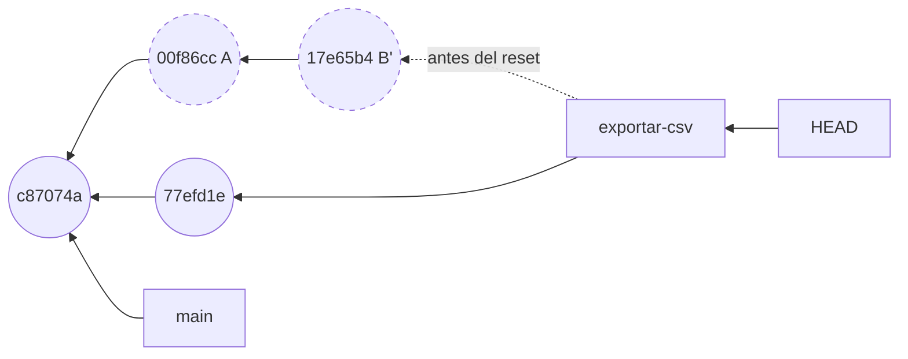
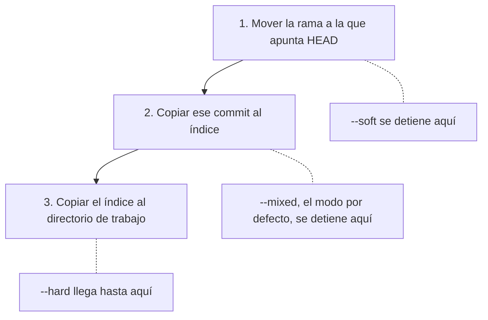

## 1.7 reset sin miedo

Sin ruta, `git reset` lleva la rama en la que estás a otro commit y, según el modo, copia además ese commit al índice y al directorio de trabajo [h01-718, h01-724, h01-728]. Lo que confirmaste sigue localizable en el reflog durante un tiempo; lo que `--hard` pisa sin que lo hubieras confirmado no vuelve [h01-774, h01-870, h01-872, h01-733].

### Lo que hizo el asistente

Vuelve a «El problema». Tras el rebase interactivo de la sección 1.5, `exportar-csv` tiene dos commits propios, A y B', encima del tercer commit de `main`. El ejemplo 21 arranca en ese punto y ejecuta las órdenes 2 y 3 del asistente.

<!-- ejemplo: ejemplos/cap-01/21-reset-tres-modos.sh -->
```console
# Ejecutado con Bash 5.2.21, Git 2.43.0
$ git log --oneline
17e65b4 Añade la cabecera al CSV
00f86cc Añade exportación a CSV
c87074a Cambia el tipo de IVA al 21 %
c2466c3 Añade un ejemplo de uso al README
ce4f8a1 Primera versión de la factura
$ git reset --soft HEAD~2
$ git status -s
A  exportar.py
$ git log --oneline
c87074a Cambia el tipo de IVA al 21 %
c2466c3 Añade un ejemplo de uso al README
ce4f8a1 Primera versión de la factura
$ git commit -m "Añade la exportación a CSV"
[exportar-csv 77efd1e] Añade la exportación a CSV
 1 file changed, 3 insertions(+)
 create mode 100644 exportar.py
$ git log --oneline
77efd1e Añade la exportación a CSV
c87074a Cambia el tipo de IVA al 21 %
c2466c3 Añade un ejemplo de uso al README
ce4f8a1 Primera versión de la factura
$ git reflog -3
77efd1e HEAD@{0}: commit: Añade la exportación a CSV
c87074a HEAD@{1}: reset: moving to HEAD~2
17e65b4 HEAD@{2}: rebase (finish): returning to refs/heads/exportar-csv
```
<!-- /ejemplo -->

Lee la salida en tres tiempos. Tras `git reset --soft HEAD~2`, el segundo `git log` ya no enseña `17e65b4` ni `00f86cc`: la rama ha retrocedido dos commits, hasta `c87074a`, el del IVA [h01-718, h01-828]. Sin embargo, `git status -s` dice `A  exportar.py`: el archivo sigue preparado, con el contenido de B', esperando al siguiente commit. Ni el índice ni tu disco se han movido; solo la rama [h01-891, h01-720, h01-715]. Después, `git commit` guarda lo que había en el índice en un único commit nuevo, `77efd1e`, colgado de `c87074a` [h01-711, h01-742, h01-570]. Dos commits se han convertido en uno.

El `git reflog -3` del final cuenta lo mismo visto desde `HEAD`: abajo, el fin del rebase; en medio, el reset; arriba, el commit [h01-775, h01-778]. Volverás a él al final de la sección.

La documentación actual de `git reset` propone justo esta pareja para juntar varios commits en uno, siempre que antes no tengas nada preparado [h01-892]. Pro Git lo cuenta igual [h01-741, h01-742] y lo presenta como una de las formas de aplastar commits [h01-874]. En la sección 1.5 viste otra: marcar un commit con `fixup` en la lista del rebase [h01-552].



En el dibujo, `exportar-csv` deja de señalar a B' y pasa a señalar al commit nuevo, hijo del commit del IVA. A y B' no se han modificado ni borrado: siguen en el repositorio, aunque ya ninguna rama llega hasta ellos [h01-763, h01-764, h01-766].

### Los tres modos desde el mismo punto

¿Y si el asistente hubiera escrito otro modo? El ejemplo 25 parte del mismo estado que el 21 (A y B' en `exportar-csv`) y prueba los tres. Entre un modo y el siguiente vuelve al punto de partida en una preparación que no se enseña.

<!-- ejemplo: ejemplos/cap-01/25-tres-modos-mismo-punto.sh -->
```console
# Ejecutado con Bash 5.2.21, Git 2.43.0
$ git log --oneline
17e65b4 Añade la cabecera al CSV
00f86cc Añade exportación a CSV
c87074a Cambia el tipo de IVA al 21 %
c2466c3 Añade un ejemplo de uso al README
ce4f8a1 Primera versión de la factura
$ git reset --soft HEAD~2
$ git status -s
A  exportar.py
$ ls
README.md
exportar.py
factura.py
$ git reset HEAD~2
$ git status -s
?? exportar.py
$ ls
README.md
exportar.py
factura.py
$ git reset --hard HEAD~2
HEAD is now at c87074a Cambia el tipo de IVA al 21 %
$ git status -s
$ ls
README.md
factura.py
```
<!-- /ejemplo -->

Las tres veces la rama acaba en `c87074a`. Lo que cambia es dónde queda `exportar.py`. Con `--soft` sigue preparado (`A `) y en el disco [h01-891]. Sin modo, que equivale a `--mixed` [h01-888], Git rehace el índice a partir de `c87074a`, que no contiene ese archivo: por eso pasa a `??`, sin rastrear, aunque `ls` lo siga enseñando [h01-889, h01-890]. Con `--hard`, el archivo desaparece del disco. Estaba rastreado y no existe en el commit de destino, así que Git lo borra para que tu directorio coincida con ese commit [h01-893, h01-895, h01-896]. El `git status -s` vacío lo confirma.

### Tres pasos sobre tres lugares

El modelo es el de los tres lugares de la sección 1.2: el directorio de trabajo, el índice y el commit al que apunta `HEAD`. Pro Git los llama «tres árboles» y aclara que ahí «árbol» significa colección de archivos [h01-701, h01-702, h01-703, h01-704, h01-708]. Sin ruta, `reset` da como mucho tres pasos, y el modo decide en cuál se detiene [h01-717, h01-720, h01-725, h01-728].



Con el dibujo delante, el caso más corto se lee solo. `git reset --soft HEAD~` coloca la rama en el padre y no toca nada más: has deshecho el último commit y sus cambios siguen preparados [h01-721, h01-722, h01-715]. El asistente hizo lo mismo, con dos commits en lugar de uno.

### reset mueve la rama; switch mueve HEAD

En la sección 1.4 llegaste a un commit antiguo cambiando de sitio, con `git switch --detach`. ¿Es lo mismo que un `reset`? El ejemplo 23 vuelve a partir de A y B' y, tras cada orden, lee los dos archivos que importan: `.git/HEAD` y el de la rama.

<!-- ejemplo: ejemplos/cap-01/23-reset-frente-a-switch.sh -->
```console
# Ejecutado con Bash 5.2.21, Git 2.43.0
$ cat .git/HEAD
ref: refs/heads/exportar-csv
$ cat .git/refs/heads/exportar-csv
17e65b42bd0b0bdad056437fdf0447a2b622df8f
$ git reset --soft HEAD~2
$ cat .git/HEAD
ref: refs/heads/exportar-csv
$ cat .git/refs/heads/exportar-csv
c87074a060dbf507d64ec3e5e304398bd8e17de3
$ git switch --detach HEAD~2
HEAD is now at c87074a Cambia el tipo de IVA al 21 %
$ cat .git/HEAD
c87074a060dbf507d64ec3e5e304398bd8e17de3
$ cat .git/refs/heads/exportar-csv
17e65b42bd0b0bdad056437fdf0447a2b622df8f
```
<!-- /ejemplo -->

Las dos órdenes te dejan en `c87074a`, pero por caminos distintos. Tras `reset --soft`, `.git/HEAD` sigue diciendo `ref: refs/heads/exportar-csv`, y lo que cambia es el archivo de la rama, que pasa de `17e65b4…` a `c87074a…` [h01-718, h01-747]. Tras `switch --detach`, la rama conserva `17e65b4…` y lo que cambia es `.git/HEAD`, que ya no nombra una rama sino un hash: estás en HEAD desacoplado [h01-474, h01-483]. Con `reset`, la rama pierde de vista B'. Con `switch`, la rama sigue apuntando a B'.

Hay otra diferencia que pesa cuando tienes cambios sin confirmar. Cambiar de rama no te exige tenerlo todo limpio, pero se aborta si fuera a perder cambios locales [h01-476], y Pro Git dice lo mismo de `git checkout <rama>` [h01-745]. `reset --hard`, en cambio, lo sustituye todo sin comprobar nada [h01-746].

### Con una ruta, reset no mueve la rama

Una ruta cambia el comportamiento de `reset`. El ejemplo 22 parte de otro estado: `facturas` en `main`, con los tres primeros commits y uno más que redondea el total.

<!-- ejemplo: ejemplos/cap-01/22-reset-con-ruta.sh -->
```console
# Ejecutado con Bash 5.2.21, Git 2.43.0
$ git log --oneline
6c3625e Redondea el total a dos decimales
c87074a Cambia el tipo de IVA al 21 %
c2466c3 Añade un ejemplo de uso al README
ce4f8a1 Primera versión de la factura
$ git reset HEAD~2 factura.py
Unstaged changes after reset:
M	factura.py
$ git status -s
MM factura.py
$ git restore --source=HEAD~2 --staged factura.py
$ git status -s
MM factura.py
$ git log --oneline -1
6c3625e Redondea el total a dos decimales
```
<!-- /ejemplo -->

`git reset HEAD~2 factura.py` no ha movido la rama: el último `git log` sigue mostrando `6c3625e`. Lo que ha hecho es copiar al índice el `factura.py` de `HEAD~2`, la versión con el IVA del 20 % [h01-899, h01-902]. Por eso sale `MM`: el índice ya no coincide con `HEAD`, y tu disco, con el redondeo, ya no coincide con el índice [h01-714, h01-715]. Con una ruta, `reset` se salta el primer paso, porque `HEAD` no puede apuntar a medio commit, y solo actualiza el índice para esos archivos [h01-734, h01-735, h01-902]. El aviso «Unstaged changes after reset» te recuerda que tu archivo no se ha tocado.

La segunda orden, `git restore --source=HEAD~2 --staged factura.py`, deja exactamente el mismo `MM` [h01-354, h01-358, h01-849]. Sin commit, la forma con ruta es lo contrario de `git add`: saca el archivo del área de preparación, igual que `git restore --staged` [h01-900, h01-901]. Si quieres esa versión también en el disco, `reset` ya no te sirve. Su documentación te manda a `git restore`, que con `--staged --worktree` actualiza los dos lugares [h01-903, h01-851, h01-358].

### Qué toca cada orden

La tabla reúne las órdenes de esta sección y de la 1.3. La última columna no pregunta qué protege la orden, sino qué puede romper: si puede borrar cambios de tu directorio que no habías confirmado.

| Orden | Qué cambia de sitio | Índice | Directorio de trabajo | ¿Puede pisar cambios sin confirmar? |
| --- | --- | --- | --- | --- |
| `git reset --soft <commit>` | la rama | no | no | no [h01-718, h01-891] |
| `git reset <commit>` | la rama | sí | no | no [h01-888, h01-889, h01-890] |
| `git reset --hard <commit>` | la rama | sí | sí | sí [h01-893, h01-896, h01-746, h01-912] |
| `git switch <rama>` o `git switch --detach <commit>` | `HEAD` | sí | sí | no: se aborta [h01-471, h01-472, h01-474, h01-476] |
| `git reset [<commit>] <archivo>` | nada | sí | no | no [h01-899, h01-902] |
| `git restore --staged [--source=<commit>] <archivo>` | nada | sí | no | no [h01-354, h01-356, h01-358, h01-849] |
| `git restore [--source=<commit>] <archivo>` | nada | no | sí | sí [h01-352, h01-357, h01-850, h01-772, h01-912] |

### Recuperar lo que el asistente abandonó

Queda la segunda pregunta de «El problema»: dónde están tus commits. El ejemplo 24 parte de la secuencia completa del asistente (rebase, `reset --soft` y `commit`) y busca los cuatro commits originales.

<!-- ejemplo: ejemplos/cap-01/24-recuperar-con-reflog.sh -->
```console
# Ejecutado con Bash 5.2.21, Git 2.43.0
$ git log --oneline
77efd1e Añade la exportación a CSV
c87074a Cambia el tipo de IVA al 21 %
c2466c3 Añade un ejemplo de uso al README
ce4f8a1 Primera versión de la factura
$ git reflog exportar-csv
77efd1e exportar-csv@{0}: commit: Añade la exportación a CSV
c87074a exportar-csv@{1}: reset: moving to HEAD~2
17e65b4 exportar-csv@{2}: rebase (finish): refs/heads/exportar-csv onto c87074a060dbf507d64ec3e5e304398bd8e17de3
7135be3 exportar-csv@{3}: commit: Prueba el formato con punto y coma
28fab7a exportar-csv@{4}: commit: Corrige el separador de la cabecera
0da1b36 exportar-csv@{5}: commit: Añade la cabecera al CSV
00f86cc exportar-csv@{6}: commit: Añade exportación a CSV
c87074a exportar-csv@{7}: branch: Created from HEAD
$ git branch rescate exportar-csv@{3}
$ git log --oneline -4 rescate
7135be3 Prueba el formato con punto y coma
28fab7a Corrige el separador de la cabecera
0da1b36 Añade la cabecera al CSV
00f86cc Añade exportación a CSV
```
<!-- /ejemplo -->

`git log` solo ve el commit nuevo. `git reflog exportar-csv`, en cambio, enseña cada vez que se movió la punta de esa rama, de la más reciente a la más antigua [h01-774, h01-777]. Léelo de abajo arriba y tienes «El problema» entero. La rama nace en `c87074a` y recibe tus cuatro commits (`00f86cc`, `0da1b36`, `28fab7a` y `7135be3`). Después salta a `17e65b4` al acabar el rebase, retrocede a `c87074a` con el reset y avanza a `77efd1e` con el commit.

Cada línea tiene un nombre, `exportar-csv@{n}`, que designa el valor que tenía la rama n movimientos atrás [h01-904, h01-905]. La punta de antes del rebase es `exportar-csv@{3}`. Para recuperarla basta con ponerle una rama, y `git branch rescate exportar-csv@{3}` lo hace sin cambiarte de sitio [h01-783, h01-788, h01-417]. El `git log` de `rescate` enseña los cuatro commits originales, D arriba y A abajo. Ese A, `00f86cc`, es el mismo que el rebase había dejado como base de B' en el ejemplo 21, porque no lo reescribió [h01-860].

### Cuánto dura la red

El reflog no lo guarda todo para siempre. Sus entradas caducan, y el plazo depende de si el commit de la entrada se alcanza todavía desde la punta actual de la rama. Por defecto, las entradas alcanzables se podan cuando pasan de 90 días, y las inalcanzables, cuando pasan de 30 [h01-868, h01-870, h01-871, h01-872]. Desde `77efd1e` no se llega a ninguno de tus cuatro commits originales ni a B', así que sus entradas están en el segundo grupo: 30 días [h01-871, h01-872]. Esa poda no la sueles lanzar tú; la página de `git reflog` dice que los usuarios rara vez usan `expire` directamente y remite a `git gc` [h01-873]. Cuando la entrada desaparece y nada más señala al commit, queda a merced de la recolección de basura de la sección 1.4 [h01-485].

Si el reflog ya no tiene la entrada, Pro Git propone un último recurso: `git fsck --full` lista los objetos a los que nada apunta, un commit perdido aparece tras «dangling commit» y se rescata igual, con una rama [h01-791, h01-792, h01-793]. Lo que nunca confirmaste es otro caso: si `--hard` lo pisa, es irrecuperable [h01-733, h01-347].

> **Error típico.** Lanzar `git reset --hard` para «volver atrás» con cambios sin confirmar. Es la única forma peligrosa de `reset` y una de las raras ocasiones en las que Git borra datos de verdad: reescribe tu directorio sin mirar si había algo tuyo [h01-730, h01-746]. Lo confirmado se puede recuperar durante un tiempo, y la vía más rápida suele ser el reflog [h01-784, h01-872]; lo que no habías confirmado se pierde [h01-733]. Antes de un `--hard`, mira `git status -s`, o cambia de sitio con `git switch`, que se niega a pisar tus cambios [h01-476].

> **Bajo el capó.** El reflog es local: registra cómo se movieron las referencias en tu repositorio y vive en `.git/logs/` [h01-774, h01-790]. `git reflog` sin argumentos enseña el de `HEAD`, y con un nombre, el de esa referencia [h01-777]. `HEAD@{n}` es dónde estaba `HEAD` n movimientos atrás [h01-775]; `rama@{n}`, el valor que tenía esa rama [h01-904, h01-905]; y `@{n}`, sin nombre, se refiere a la rama en la que estás [h01-906, h01-907]. Por eso el ejemplo 21 enseña `HEAD@{n}` y el 24, `exportar-csv@{n}`. El reflog de `HEAD` apunta además los cambios de rama, así que un mismo momento puede tener un número distinto en cada reflog [h01-778].

> **Ojo con la versión.** Pro Git explica `git reset <archivo>` como abreviatura de `git reset --mixed HEAD <archivo>` [h01-736], y compara el reset con ruta con `git checkout <rama> <archivo>`, que además sobrescribe el archivo del disco [h01-751]. En la documentación actual, la forma con ruta solo actualiza el índice, sin tocar `HEAD` ni tus archivos; equivale a `git restore --staged`, y para actualizar también los archivos te remite a `git restore` [h01-902, h01-901, h01-903]. La página de `git revert` hace lo mismo cuando quieres sacar archivos de otro commit: te manda a `git restore --source` [h01-597].

### Vuelta a «El problema»

Ya puedes contestar a las tres preguntas.

**Qué hizo cada orden.** El rebase interactivo conservó A y creó commits nuevos desde el primero que cambió, B' (sección 1.5) [h01-860, h01-764]. `git reset --soft HEAD~2` llevó la rama al commit del IVA sin tocar el índice, y `git commit` guardó de una vez lo que había preparado [h01-718, h01-891, h01-742]. `git push --force` sobrescribió lo que había en el servidor [h01-522].

**Dónde están los commits.** En tu repositorio: el reflog de `exportar-csv` los localiza y una rama los rescata [h01-774, h01-783]. Como ya no se alcanzan desde la punta, sus entradas se podan cuando pasan de 30 días [h01-871, h01-872].

**Cómo lo defiendes.** El fallo no fue limpiar la rama, sino reescribir commits sobre los que Marta ya había construido: quien depende de una rama reescrita tiene que arreglar su historial a mano [h01-591]. La regla para la próxima vez: reorganiza tu trabajo antes de compartirlo, y nunca después [h01-535].

**Qué puede hacer Marta.** Reorganizar su trabajo encima de tu commit nuevo, con la ayuda del `patch-id` de la sección 1.5 si los parches se parecen mucho [h01-593, h01-526, h01-527].

## El proyecto avanza: Arqueología de un PR

La misión de la Parte I es reimplementar, sin mirar el diff, un PR ya integrado en gentle-shell, y comparar tu versión con la real. En este capítulo solo preparas la excavación. No escribes código.

1. Clona gentle-shell con el mismo `git clone` de la sección 1.1, pero con la URL del proyecto; los remotos se explican en el capítulo 2. Elige un PR integrado y, sin abrir su diff, localiza en el historial el commit que lo integró.
2. Averigua si ese commit es una fusión. Ábrelo con `git cat-file -p` y cuenta sus líneas `parent`: un commit de fusión tiene más de una [h01-404, h01-570]. Si solo tiene una, anota «no concluyente»: con lo que sabes, no puedes saber cómo llegó ese trabajo a la rama, y el capítulo 2 vuelve sobre ello. Guarda en `arqueologia.md` las pruebas que te llevan a cada conclusión.
3. Busca la base sobre la que trabajó el autor. En una fusión, el primer padre es la rama sobre la que se fusionó, así que la base de la comparación es `<hash>^1` [h01-841, h01-823]. Si no hay fusión, toma el padre del primer commit del PR que hayas localizado y anótalo como supuesto. Crea ahí tu rama con `git switch -c arqueologia/pr-NNN <base>` [h01-473] y comprueba con `cat .git/HEAD` y `git log --oneline -1` que estás donde crees.
4. Dibuja en Mermaid el grafo alrededor del PR: la base, sus commits y el punto de integración.
5. Anota qué archivos tocó el PR y cuántas líneas añadió y quitó, con `git log --stat` [h01-308, h01-309]. Pásalo sobre los commits del PR, no sobre el de fusión: `git log` no enseña las diferencias de un commit de fusión salvo que se lo pidas con una variante de `--diff-merges` [h01-877]. Esa lista será tu único plano cuando lo reimplementes en el capítulo 5.

Repite los pasos con un PR de FastAPI.

## Resumen

- Un commit guarda una foto completa del proyecto, sus padres y sus metadatos, y se nombra por el hash de su contenido [h01-203, h01-638, h01-570, h01-639, h01-214].
- Los commits no cambian nunca y forman un grafo que se recorre hacia atrás siguiendo los padres [h01-763, h01-761, h01-762].
- Ramas y `HEAD` son referencias que se mueven: una rama es un archivo con el hash de un commit, y `HEAD` dice en qué rama o en qué commit estás [h01-424, h01-664, h01-483, h01-766].
- Reescribir crea commits nuevos desde el primero que cambia; no reescribas lo que otros ya tienen [h01-764, h01-860, h01-570, h01-535, h01-591].
- Sin ruta, `reset` mueve la rama y solo `--hard` destruye lo que no confirmaste; lo confirmado sigue en el reflog un tiempo, 30 días por defecto si ya no se alcanza [h01-718, h01-730, h01-733, h01-872].

## Ejercicios

Las soluciones están en `soluciones.md` de la Parte I.

**Comprobación**

1. `main` apunta a C3; `descuentos`, a C2, que es el padre de C3; y `HEAD`, a `descuentos`. Haces un commit. Dibuja el grafo resultante y di qué archivos de `.git` cambian y cuáles se quedan igual.
2. Explica qué significa cada columna en estas cuatro salidas de `git status -s`: `??`, `A `, ` M` y `MM`. Para cada una, escribe qué órdenes la producen a partir de un repositorio sin cambios.

**Aplicación**

3. Monta `facturas` como en el ejemplo 22, o usa cualquier repositorio con tres commits que cambien un mismo archivo. Recupera la versión de `factura.py` de dos commits atrás de dos formas: con `git restore --source` y con `git reset <commit> <archivo>`. En cada caso, confirma el resultado como commit nuevo. Explica qué lugares toca cada camino, qué queda en tu disco después del commit y por qué ninguno de los dos mueve la rama antes de confirmar [h01-902, h01-358, h01-850].
4. En una rama nueva, haz tres commits pequeños seguidos y crea una rama de respaldo en el último. Júntalos en uno con `git reset --soft` y `git commit`. Vuelve al punto de partida con la rama de respaldo y júntalos ahora con un rebase interactivo y `fixup`. Compara el árbol y el hash de los dos resultados y explica en qué coinciden y en qué no.

**Construir sin IA**

5. Crea un repo, tres ramas, provoca un conflicto, resuélvelo y limpia el historial con rebase interactivo. Dibuja el grafo antes y después. Pista: limpia la rama antes de fusionarla, porque por defecto el rebase quita los commits de fusión de su lista [h01-866].

**Reto**

6. Escribe en Python un `git log --oneline` mínimo que no llame a `git`. Lee `.git/HEAD`, sigue la referencia hasta el archivo de la rama, descomprime cada objeto con `zlib`, salta su cabecera y recorre los padres hasta el primer commit, imprimiendo el hash abreviado y la primera línea del mensaje [h01-664, h01-652, h01-648, h01-646, h01-570]. Pruébalo en un repositorio nuevo con pocos commits y compara su salida con la de Git.

## Preguntas de examen

**Explicar.** ¿Qué es realmente una rama y qué cambia en el repositorio cuando haces un commit?

**Defender**

1. Un merge y un rebase de las mismas ramas pueden dejar la misma foto final [h01-510]. ¿Por qué no son intercambiables y con qué criterio eliges uno u otro?
2. Reorganizas una rama sobre la que Marta ya trabaja y la subes con `--force`. ¿Qué le dirá Git cuando intente traerla y qué verá si fuerza la fusión [h01-591, h01-881, h01-883, h01-523, h01-524]?
3. Con un rebase interactivo corriges el mensaje de un commit de hace diez. ¿Qué hashes cambian, cuáles no y por qué [h01-860, h01-570, h01-571]?
4. ¿Qué hace `git reset HEAD~` en cada uno de los tres lugares y por qué no pierdes trabajo [h01-726, h01-889, h01-731]?
5. ¿Qué pasaría si ejecutas `git reset --hard HEAD~2` con cambios sin confirmar? ¿Qué podrías recuperar, cómo, durante cuánto tiempo y qué no?
6. Un commit defectuoso ya está en una rama que usa todo el equipo. `git revert` añade un commit que deshace su efecto [h01-594]. ¿Por qué eliges `revert` y no `reset` [h01-764, h01-535, h01-591]?
