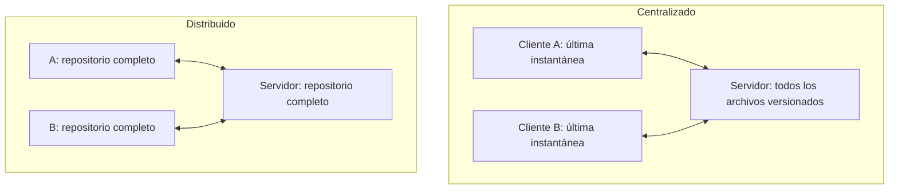
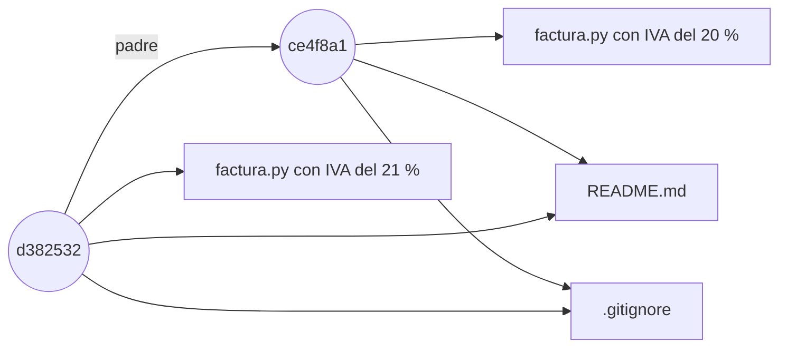
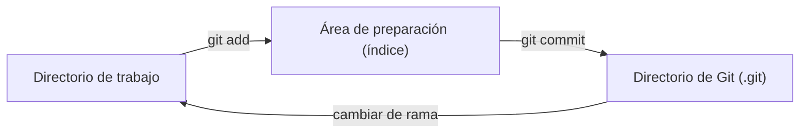
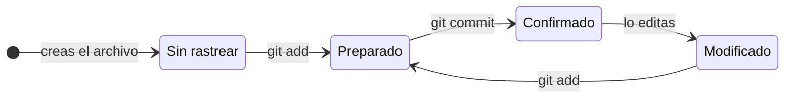

# Capítulo 1. Git por dentro

## Lo que podrás hacer al terminar

1. Explicar qué guarda un *commit* (confirmación): una instantánea (*snapshot*) del proyecto, sus padres y sus metadatos; y por qué cambiar un commit antiguo cambia el identificador de todos los que vienen detrás [h01-402, h01-403, h01-404, h01-638, h01-570, h01-571, h01-647].
2. Dibujar el grafo de commits, ramas y `HEAD` antes y después de un commit, de un *merge* (fusión) por avance rápido o a tres bandas, de un *rebase* (reaplicar los commits de una rama sobre otra) y de un `git reset`, y comprobar el dibujo con `git log --graph` y con los archivos de `.git` [h01-761, h01-435, h01-441, h01-503, h01-314, h01-652, h01-663].
3. Elegir entre merge, rebase y `git revert` según el historial esté ya publicado o no, y justificar la elección [h01-535, h01-591, h01-594].
4. Predecir qué hacen `git reset --soft`, `--mixed` y `--hard` sobre `HEAD`, el índice y el directorio de trabajo, y recuperar con `git reflog` un commit que parecía perdido [h01-701, h01-717, h01-720, h01-725, h01-728, h01-783, h01-784].
5. Construir sin ayuda un repositorio con tres ramas, provocar y resolver un conflicto y limpiar el historial con rebase interactivo, dibujando el grafo antes y después.

## Lo que necesitas antes

- Capítulos previos: ninguno.
- Git instalado y una terminal en la que sepas moverte entre carpetas. Los ejemplos se han ejecutado con Git 2.43. El capítulo 3 trata la terminal a fondo.
- Tu nombre y tu correo configurados en Git (`user.name` y `user.email`), porque Git los usa, junto con una marca de tiempo, para anotar el autor y el confirmador de tus commits [h01-639].
- La rama inicial llamada `main`. Si no configuras nada, Git usa hoy `master` como nombre por defecto [h01-278, h01-279]; ese nombre se cambia con la variable de configuración `init.defaultBranch` [h01-279]. Así tus salidas coincidirán con las del libro. El recuadro «Ojo con la versión» de la sección 1.2 cuenta el porqué.

Cómo configurar ambas cosas está en el apéndice «Preparar el entorno».

## El problema

Antes de abrir un *pull request* (PR, solicitud de integración de cambios), quieres que el historial de tu rama se vea limpio. Se lo pides a un asistente de IA y te devuelve tres órdenes: `git rebase -i HEAD~4`, `git reset --soft HEAD~2` y `git push --force`. Las ejecutas. El historial queda ordenado y nada protesta.

Al día siguiente te escribe una compañera que había partido de tu rama para su trabajo. Al traer tus cambios ve tus commits repetidos en su historial, y su PR ya no se puede fusionar.

Te toca dar explicaciones, y para eso tienes que responder tres preguntas. ¿Qué hizo exactamente cada uno de esos comandos? ¿Dónde están ahora los commits que «desaparecieron» de tu rama? ¿Cómo defiendes lo que pasó en la revisión? Este capítulo construye el modelo que responde a las tres.

## 1.1 Qué es el control de versiones

Un sistema de control de versiones registra los cambios de un conjunto de archivos a lo largo del tiempo para que puedas recuperar versiones anteriores, de un archivo o del proyecto entero [h01-101, h01-102, h01-103]. Git es distribuido: cada clon es una copia completa del repositorio, así que casi todo lo que haces ocurre en tu disco, sin red [h01-119, h01-121, h01-206, h01-207].

Para ordenar las ideas, fíjate en dónde vive el historial: solo en tu máquina, en un servidor central o en todas las máquinas a la vez. La forma más simple de la primera opción ya la conoces: copiar los archivos a otro directorio [h01-105]. Es lo que acaba en carpetas como `facturas_v2_final_DEFINITIVO`. Es sencillo, pero muy propenso a errores: olvidas en qué copia estás, guardas en el archivo equivocado o sobrescribes lo que no querías [h01-106, h01-107]. Las herramientas locales, como RCS, llevan el registro de los cambios en una base de datos sencilla y los guardan como conjuntos de parches, es decir, como diferencias entre archivos [h01-108, h01-109, h01-134].

El servidor central aparece cuando hace falta colaborar con gente que trabaja en otras máquinas [h01-110]. Los sistemas centralizados, como CVS o Subversion, tienen un único servidor con todos los archivos versionados y varios clientes que descargan de él los archivos [h01-111, h01-112]. La tercera opción es la de Git: en un sistema distribuido, cada máquina no se queda solo con la última instantánea de los archivos, sino con una réplica completa del repositorio [h01-119, h01-120].



La diferencia no está en las flechas, sino en lo que guarda cada máquina [h01-112, h01-120].

Compruébalo con `facturas`, el repositorio que te acompaña en todo el capítulo. Parte de un solo commit: el ejemplo muestra su historial, lo clona en la carpeta `copia` y muestra el del clon.

<!-- ejemplo: ejemplos/cap-01/01-clon-completo.sh -->
```console
# Ejecutado con Bash 5.2.21, Git 2.43.0
$ cd facturas && git log --oneline
ce4f8a1 Primera versión de la factura
$ cd .. && git clone facturas copia
Cloning into 'copia'...
done.
$ cd copia && git log --oneline
ce4f8a1 Primera versión de la factura
```
<!-- /ejemplo -->

El clon tiene el mismo commit, con el mismo identificador, `ce4f8a1`. La copia no trae solo los archivos: trae el repositorio entero [h01-120, h01-121]. Al clonar un repositorio desde otra máquina se copia el directorio de Git, donde viven los metadatos y la base de datos de objetos del proyecto [h01-222, h01-223]. Aquí el original está en la carpeta de al lado y el historial llega igual. De dónde sale ese identificador lo verás en la sección 1.2.

¿Qué ganas replicándolo todo? Mira primero el punto débil del modelo centralizado: el servidor es un punto único de fallo [h01-116]. Si se cae durante una hora, durante esa hora nadie puede colaborar ni guardar los cambios en los que estaba trabajando [h01-117]. Con Git, en cambio, tienes el historial completo en tu disco, y la mayoría de las operaciones solo necesitan recursos locales y parecen inmediatas [h01-206, h01-207]. Puedes confirmar cambios en un tren sin cobertura y subirlos cuando vuelvas a tener red [h01-208].

El diseño tiene también una historia. De 1991 a 2002, el *kernel* (núcleo) de Linux se mantuvo casi todo el tiempo intercambiando parches y archivos [h01-125]. En 2002 el proyecto pasó a BitKeeper, un sistema distribuido propietario; en 2005 se rompió la relación con la empresa y la herramienta dejó de ser gratuita [h01-126, h01-127]. Aquello empujó a la comunidad de Linux, y en particular a Linus Torvalds, a desarrollar una herramienta propia [h01-128]. Entre los objetivos del nuevo sistema estaban la velocidad, un diseño sencillo, soportar miles de ramas en paralelo, ser completamente distribuido y manejar con eficiencia proyectos del tamaño del kernel [h01-128, h01-129, h01-130, h01-131, h01-132, h01-133]. Volverás a encontrarte esos objetivos a lo largo del capítulo.

> PENDIENTE: falta hecho que identifique con Git la herramienta propia que empezó a escribir la comunidad de Linux en 2005. La copia local de f01-02 lo dice («Desde su nacimiento en el 2005, Git…»), pero no se ha extraído como hecho.

Lleva el fallo al extremo: el disco del servidor se corrompe y nadie había hecho copias de seguridad. En un sistema centralizado pierdes toda la información del proyecto, salvo las instantáneas que cada persona tenga en su máquina [h01-118]. Con Git puedes copiar al servidor cualquiera de los clones para restaurarlo [h01-119, h01-122]. Esa red cubre lo que llegó a confirmarse [h01-345]. Si pierdes algo que nunca confirmaste, puede que no vuelvas a verlo [h01-347].

## 1.2 Fotos, no diferencias; los tres estados

Cada commit guarda una instantánea completa de tus archivos, nombrada por un *hash* (resumen) de su contenido, y lo que no ha cambiado no se vuelve a guardar: se enlaza [h01-203, h01-204, h01-214]. Entre tus archivos y esa instantánea hay una zona intermedia, el área de preparación, y lo que confirmas es lo que hay en ella, no lo que tienes en disco [h01-221, h01-229, h01-263].

En la sección 1.1 viste que RCS guarda parches [h01-109]. Conceptualmente, la mayoría de los demás sistemas también guardan la información como una lista de cambios en los archivos [h01-201]. Git no: guarda una serie de instantáneas, copias puntuales de los archivos completos [h01-401, h01-205]. Piensa en un álbum. Cada vez que confirmas, Git fotografía todos tus archivos y guarda una referencia a esa foto [h01-203]. Si un archivo no ha cambiado, no lo guarda otra vez: enlaza la copia idéntica que ya tenía [h01-204].



En el dibujo, el segundo commit de `facturas` solo cambia `factura.py`; `README.md` y `.gitignore` los comparte con el primero, que es su padre [h01-204, h01-404]. El dibujo simplifica: entre un commit y sus archivos hay un árbol, que verás en la sección 1.6 [h01-407, h01-630].

Compruébalo. El ejemplo parte del `facturas` de la sección 1.1, confirma un cambio que solo toca `factura.py` (el IVA pasa del 20 % al 21 %) y muestra el historial y el árbol de cada commit, primero el del anterior.

<!-- ejemplo: ejemplos/cap-01/03-fotos-no-diferencias.sh -->
```console
# Ejecutado con Bash 5.2.21, Git 2.43.0
$ git log --oneline
d382532 Cambia el tipo de IVA al 21 %
ce4f8a1 Primera versión de la factura
$ git cat-file -p HEAD~1^{tree}
100644 blob 7a60b85e148f80966a550e5ab6a762a907c69ca6	.gitignore
100644 blob 9d8ab3c07b02fa17caddef19459698b2b58b5fcc	README.md
100644 blob 6e7a5575ee3ce687d1f99a404d29344255b11abb	factura.py
$ git cat-file -p HEAD^{tree}
100644 blob 7a60b85e148f80966a550e5ab6a762a907c69ca6	.gitignore
100644 blob 9d8ab3c07b02fa17caddef19459698b2b58b5fcc	README.md
100644 blob 8ff14bec51fd28b8c6601ab9bcafa262cae0cbdb	factura.py
```
<!-- /ejemplo -->

`git cat-file -p` muestra un objeto de forma legible según su tipo [h01-623, h01-624], y `^{tree}` designa el árbol al que apunta un commit, como en `master^{tree}` [h01-631]. Cada línea del árbol lleva modo, tipo, hash y nombre [h01-630]; `100644` indica un archivo normal [h01-635] y `blob`, el objeto que guarda el contenido de un archivo sin su nombre [h01-627]. Compara los dos árboles: `.gitignore` y `README.md` repiten hash; `factura.py`, no. Lo que seguía igual no se volvió a guardar [h01-204].

Esos nombres de 40 caracteres son hashes. Git verifica todo con una suma de comprobación SHA-1 antes de guardarlo [h01-209, h01-211], una cadena de 40 caracteres hexadecimales calculada a partir del contenido [h01-212, h01-213]. Guarda cada cosa por el hash de su contenido, no por su nombre de archivo [h01-214], y su documentación dice que, en su núcleo, Git es un sistema de archivos direccionable por contenido [h01-284]. Archivos, directorios y revisiones se identifican por hash, y no por números consecutivos como en otros sistemas tradicionales [h01-286].

Ya puedes cerrar lo que dejó abierto la sección 1.1. `git log` enseña cada commit con su suma SHA-1 [h01-303], así que `ce4f8a1` identifica el primer commit de `facturas` por el hash de su contenido [h01-214]. Eso sí, en el historial ves siete caracteres, no cuarenta.

> PENDIENTE: falta hecho sobre la forma abreviada del hash en `git log --oneline` (por qué `ce4f8a1` tiene siete caracteres y no cuarenta). Pro Git 2.3 (f01-05) dice que `--abbrev-commit` muestra «solamente los primeros caracteres de la suma SHA-1»; falta además que `--oneline` lo active, algo que está en la documentación de `git log`, que no está en el mapa.

Como el nombre sale del contenido, no puedes cambiar un archivo sin que Git se entere [h01-210]: si un bit se corrompe, el hash del contenido dañado deja de coincidir con su nombre [h01-287]. Y como casi todo lo que haces en Git solo añade información a su base de datos [h01-215], una instantánea confirmada es muy difícil de perder [h01-216]. Es la red de seguridad de la sección 1.1.

> **Bajo el capó.** Git no guarda ningún metadato cuando renombras un archivo [h01-269, h01-270]. Da igual que uses `git mv` o que muevas el archivo y luego hagas `git rm` y `git add`: Git se da cuenta de que es un renombre [h01-274]. Es lo esperable si guardas instantáneas y no cambios: el renombre no queda escrito en ninguna [h01-203, h01-270].

Falta la otra mitad: de dónde saca Git lo que fotografía. Un proyecto de Git tiene tres secciones [h01-221]. El directorio de Git es la carpeta `.git`, con la base de datos de objetos que copió el clon de la sección 1.1 [h01-222, h01-223, h01-275]. El directorio de trabajo es una copia de una versión del proyecto, sacada de esa base de datos y puesta en disco para que la uses o la cambies [h01-224, h01-225]. Entre ambos está el *staging area* (área de preparación), un archivo, por lo general dentro de `.git`, que guarda qué irá en el próximo commit [h01-226]. También se llama índice, y el archivo, `index` [h01-706, h01-614].

El flujo básico recorre los tres lugares en orden. Cambias archivos en el directorio de trabajo [h01-227]. Los preparas con `git add`, que copia su contenido al índice [h01-228, h01-710]. Y confirmas con `git commit`, que guarda de forma permanente en `.git` la instantánea de lo que hay en el área de preparación [h01-229, h01-711].



La flecha de vuelta llega en la sección 1.4: al cambiar de rama con `git switch`, Git actualiza el directorio de trabajo y el índice para que coincidan con la rama [h01-472].

Sobre ese dibujo se leen los tres estados de un archivo: confirmado, modificado y preparado [h01-217]. Si su versión está en el directorio de Git, está confirmada [h01-230]. Si ha cambiado desde que salió del repositorio y la has llevado al área de preparación, está preparada; si no la has preparado, modificada [h01-231, h01-232]. Fuera quedan los archivos sin rastrear: no estaban en la última instantánea ni están en el área de preparación [h01-233, h01-235], y Git no los mete en un commit salvo que se lo pidas con `git add` [h01-241, h01-242].



Preparas lo modificado, confirmas lo preparado y vuelta a empezar [h01-237].

Recorre el ciclo en `facturas`, ahora desde el primer paso: el ejemplo crea el repositorio de cero con una versión mínima de `README.md` y `factura.py`. Entre paso y paso consulta `git status -s`, la forma corta de `git status` [h01-248], que es la herramienta principal para saber en qué estado está cada archivo [h01-238].

<!-- ejemplo: ejemplos/cap-01/02-tres-estados.sh -->
```console
# Ejecutado con Bash 5.2.21, Git 2.43.0
$ git init facturas
Initialized empty Git repository in /tmp/ejemplo/facturas/.git/
$ cd facturas
$ echo "# facturas" > README.md
$ cat > factura.py <<'PY'
> IVA = 0.20
> def total(base, iva=IVA):
>     return base * (1 + iva)
> PY
$ git status -s
?? README.md
?? factura.py
$ git add README.md
$ git status -s
A  README.md
?? factura.py
$ git add factura.py
$ git commit -m "Primera versión de la factura"
[main (root-commit) 701842a] Primera versión de la factura
 2 files changed, 4 insertions(+)
 create mode 100644 README.md
 create mode 100644 factura.py
$ echo "IVA_REDUCIDO = 0.10" >> factura.py
$ git status -s
 M factura.py
$ git add factura.py
$ echo "IVA_SUPERREDUCIDO = 0.04" >> factura.py
$ git status -s
MM factura.py
$ git diff
diff --git a/factura.py b/factura.py
index 21c1b83..03f012b 100644
--- a/factura.py
+++ b/factura.py
@@ -2,3 +2,4 @@ IVA = 0.20
 def total(base, iva=IVA):
     return base * (1 + iva)
 IVA_REDUCIDO = 0.10
+IVA_SUPERREDUCIDO = 0.04
$ git diff --staged
diff --git a/factura.py b/factura.py
index 889ee08..21c1b83 100644
--- a/factura.py
+++ b/factura.py
@@ -1,3 +1,4 @@
 IVA = 0.20
 def total(base, iva=IVA):
     return base * (1 + iva)
+IVA_REDUCIDO = 0.10
```
<!-- /ejemplo -->

`git status -s` se lee en dos columnas: la izquierda es lo preparado y la derecha, lo que está sin preparar [h01-250]. Los archivos nuevos salen con `??`, sin rastrear [h01-249]. Tras `git add`, `README.md` pasa a `A` en la columna izquierda: rastreado y preparado [h01-243, h01-249]. Después del commit, una línea nueva deja `factura.py` en ` M`, con la marca a la derecha porque el cambio no está preparado [h01-249, h01-250]. Al `MM` del final vuelves enseguida.

Antes, mira el nombre del commit: lleva el mismo mensaje que `ce4f8a1`, pero se llama `701842a`. Aquí `facturas` nace sin `.gitignore` y con otro texto. El nombre de un commit sale de su contenido, que incluye el árbol con el estado del proyecto [h01-214, h01-638]. Distinto contenido, distinto nombre [h01-213].

`git diff` y `git diff --staged` muestran los dos lados de ese `MM` como parches, con las líneas añadidas y quitadas [h01-255]. `git diff` a secas compara el directorio de trabajo con el área de preparación: solo enseña lo no preparado, la línea de `IVA_SUPERREDUCIDO` [h01-256, h01-259]. `git diff --staged`, o su sinónimo `--cached`, compara lo preparado con la última instantánea confirmada: enseña lo que iría en el próximo commit, la línea de `IVA_REDUCIDO` [h01-257, h01-258, h01-260].

¿Por qué funciona así? Porque preparar no es apuntar un nombre en una lista: Git guarda una copia del contenido del archivo tal como está al ejecutar `git add` [h01-405, h01-246]. `git status` compara por parejas: hay un cambio por confirmar si el índice difiere de la última instantánea confirmada, y uno sin preparar si el índice difiere del directorio de trabajo [h01-703, h01-715, h01-714]. Y el commit guarda una instantánea del área de preparación, no de tu disco [h01-262, h01-263].

Vuelve al `MM`. ¿Qué pasa si confirmas sin otro `git add`? `factura.py` está preparado y modificado a la vez [h01-245, h01-246]. El commit se llevaría `IVA_REDUCIDO` y dejaría fuera `IVA_SUPERREDUCIDO`, porque lo que cambias después de `git add` no entra hasta que lo vuelves a añadir [h01-247, h01-262, h01-263].

> **Error típico.** Confirmar trazas o archivos que genera tu sistema de compilación [h01-251]. Para lo que no quieres que Git añada, ni que aparezca como sin rastrear, crea un `.gitignore` con patrones al empezar el proyecto, y no confirmarás nada por accidente [h01-272, h01-251, h01-252]. Usa patrones *glob* (patrones de nombres de archivo) estándar, que se aplican de forma recursiva a todo el repositorio; un `!` delante niega un patrón [h01-253, h01-254]. El `facturas` de la sección 1.1 ya trae el suyo: es la entrada `.gitignore` que viste en sus árboles.

> **Ojo con la versión.** Pro Git en español da `master` como rama por defecto [h01-410]. La documentación actual de `git init` dice que hoy la rama inicial se sigue llamando así si no indicas otro nombre, y que pasará a llamarse `main` con Git 3.0 [h01-276, h01-278]. Los ejemplos usan `main` porque su entorno lo fija con `init.defaultBranch` [h01-279]; para un solo repositorio está `git init -b` [h01-277]. `master` no tiene nada de especial: está en casi todos los repositorios solo porque `git init` la crea por defecto y casi nadie la renombra [h01-412, h01-413].
>
> Con el hash, algo parecido. `git init` usa SHA-1 salvo que pidas `--object-format=sha256`, si está habilitado, y por ahora los repositorios SHA-256 y SHA-1 no interoperan [h01-280, h01-283]. Que un objeto pueda nombrarse con 40 dígitos hexadecimales (SHA-1) o con 64 (SHA-256) es lo que prevé el diseño de la transición, no lo que hace `git init` por defecto [h01-293, h01-280]. La sección 1.6 cuenta por qué se eligió SHA-256 como sucesor [h01-292].
