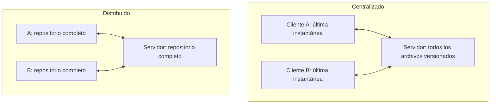

# Capítulo 1. Git por dentro

## Lo que podrás hacer al terminar

1. Explicar qué guarda un *commit* (confirmación): una instantánea (*snapshot*) del proyecto, sus padres y sus metadatos; y por qué cambiar un commit antiguo cambia el identificador de todos los que vienen detrás [h01-402, h01-403, h01-404, h01-638, h01-570, h01-571, h01-647].
2. Dibujar el grafo de commits, ramas y `HEAD` antes y después de un commit, de un *merge* (fusión) por avance rápido o a tres bandas, de un *rebase* (reaplicar los commits de una rama sobre otra) y de un `git reset`, y comprobar el dibujo con `git log --graph` y con los archivos de `.git` [h01-761, h01-435, h01-441, h01-503, h01-314, h01-652, h01-663].
3. Elegir entre merge, rebase y `git revert` según el historial esté ya publicado o no, y justificar la elección [h01-535, h01-591, h01-594].
4. Predecir qué hacen `git reset --soft`, `--mixed` y `--hard` sobre `HEAD`, el índice y el directorio de trabajo, y recuperar con `git reflog` un commit que parecía perdido [h01-701, h01-717, h01-720, h01-725, h01-728, h01-783, h01-784].
5. Construir sin ayuda un repositorio con tres ramas, provocar y resolver un conflicto y limpiar el historial con rebase interactivo, dibujando el grafo antes y después.

## Lo que necesitas antes

- Capítulos previos: ninguno.
- Git instalado y una terminal en la que sepas moverte entre carpetas. Los ejemplos se han ejecutado con Git 2.43. El capítulo 3 trata la terminal a fondo.
- Tu nombre y tu correo configurados en Git (`user.name` y `user.email`), porque Git los usa, junto con una marca de tiempo, para anotar el autor y el confirmador de tus commits [h01-639].
- La rama inicial llamada `main`. Si no configuras nada, Git usa hoy `master` como nombre por defecto [h01-278, h01-279]; ese nombre se cambia con la variable de configuración `init.defaultBranch` [h01-279]. Así tus salidas coincidirán con las del libro. El recuadro «Ojo con la versión» de la sección 1.2 cuenta el porqué.

Cómo configurar ambas cosas está en el apéndice «Preparar el entorno».

## El problema

Antes de abrir un *pull request* (PR, solicitud de integración de cambios), quieres que el historial de tu rama se vea limpio. Se lo pides a un asistente de IA y te devuelve tres órdenes: `git rebase -i HEAD~4`, `git reset --soft HEAD~2` y `git push --force`. Las ejecutas. El historial queda ordenado y nada protesta.

Al día siguiente te escribe una compañera que había partido de tu rama para su trabajo. Al traer tus cambios ve tus commits repetidos en su historial, y su PR ya no se puede fusionar.

Te toca dar explicaciones, y para eso tienes que responder tres preguntas. ¿Qué hizo exactamente cada uno de esos comandos? ¿Dónde están ahora los commits que «desaparecieron» de tu rama? ¿Cómo defiendes lo que pasó en la revisión? Este capítulo construye el modelo que responde a las tres.

## 1.1 Qué es el control de versiones

Un sistema de control de versiones registra los cambios de un conjunto de archivos a lo largo del tiempo para que puedas recuperar versiones anteriores, de un archivo o del proyecto entero [h01-101, h01-102, h01-103]. Git es distribuido: cada clon es una copia completa del repositorio, así que casi todo lo que haces ocurre en tu disco, sin red [h01-119, h01-121, h01-206, h01-207].

Para ordenar las ideas, fíjate en dónde vive el historial: solo en tu máquina, en un servidor central o en todas las máquinas a la vez. La forma más simple de la primera opción ya la conoces: copiar los archivos a otro directorio [h01-105]. Es lo que acaba en carpetas como `facturas_v2_final_DEFINITIVO`. Es sencillo, pero muy propenso a errores: olvidas en qué copia estás, guardas en el archivo equivocado o sobrescribes lo que no querías [h01-106, h01-107]. Las herramientas locales, como RCS, llevan el registro de los cambios en una base de datos sencilla y los guardan como conjuntos de parches, es decir, como diferencias entre archivos [h01-108, h01-109, h01-134].

El servidor central aparece cuando hace falta colaborar con gente que trabaja en otras máquinas [h01-110]. Los sistemas centralizados, como CVS o Subversion, tienen un único servidor con todos los archivos versionados y varios clientes que descargan de él los archivos [h01-111, h01-112]. La tercera opción es la de Git: en un sistema distribuido, cada máquina no se queda solo con la última instantánea de los archivos, sino con una réplica completa del repositorio [h01-119, h01-120].



La diferencia no está en las flechas, sino en lo que guarda cada máquina [h01-112, h01-120].

Compruébalo con `facturas`, el repositorio que te acompaña en todo el capítulo. Parte de un solo commit: el ejemplo muestra su historial, lo clona en la carpeta `copia` y muestra el del clon.

<!-- ejemplo: ejemplos/cap-01/01-clon-completo.sh -->
```console
# Ejecutado con Bash 5.2.21, Git 2.43.0
$ cd facturas && git log --oneline
ce4f8a1 Primera versión de la factura
$ cd .. && git clone facturas copia
Cloning into 'copia'...
done.
$ cd copia && git log --oneline
ce4f8a1 Primera versión de la factura
```
<!-- /ejemplo -->

El clon tiene el mismo commit, con el mismo identificador, `ce4f8a1`. La copia no trae solo los archivos: trae el repositorio entero [h01-120, h01-121]. Al clonar un repositorio desde otra máquina se copia el directorio de Git, donde viven los metadatos y la base de datos de objetos del proyecto [h01-222, h01-223]. Aquí el original está en la carpeta de al lado y el historial llega igual. De dónde sale ese identificador lo verás en la sección 1.2.

¿Qué ganas replicándolo todo? Mira primero el punto débil del modelo centralizado: el servidor es un punto único de fallo [h01-116]. Si se cae durante una hora, durante esa hora nadie puede colaborar ni guardar los cambios en los que estaba trabajando [h01-117]. Con Git, en cambio, tienes el historial completo en tu disco, y la mayoría de las operaciones solo necesitan recursos locales y parecen inmediatas [h01-206, h01-207]. Puedes confirmar cambios en un tren sin cobertura y subirlos cuando vuelvas a tener red [h01-208].

El diseño tiene también una historia. De 1991 a 2002, el *kernel* (núcleo) de Linux se mantuvo casi todo el tiempo intercambiando parches y archivos [h01-125]. En 2002 el proyecto pasó a BitKeeper, un sistema distribuido propietario; en 2005 se rompió la relación con la empresa y la herramienta dejó de ser gratuita [h01-126, h01-127]. Aquello empujó a la comunidad de Linux, y en particular a Linus Torvalds, a desarrollar una herramienta propia [h01-128]. Entre los objetivos del nuevo sistema estaban la velocidad, un diseño sencillo, soportar miles de ramas en paralelo, ser completamente distribuido y manejar con eficiencia proyectos del tamaño del kernel [h01-128, h01-129, h01-130, h01-131, h01-132, h01-133]. Volverás a encontrarte esos objetivos a lo largo del capítulo.

> PENDIENTE: falta hecho que identifique con Git la herramienta propia que empezó a escribir la comunidad de Linux en 2005. La copia local de f01-02 lo dice («Desde su nacimiento en el 2005, Git…»), pero no se ha extraído como hecho.

Lleva el fallo al extremo: el disco del servidor se corrompe y nadie había hecho copias de seguridad. En un sistema centralizado pierdes toda la información del proyecto, salvo las instantáneas que cada persona tenga en su máquina [h01-118]. Con Git puedes copiar al servidor cualquiera de los clones para restaurarlo [h01-119, h01-122]. Esa red cubre lo que llegó a confirmarse [h01-345]. Si pierdes algo que nunca confirmaste, puede que no vuelvas a verlo [h01-347].
