# Capítulo 1. Git por dentro

## Lo que podrás hacer al terminar

1. Explicar qué guarda un *commit* (confirmación): una *snapshot* (instantánea) del proyecto, sus padres y sus metadatos; y por qué tocar un commit antiguo cambia el *hash* (resumen) que da nombre a todos los que vienen detrás [h01-402, h01-403, h01-404, h01-638, h01-570, h01-571, h01-647].
2. Dibujar el grafo de commits, ramas y `HEAD` antes y después de un commit, de un *merge* (fusión) por avance rápido o a tres bandas, de un *rebase* (reorganización: reaplicar commits sobre otra base) y de un `git reset`, y comprobar el dibujo con `git log --graph` y con los archivos de `.git` [h01-761, h01-435, h01-441, h01-503, h01-314, h01-652, h01-663].
3. Elegir entre merge y rebase, y decidir cuándo no reescribir, según si otros ya tienen esos commits; y deshacer un commit sin reescribir nada con `git revert` [h01-510, h01-535, h01-591, h01-594].
4. Predecir qué hacen `git reset --soft`, `--mixed` y `--hard` con `HEAD`, el índice y el directorio de trabajo; recuperar con el *reflog* (registro de referencias) un commit que parecía perdido, y saber cuánto tiempo lo guarda el reflog [h01-701, h01-717, h01-720, h01-725, h01-728, h01-783, h01-784, h01-870, h01-872].
5. Construir sin ayuda un repositorio con tres ramas, provocar un conflicto y resolverlo, y limpiar el historial con un rebase interactivo, dibujando el grafo antes y después [h01-542, h01-580, h01-448, h01-456].

## Lo que necesitas antes

- Capítulos previos: ninguno.
- Git 2.43 o posterior y una terminal. Los ejemplos se han ejecutado con Git 2.43.0.
- Tu nombre y tu correo, que Git apunta en cada commit junto con una marca de tiempo [h01-639, h01-812]. Se fijan una sola vez con `git config --global user.name` y `git config --global user.email` [h01-811, h01-813].
- La rama inicial llamada `main`, para que tus nombres de rama coincidan con los del libro: dale ese valor a la variable `init.defaultBranch` con `git config --global` [h01-279, h01-811]. El «Ojo con la versión» de la sección 1.2 explica por qué.
- Los hashes de tus commits no coincidirán con los del libro: en cada uno entran tu nombre, tu correo y la hora [h01-639, h01-647]. La sección 1.6 cuenta qué hashes sí te saldrán iguales.

## El problema

Tu rama `exportar-csv` de `facturas` tiene cuatro commits: dos con la exportación a CSV, uno que arregla el segundo y una prueba que sobra. Antes de abrir el *pull request* (PR, la petición para que integren tu rama), le pides a un asistente de IA que te la deje limpia.

Te da cuatro órdenes: `git rebase -i HEAD~4`, con una lista que funde el arreglo con su commit y quita la prueba; `git reset --soft HEAD~2`; `git commit -m "Añade la exportación a CSV"`, y `git push --force`. Las ejecutas, nada protesta y la rama queda con un solo commit.

Al día siguiente te escribe Marta Ruiz, tu compañera, que había empezado su rama a partir de la tuya. Al intentar traer tus cambios, Git le dice que su copia y la del servidor han divergido, y se detiene. Cuando le obliga a fusionar, su historial enseña tus commits viejos junto al nuevo: los mismos cambios, dos veces. Ahora tiene que arreglar su rama a mano.

En la revisión te harán tres preguntas. ¿Qué hizo exactamente cada orden? ¿Dónde están los commits que «desaparecieron» de tu rama? ¿Cómo defiendes lo que pasó? Este capítulo construye el modelo que responde a las tres.

## 1.1 Qué es el control de versiones

Un sistema de control de versiones guarda la historia de tus archivos para que puedas volver a cualquier versión anterior, de un archivo o del proyecto entero [h01-101, h01-102, h01-103]. En Git cada clon trae esa historia completa, y por eso casi todo lo que haces ocurre en tu disco [h01-120, h01-121, h01-206, h01-207].

Imagina `facturas` antes de Git: una carpeta con `factura.py` y `README.md` y, al lado, sus copias, `facturas_v2`, `facturas_v2_final` y `facturas_v2_final_DEFINITIVO`. Duplicar la carpeta es un método habitual [h01-105], y también una fuente de errores: pierdes la cuenta de qué copia tienes abierta, guardas en la que no era o pisas un archivo que querías conservar [h01-106, h01-107]. A un control de versiones le pides justo lo contrario: que cada versión anterior siga ahí y puedas volver a ella [h01-102, h01-103].

Así se ve `facturas` con Git. El ejemplo parte de un repositorio con tres commits en la rama `main`. Lista su historial, una línea por commit; después lo clona en la carpeta `copia` y repite la consulta dentro del clon.

<!-- ejemplo: ejemplos/cap-01/01-clon-completo.sh -->
```console
# Ejecutado con Bash 5.2.21, Git 2.43.0
$ cd facturas && git log --oneline
c87074a Cambia el tipo de IVA al 21 %
c2466c3 Añade un ejemplo de uso al README
ce4f8a1 Primera versión de la factura
$ cd .. && git clone facturas copia
Cloning into 'copia'...
done.
$ cd copia && git log --oneline
c87074a Cambia el tipo de IVA al 21 %
c2466c3 Añade un ejemplo de uso al README
ce4f8a1 Primera versión de la factura
```
<!-- /ejemplo -->

Las dos listas son idénticas: tres commits, en el mismo orden y con los mismos nombres, `ce4f8a1`, `c2466c3` y `c87074a`. `git clone` no se ha traído solo los archivos de la última versión, sino el repositorio entero, con todo su historial [h01-120, h01-121]. Qué son esos nombres lo verás en la sección 1.2.

Esa salida responde a la pregunta que separa unos sistemas de otros: ¿dónde vive el historial? En la carpeta de copias, solo en tu disco. En un sistema centralizado, como Subversion, en un único servidor del que cada persona descarga los archivos con los que trabaja; nació para que pudiera colaborar gente desde máquinas distintas [h01-110, h01-111, h01-112]. En uno distribuido, como Git, cada máquina guarda una réplica completa del repositorio [h01-119, h01-120].

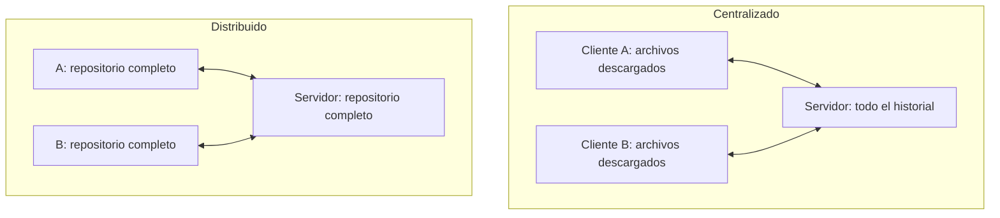

Las flechas son las mismas en los dos dibujos; lo que cambia es qué guarda cada máquina [h01-112, h01-120].

Con todo el historial dentro de `copia`, la mayoría de las operaciones de Git no necesitan nada que esté fuera de tu disco, y por eso responden casi al instante [h01-206, h01-207]. Puedes seguir confirmando cambios sin conexión y enviarlos cuando vuelvas a tener red [h01-208].

Lleva el caso al extremo: el disco del servidor se estropea y nadie tenía copia de seguridad. En un sistema centralizado el servidor es un punto único de fallo, y con su disco se va el historial del proyecto; solo quedan las versiones sueltas que cada persona tuviera en su máquina [h01-116, h01-118]. Con Git, cualquier clon puede copiarse al servidor para restaurarlo, con lo que ese clon tuviera [h01-121, h01-122]. Lo que nadie llegó a confirmar no está en ningún clon, y puede que no vuelvas a verlo [h01-347].

Git nació en 2005 en la comunidad del *kernel* (núcleo) de Linux, cuando BitKeeper, la herramienta que usaban, dejó de ser gratuita [h01-126, h01-127, h01-128, h01-809]. Entre sus objetivos estaban la velocidad y soportar miles de ramas en paralelo; los dos reaparecen en la sección 1.4 [h01-129, h01-130].

## 1.2 Fotos, no diferencias; los tres estados

Cada commit guarda una foto completa del proyecto, y lo que no cambió desde la foto anterior no se copia otra vez: se reutiliza [h01-203, h01-204]. Cada pieza se nombra por el hash de su contenido, y la foto no se toma de tu disco, sino de una zona intermedia, el *staging area* (área de preparación) [h01-214, h01-226, h01-263].

Empieza por un experimento. El ejemplo parte de un `facturas` con dos commits en `main`: el primero de la sección 1.1 y otro que sube el IVA del 20 % al 21 %, esta vez sin el commit del README entre medias. Pide la diferencia entre los dos commits y después la lista de archivos que guarda cada uno.

<!-- ejemplo: ejemplos/cap-01/03-fotos-no-diferencias.sh -->
```console
# Ejecutado con Bash 5.2.21, Git 2.43.0
$ git log --oneline
d382532 Cambia el tipo de IVA al 21 %
ce4f8a1 Primera versión de la factura
$ git diff HEAD~1 HEAD
diff --git a/factura.py b/factura.py
index 6e7a557..8ff14be 100644
--- a/factura.py
+++ b/factura.py
@@ -1,4 +1,4 @@
-IVA = 0.20
+IVA = 0.21
 def total(base, iva=IVA):
     """Calcula el total de una factura."""
     return base * (1 + iva)
$ git cat-file -p HEAD~1^{tree}
100644 blob 7a60b85e148f80966a550e5ab6a762a907c69ca6	.gitignore
100644 blob 9d8ab3c07b02fa17caddef19459698b2b58b5fcc	README.md
100644 blob 6e7a5575ee3ce687d1f99a404d29344255b11abb	factura.py
$ git cat-file -p HEAD^{tree}
100644 blob 7a60b85e148f80966a550e5ab6a762a907c69ca6	.gitignore
100644 blob 9d8ab3c07b02fa17caddef19459698b2b58b5fcc	README.md
100644 blob 8ff14bec51fd28b8c6601ab9bcafa262cae0cbdb	factura.py
```
<!-- /ejemplo -->

`HEAD` señala el último commit de la rama y `HEAD~1`, su padre [h01-663, h01-703, h01-826]; la sección 1.3 cuenta esta notación. Según `git diff`, entre los dos commits solo cambia una línea de `factura.py` [h01-843, h01-255]. ¿Qué ha guardado Git, entonces? ¿Solo esa línea?

Mira los dos listados. `git cat-file -p` enseña un objeto de Git de forma legible, y `^{tree}` detrás de un commit designa su árbol (*tree*), el listado de archivos de esa foto [h01-623, h01-624, h01-829, h01-631, h01-629]. Cada línea del árbol lleva el modo (`100644` es un archivo normal), el tipo, un hash y el nombre del archivo [h01-630, h01-635]. El tipo `blob` (de *binary large object*, objeto binario grande) es el objeto que guarda el contenido de un archivo, sin su nombre [h01-627].

Los dos árboles nombran los tres archivos, también los que no cambiaron. `.gitignore` y `README.md` tienen el mismo hash en ambos; `factura.py`, no.

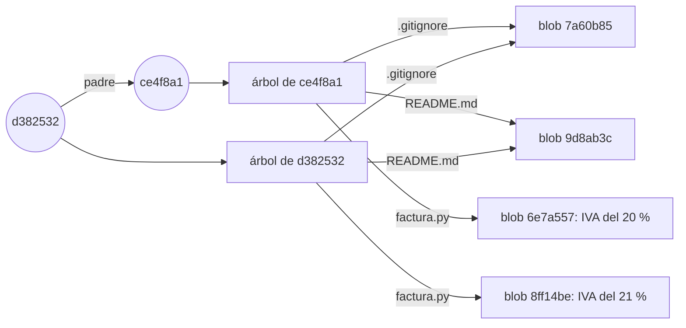

Cada commit tiene su foto completa, pero lo que no cambió apunta al contenido que ya estaba guardado, y el nombre de cada archivo vive en el árbol, no en el blob [h01-203, h01-204, h01-627, h01-630]. `git diff` te enseña los cambios entre dos commits cualesquiera [h01-843], pero lo que Git guarda son fotos, no listas de cambios [h01-401, h01-205].

Piensa en un álbum: cada página es un commit con la foto de lo que tenías preparado, y lo que no cambió se pega de la página anterior en vez de revelarse otra vez [h01-203, h01-204, h01-263].

Esos nombres de 40 caracteres son hashes SHA-1, cadenas hexadecimales calculadas a partir del contenido [h01-211, h01-212, h01-213, h01-630]. Git comprueba cada cosa con ese cálculo antes de guardarla y la guarda por su hash, no por su nombre de archivo; por eso `.gitignore` se llama igual en los dos árboles [h01-209, h01-213, h01-214]. `ce4f8a1` y `d382532` son prefijos: `--oneline` enseña solo el principio del hash, lo justo para identificar el commit [h01-820, h01-821].

El commit del IVA no se llama como en la sección 1.1, `c87074a`, porque su padre y su README son otros, y un commit guarda el hash de su padre y apunta a su árbol [h01-570, h01-407, h01-638, h01-294]. La sección 1.6 hace el cálculo.

Como el nombre sale del contenido, no puedes cambiar un archivo sin que Git lo note: si se corrompe un solo bit, el hash del contenido dañado ya no coincide con su nombre [h01-210, h01-287]. Y como casi todo lo que haces en Git solo añade información a su base de datos, lo que has confirmado es muy difícil de perder [h01-215, h01-216].

Queda la pregunta del principio: ¿de dónde sale la foto? Git trabaja con tres lugares [h01-221]:

- El directorio de trabajo: los archivos que ves y editas, una versión del proyecto que Git saca de su base de datos y deja en tu disco [h01-224, h01-225].
- El área de preparación, que también se llama índice (*index*): un archivo, normalmente dentro de `.git`, con lo que irá en el próximo commit [h01-226, h01-706, h01-614].
- El directorio de Git, la carpeta `.git`: guarda los objetos, como los blobs y los árboles que acabas de ver, y los metadatos del proyecto [h01-222, h01-627]. Cuando clonas desde otra máquina, esto es lo que te llevas [h01-223].


`git add` copia contenido del directorio de trabajo al índice, y `git commit` convierte lo que hay en el índice en una foto permanente dentro de `.git` [h01-710, h01-711, h01-229]. La flecha de vuelta saca una versión de `.git` a tu disco [h01-225]; la sección 1.7 cuenta que, al cambiar de rama, ese camino pasa también por el índice [h01-716].

Recorre ahora esos lugares. Este ejemplo no parte de ningún `facturas`: crea el repositorio desde cero, con una versión mínima de `README.md` y `factura.py`, y entre paso y paso consulta `git status -s`. Es la forma corta de la orden que te dice en qué estado está cada archivo [h01-248, h01-238].

<!-- ejemplo: ejemplos/cap-01/02-tres-estados.sh -->
```console
# Ejecutado con Bash 5.2.21, Git 2.43.0
$ git init facturas
Initialized empty Git repository in /tmp/ejemplo/facturas/.git/
$ cd facturas
$ echo "# facturas" > README.md
$ cat > factura.py <<'PY'
> IVA = 0.20
> def total(base, iva=IVA):
>     return base * (1 + iva)
> PY
$ git status -s
?? README.md
?? factura.py
$ git add README.md
$ git status -s
A  README.md
?? factura.py
$ git add factura.py
$ git commit -m "Primera versión de la factura"
[main (root-commit) 701842a] Primera versión de la factura
 2 files changed, 4 insertions(+)
 create mode 100644 README.md
 create mode 100644 factura.py
$ echo "IVA_REDUCIDO = 0.10" >> factura.py
$ git status -s
 M factura.py
$ git add factura.py
$ echo "IVA_SUPERREDUCIDO = 0.04" >> factura.py
$ git status -s
MM factura.py
$ git diff
diff --git a/factura.py b/factura.py
index 21c1b83..03f012b 100644
--- a/factura.py
+++ b/factura.py
@@ -2,3 +2,4 @@ IVA = 0.20
 def total(base, iva=IVA):
     return base * (1 + iva)
 IVA_REDUCIDO = 0.10
+IVA_SUPERREDUCIDO = 0.04
$ git diff --staged
diff --git a/factura.py b/factura.py
index 889ee08..21c1b83 100644
--- a/factura.py
+++ b/factura.py
@@ -1,3 +1,4 @@
 IVA = 0.20
 def total(base, iva=IVA):
     return base * (1 + iva)
+IVA_REDUCIDO = 0.10
```
<!-- /ejemplo -->

Cada línea de `git status -s` tiene dos columnas: la izquierda habla de lo preparado y la derecha, de lo que no [h01-250].

- `??`: sin rastrear; Git ve el archivo, pero no estaba en la última foto ni está preparado [h01-235, h01-249].
- `A `: `README.md`, rastreado y preparado tras `git add` [h01-243, h01-249].
- ` M`: `factura.py`, con una línea nueva sin preparar [h01-249, h01-250].
- `MM`: preparaste `IVA_REDUCIDO` y luego escribiste `IVA_SUPERREDUCIDO`; a la izquierda, el cambio preparado; a la derecha, el posterior [h01-246, h01-250].

El commit se llama `701842a`, no `ce4f8a1`: sin `.gitignore` y con otros archivos, la foto es otra [h01-214, h01-638].

Las marcas corresponden a los estados de un archivo. Uno rastreado estaba en la última foto, y puede estar confirmado, modificado o preparado [h01-217, h01-233, h01-234]. Uno sin rastrear no entra en ningún commit hasta que lo añades con `git add` [h01-235, h01-241, h01-242].

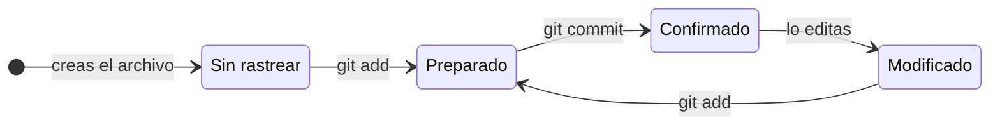

Cada lado del `MM` tiene su `git diff`. Sin opciones, compara tu disco con el índice y enseña lo que no has preparado, la línea de `IVA_SUPERREDUCIDO` [h01-256, h01-259]. Con `--staged`, o su sinónimo `--cached`, compara el índice con el último commit y enseña lo que entraría en el próximo, la de `IVA_REDUCIDO` [h01-257, h01-258, h01-260]. Los dos dan el parche: las líneas que se añaden y las que se quitan [h01-255]. Fíjate en `21c1b83`: cierra la línea `index` de una salida y abre la de la otra. Encaja con lo anterior, porque las dos comparaciones comparten un extremo, el índice [h01-256, h01-258].

¿Por qué hay dos lados? Porque `git add` no apunta un nombre en una lista: copia el contenido del archivo tal como está en ese momento, y lo que edites después queda fuera de esa copia [h01-405, h01-246, h01-247]. `git status` compara por parejas: el índice con el último commit, para los cambios por confirmar, y tu disco con el índice, para los cambios sin preparar [h01-703, h01-715, h01-714].

Vuelve al `MM` y confirma sin otro `git add`. El commit se lleva `IVA_REDUCIDO`, que es lo preparado, mientras que `IVA_SUPERREDUCIDO` se queda en tu disco sin preparar [h01-246, h01-250, h01-262, h01-263, h01-714]. Para que entrara, tendrías que haber vuelto a ejecutar `git add` [h01-247].

> **Error típico.** Confirmar sin querer trazas o archivos que genera tu compilación [h01-251]. Un `.gitignore` lista patrones de archivos que Git no debe añadir ni enseñar como sin rastrear [h01-251, h01-272]. Créalo al empezar el proyecto, como el de `facturas`, y evitarás confirmar por accidente lo que no quieres [h01-252]. Usa la sintaxis *glob* (de comodines) estándar; por defecto, cada patrón se aplica de forma recursiva en todo el repositorio, y un `!` delante lo niega [h01-253, h01-254].

> **Ojo con la versión.** Pro Git en español da `master` como rama por defecto, y explica que está en casi cualquier repositorio porque `git init` la crea así y casi nadie le cambia el nombre [h01-410, h01-412, h01-413]. La documentación actual de `git init` dice que ese sigue siendo el nombre por defecto y que pasará a ser `main` con Git 3.0 [h01-278]. Los ejemplos usan `main` porque su entorno lo fija con `init.defaultBranch` [h01-279]; para un solo repositorio tienes `git init -b` [h01-277].
>
> Con el hash pasa algo parecido: por defecto `git init` usa SHA-1 y, con `--object-format=sha256`, si tu Git lo tiene habilitado, SHA-256 [h01-280]. La sección 1.6 cuenta por qué Git busca un sucesor de SHA-1.

## 1.3 Leer y deshacer el historial

Deshacer en Git casi nunca borra: o crea un commit nuevo o copia contenido de un lugar a otro, y solo pierdes lo que nunca llegaste a confirmar. Para elegir qué deshacer, antes tienes que encontrarlo, y `git log` es una consulta sobre el historial.

Casi todo lo que haces en Git añade información a su base de datos y no quita la que había [h01-215]. Corregir un commit tampoco lo modifica: Git escribe otro y mueve la rama hacia él [h01-764]. Lo confirmado se puede recuperar [h01-345]. El riesgo está en tu disco: si deshaces un cambio que no llegó a entrar en ningún commit, puede que no haya forma de traerlo de vuelta [h01-327, h01-347].

Empieza por el error más pequeño, un mensaje que no dice lo que hace el commit. El ejemplo parte de `facturas` con tres commits en `main`. Una línea de preparación oculta cambia `factura.py` para que redondee el total. Lo confirmas con un mensaje vago, lo corriges con `git commit --amend -m` y lees los dos commits con el `git cat-file -p` de la sección 1.2.

<!-- ejemplo: ejemplos/cap-01/05-amend.sh -->
```console
# Ejecutado con Bash 5.2.21, Git 2.43.0
$ git add factura.py
$ git commit -m "Cambia la función total"
[main ddf220e] Cambia la función total
 1 file changed, 1 insertion(+), 1 deletion(-)
$ git commit --amend -m "Redondea el total a dos decimales"
[main 6c3625e] Redondea el total a dos decimales
 Date: Thu Jan 1 12:00:00 2026 +0100
 1 file changed, 1 insertion(+), 1 deletion(-)
$ git cat-file -p HEAD
tree 146d547efe65a31174617d8c41ccd8dac9fa38ee
parent c87074a060dbf507d64ec3e5e304398bd8e17de3
author devOC <devoc@ejemplo.dev> 1767265200 +0100
committer devOC <devoc@ejemplo.dev> 1767265200 +0100

Redondea el total a dos decimales
$ git cat-file -p HEAD@{1}
tree 146d547efe65a31174617d8c41ccd8dac9fa38ee
parent c87074a060dbf507d64ec3e5e304398bd8e17de3
author devOC <devoc@ejemplo.dev> 1767265200 +0100
committer devOC <devoc@ejemplo.dev> 1767265200 +0100

Cambia la función total
$ git reflog -2
6c3625e HEAD@{0}: commit (amend): Redondea el total a dos decimales
ddf220e HEAD@{1}: commit: Cambia la función total
```
<!-- /ejemplo -->

Compara las dos lecturas. Árbol (`146d547`), padre (`c87074a`) y autor coinciden. Solo difiere el mensaje, y con él el nombre: el commit vago es `ddf220e` y el corregido, `6c3625e`.

Eso es lo que hace `--amend`: no retoca la punta de tu rama, la sustituye por un commit nuevo que hereda sus padres y su autor [h01-846, h01-847, h01-848]. Un commit ya escrito no se puede cambiar [h01-763]. El mensaje forma parte del objeto y el hash se calcula sobre todo su contenido, así que otro mensaje da otro nombre [h01-640, h01-647]. Como no habías preparado nada más, solo cambia el mensaje [h01-332]; un archivo preparado antes del `--amend` habría entrado en la foto nueva [h01-331].

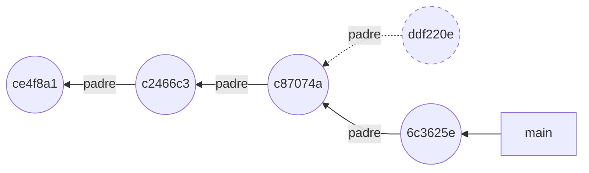

En el dibujo, `ddf220e`, con borde discontinuo, sigue en el repositorio, pero ninguna rama lo señala ya [h01-764, h01-766].

¿Y si el commit que quieres corregir no es el último? Para nombrarlo tienes que moverte por el historial, que es un grafo de commits [h01-761]. Cada commit guarda el hash de su padre, o de sus padres si tiene varios [h01-570]. Por eso solo se puede recorrer en un sentido, de cada commit a su padre, y `git log` lo hace desde la punta: lo más reciente sale arriba [h01-302].

No hace falta copiar hashes. Puedes nombrar un commit por su distancia a otro. `HEAD^` es el primer padre de `HEAD`, y `HEAD~` también [h01-822, h01-825]. Con un número, `~` sube ese número de generaciones siguiendo siempre el primer padre, así que `HEAD~2` es el abuelo [h01-826, h01-828]. En el `facturas` del ejemplo 05 quedan así:

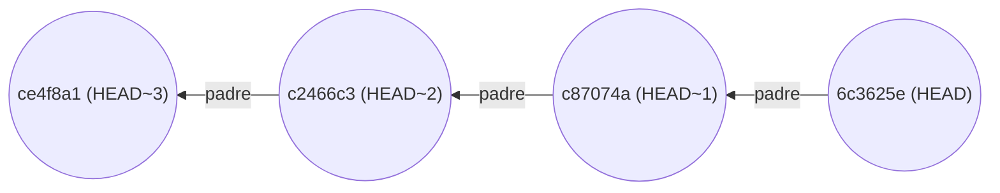

No confundas `HEAD~1` con el `HEAD@{1}` del ejemplo. `HEAD~1` es el padre, `c87074a`. `HEAD@{1}` es el sitio donde estaba `HEAD` un movimiento antes [h01-775]: el commit vago, `ddf220e`, que no es padre de nadie. Uno mira el grafo; el otro, la lista de tus movimientos.

Con más commits, `git log` sirve para hacer preguntas. Este ejemplo monta `facturas` con cinco commits en `main`: a los tres de siempre se suman los tests que escribió Marta Ruiz y una nota sobre el IVA en el README.

<!-- ejemplo: ejemplos/cap-01/04-leer-historial.sh -->
```console
# Ejecutado con Bash 5.2.21, Git 2.43.0
$ git log --oneline
938b805 Documenta el IVA en el README
795693a Añade tests de total
c87074a Cambia el tipo de IVA al 21 %
c2466c3 Añade un ejemplo de uso al README
ce4f8a1 Primera versión de la factura
$ git log --stat -1
commit 938b8051e8da371c0d510280521d4cff1343fa6f
Author: devOC <devoc@ejemplo.dev>
Date:   Thu Jan 1 12:00:00 2026 +0100

    Documenta el IVA en el README

 README.md | 1 +
 1 file changed, 1 insertion(+)
$ git log -S "0.21" --oneline
c87074a Cambia el tipo de IVA al 21 %
$ git log --oneline -- README.md
938b805 Documenta el IVA en el README
c2466c3 Añade un ejemplo de uso al README
ce4f8a1 Primera versión de la factura
$ git log --format=fuller -1 HEAD~1
commit 795693a3558a7d3086daa5692c61635643e96470
Author:     Marta Ruiz <marta@ejemplo.dev>
AuthorDate: Thu Jan 1 12:00:00 2026 +0100
Commit:     devOC <devoc@ejemplo.dev>
CommitDate: Thu Jan 1 12:00:00 2026 +0100

    Añade tests de total
```
<!-- /ejemplo -->

¿Qué tocó el último commit? `-1` limita la lista al más reciente [h01-306], y `--stat` añade debajo los archivos que cambió y cuántas líneas ganó o perdió cada uno [h01-308, h01-309]. Aquí, una línea más en `README.md`.

¿Cuándo pasó el IVA al 21 %? `-S "0.21"` se queda con los commits cuyo cambio añadió o quitó esa cadena del código [h01-324]. Sale uno solo, `c87074a`.

¿Qué commits tocaron el README? Pones la ruta al final, detrás de `--`, y la lista se reduce a los commits que cambiaron ese archivo [h01-325, h01-326]. Son tres de los cinco.

¿Quién escribió los tests? Son el penúltimo commit, `HEAD~1`, y `--format=fuller` enseña más campos que el formato habitual [h01-838, h01-839]. Aparecen dos personas. En `Author` está Marta y en `Commit`, devOC: ella escribió el cambio y tú lo aplicaste [h01-316, h01-317].

Si lees esta salida desde un programa, como en el reto del final del capítulo, usa `--format` con un formato escrito por ti: no cambiará en futuras versiones de Git [h01-312, h01-313].

Las otras formas de deshacer no tocan commits, sino los tres lugares de la sección 1.2. El ejemplo vuelve a `facturas` con tres commits: preparas una línea nueva en `factura.py` y das marcha atrás en dos pasos, mirando `git status -s` tras cada uno.

<!-- ejemplo: ejemplos/cap-01/06-restore.sh -->
```console
# Ejecutado con Bash 5.2.21, Git 2.43.0
$ echo "IVA_REDUCIDO = 0.10" >> factura.py
$ git add factura.py
$ git status
On branch main
Changes to be committed:
  (use "git restore --staged <file>..." to unstage)
	modified:   factura.py
$ git status -s
M  factura.py
$ git restore --staged factura.py
$ git status -s
 M factura.py
$ git restore factura.py
$ git status -s
```
<!-- /ejemplo -->

El `git status` largo ya te sugiere cómo sacar el archivo del área de preparación [h01-350]. En la versión corta, `M ` lleva la marca en la columna izquierda: el cambio está preparado [h01-250].

`git restore --staged factura.py` copia en el índice la versión de `HEAD`, que es la fuente por defecto con esa opción [h01-354, h01-356]. No toca nada más que el índice [h01-849]. Por eso la marca salta a la columna derecha, ` M`: tu línea sigue en el disco, pero ya no está preparada.

`git restore factura.py`, sin opciones, escribe en tu directorio de trabajo; sin `--staged`, la fuente pasa a ser el índice [h01-357, h01-850]. El índice ya tenía la versión de `HEAD`, así que el archivo vuelve a ella y `git status -s` no imprime nada.

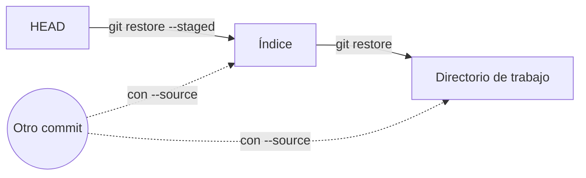

Las dos órdenes recorren al revés el camino de `git add` y `git commit` [h01-710, h01-711, h01-356, h01-357]. Con `--source` cambias la fuente por otro commit, que puedes nombrar por su hash, por una rama o por una etiqueta [h01-358, h01-359].

> **Error típico.** Lanzar `git restore factura.py` para «limpiar» y darte cuenta después de que querías ese cambio. La orden reemplaza el contenido del archivo por el del índice [h01-352, h01-357]. Si lo que había en el disco no estaba preparado ni confirmado, puede que no lo recuperes nunca [h01-347]. La forma que enseña Pro Git, `git checkout -- <archivo>`, también copia desde el índice, y el propio libro la llama peligrosa [h01-852, h01-341, h01-342]. La documentación actual la mantiene como uno de los dos modos de `git checkout` [h01-479]. Si dudas, confirma antes [h01-345].

Queda un cabo suelto del ejemplo 05. ¿Dónde está `ddf220e`? `git log` ya no lo enseña, pero sale en la segunda línea de `git reflog -2`. El *reflog* (registro de referencias) anota, en tu repositorio, cada vez que se movió la punta de una rama o de otra referencia [h01-774]. Sin argumentos, `git reflog` enseña el de `HEAD` [h01-777], y cada commit o cambio de rama le añade una entrada [h01-786]. Un commit sustituido con `--amend` se puede recuperar, y para eso lo primero es tener su hash [h01-346, h01-783]. Cuánto dura esa red y cómo se rescata un commit lo verás en la sección 1.7.

> **Ojo con la versión.** Pro Git en español saca un archivo del área de preparación con `git reset HEAD <archivo>`, que es lo que sugiere su `git status`, y descarta cambios con `git checkout -- <archivo>` [h01-336, h01-340]. El `git status` de Git 2.43, en el ejemplo 06, ya sugiere `git restore --staged` [h01-350]. Hoy, `git restore --staged <archivo>` hace lo mismo que `git reset <archivo>` [h01-361, h01-901]. `git checkout -- <archivo>` copia la versión del índice, igual que `git restore <archivo>` [h01-852, h01-357]. Y `git checkout <commit> -- <archivo>` pone la versión de ese commit en el archivo y en el índice [h01-853], que es lo que hace `git restore` con `--source`, `--staged` y `--worktree` a la vez [h01-358, h01-362, h01-851].

## 1.4 Las ramas son punteros

Una rama es un archivo que guarda el hash de un commit, y `HEAD` es otro archivo que dice en qué rama estás o, a veces, en qué commit. Confirmar adelanta una rama; fusionar adelanta un puntero o crea un commit con dos padres, y hay conflicto cuando los dos lados cambian de forma distinta la misma zona de un archivo.

Busca las ramas donde Git las guarda. El ejemplo parte de `facturas` con tres commits en `main`. Crea la rama `descuentos`, lee los archivos de las dos ramas y el de `HEAD`, se cambia a `descuentos` y confirma. Antes del `git add`, una línea de preparación oculta añade a `total` un parámetro `descuento`. Al final vuelve a leer los dos archivos de rama.

<!-- ejemplo: ejemplos/cap-01/07-rama-es-un-archivo.sh -->
```console
# Ejecutado con Bash 5.2.21, Git 2.43.0
$ git branch descuentos
$ cat .git/refs/heads/main
c87074a060dbf507d64ec3e5e304398bd8e17de3
$ cat .git/refs/heads/descuentos
c87074a060dbf507d64ec3e5e304398bd8e17de3
$ cat .git/HEAD
ref: refs/heads/main
$ git switch descuentos
Switched to branch 'descuentos'
$ cat .git/HEAD
ref: refs/heads/descuentos
$ git add factura.py
$ git commit -m "Empieza los descuentos"
[descuentos ac83193] Empieza los descuentos
 1 file changed, 2 insertions(+), 2 deletions(-)
$ cat .git/refs/heads/main
c87074a060dbf507d64ec3e5e304398bd8e17de3
$ cat .git/refs/heads/descuentos
ac83193a06c714aa6bc5936ce733ee5853d3c887
$ git log --oneline --decorate --graph --all
* ac83193 (HEAD -> descuentos) Empieza los descuentos
* c87074a (main) Cambia el tipo de IVA al 21 %
* c2466c3 Añade un ejemplo de uso al README
* ce4f8a1 Primera versión de la factura
```
<!-- /ejemplo -->

Justo después de `git branch descuentos`, los dos archivos contienen lo mismo: el hash completo de `c87074a`. Has creado un puntero nuevo al commit en el que estabas, pero sigues en `main` [h01-415, h01-417]. Ese puntero es un archivo de `.git/refs/heads` con los 40 caracteres del hash [h01-424, h01-655].

`.git/HEAD` no lleva un hash, sino `ref: refs/heads/main`, el nombre de otra referencia. Es una referencia simbólica que señala la rama en la que estás [h01-664, h01-665]. Tras `git switch descuentos`, esa línea dice `descuentos`.

Después del commit, el archivo de `main` sigue igual y el de `descuentos` guarda el hash nuevo, `ac83193`. Confirmar ha escrito objetos nuevos y ha movido la rama que señalaba `HEAD`, y ninguna otra [h01-643, h01-420]. Esa es la respuesta corta a qué cambia en el repositorio cuando haces un commit; la sección 1.6 cuenta esos objetos uno a uno. El último `git log` dibuja lo mismo, con cada rama junto a su commit [h01-423].

El modelo cabe en una frase: los commits no se mueven y los nombres sí. Un commit no cambia después de escrito y guarda el hash de su padre [h01-763, h01-570]. Una referencia, en cambio, puede pasar a señalar otro commit [h01-766]. `HEAD` señala la rama en la que estás [h01-416].

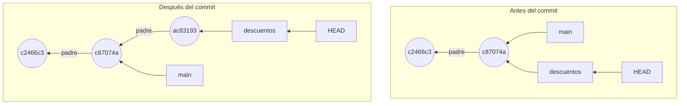

Entre los dos dibujos solo ha cambiado una flecha, la de `descuentos`.

¿Cuánto cuesta una rama? Escribir un archivo de 41 bytes: los 40 caracteres del hash y un fin de línea [h01-425]. No se copia ningún archivo del proyecto, y la operación es instantánea [h01-426]. Es el soporte para miles de ramas en paralelo que Git se puso como objetivo, el que viste en la sección 1.1 [h01-130].

¿Y si `HEAD` no lleva el nombre de una rama? El siguiente ejemplo vuelve a `facturas` con tres commits. Se coloca en `HEAD~1`, el segundo commit, con `git switch --detach`. Una preparación oculta añade a `factura.py` una línea con el IVA de Canarias y la prepara. El ejemplo confirma ese experimento, vuelve a `main` y lo rescata.

<!-- ejemplo: ejemplos/cap-01/10-head-desacoplado.sh -->
```console
# Ejecutado con Bash 5.2.21, Git 2.43.0
$ git switch --detach HEAD~1
HEAD is now at c2466c3 Añade un ejemplo de uso al README
$ cat .git/HEAD
c2466c3069368f441ff3f5b77e633c6f1d89ec71
$ git commit -m "Experimento: IVA de Canarias"
[detached HEAD bc671c4] Experimento: IVA de Canarias
 1 file changed, 1 insertion(+)
$ git switch main
Warning: you are leaving 1 commit behind, not connected to
any of your branches:

  bc671c4 Experimento: IVA de Canarias

Switched to branch 'main'
$ git log --oneline --all
c87074a Cambia el tipo de IVA al 21 %
c2466c3 Añade un ejemplo de uso al README
ce4f8a1 Primera versión de la factura
$ git reflog -4
c87074a HEAD@{0}: checkout: moving from bc671c4c1729981859fb461f6b0c345319ab1e57 to main
bc671c4 HEAD@{1}: commit: Experimento: IVA de Canarias
c2466c3 HEAD@{2}: checkout: moving from main to HEAD~1
c87074a HEAD@{3}: commit: Cambia el tipo de IVA al 21 %
$ git branch experimento HEAD@{1}
$ git log --oneline --all
bc671c4 Experimento: IVA de Canarias
c87074a Cambia el tipo de IVA al 21 %
c2466c3 Añade un ejemplo de uso al README
ce4f8a1 Primera versión de la factura
```
<!-- /ejemplo -->

Ahora `.git/HEAD` guarda un hash, el de `c2466c3`, y no una línea `ref:`. `--detach` sirve para ir a un commit a inspeccionarlo o a probar algo que puedes tirar [h01-474]. Funciona como cambiar de rama, salvo que `HEAD` señala el commit y no una rama [h01-482]. Este estado se llama *detached HEAD* (HEAD desacoplado) [h01-483].

El experimento, `bc671c4`, tiene como padre `c2466c3`, y solo `HEAD` lo señala [h01-484]. Al volver a `main`, Git avisa de que dejas atrás un commit que no está conectado a ninguna rama, y `git log --all` ya no lo enseña.

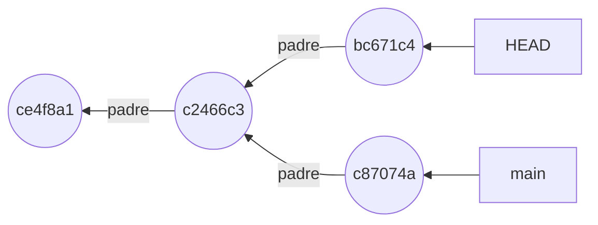

El dibujo es el momento justo antes de volver. Cuando `HEAD` pase a `main`, a `bc671c4` no le llegará ninguna flecha.

No se ha perdido. `git reflog -4` lo enseña en `HEAD@{1}`, la posición de `HEAD` un movimiento antes [h01-775]. Con ese nombre, `git branch experimento HEAD@{1}` le pone una rama, y el último `git log --all` vuelve a enseñarlo [h01-487, h01-788]. Si aún no te hubieras movido, bastaba con crear la rama allí mismo, con `git branch` o con `git switch -c` [h01-486].

¿Y si no lo rescatas? La documentación de `git checkout` lo cuenta con su propio ejemplo: un commit al que nada referencia acabará eliminado por la recolección de basura de Git [h01-485]. Hasta entonces, el reflog conserva su entrada, y las entradas que ya no son alcanzables caducan por defecto a los 30 días [h01-779, h01-871, h01-872].

Si una rama es un archivo, fusionar se entiende mirando qué archivo cambia. El ejemplo parte del punto en que terminó el 07: tres commits en `main` y `descuentos` con uno más, `ac83193`. Estás en `main`.

<!-- ejemplo: ejemplos/cap-01/08-avance-rapido.sh -->
```console
# Ejecutado con Bash 5.2.21, Git 2.43.0
$ cat .git/refs/heads/main
c87074a060dbf507d64ec3e5e304398bd8e17de3
$ cat .git/refs/heads/descuentos
ac83193a06c714aa6bc5936ce733ee5853d3c887
$ git merge descuentos
Updating c87074a..ac83193
Fast-forward
 factura.py | 4 ++--
 1 file changed, 2 insertions(+), 2 deletions(-)
$ cat .git/refs/heads/main
ac83193a06c714aa6bc5936ce733ee5853d3c887
```
<!-- /ejemplo -->

Para fusionar te colocas en la rama que recibe los cambios y le pasas la otra a `git merge` [h01-433]. Git contesta con un *fast-forward* (avance rápido): el archivo de `main` pasa de `c87074a` a `ac83193`, el mismo hash que `descuentos`. No hay commit nuevo. `ac83193` estaba justo por delante de `c87074a` y en `main` no había trabajo propio, así que a Git le basta con adelantar el puntero [h01-434, h01-435]. Es lo que hace `git merge --ff`: si se puede avanzar, actualiza la rama y no crea un commit de fusión [h01-497]. Aquí lo ha hecho sin pedírselo. Si quieres ese commit de todos modos, tienes `--no-ff` [h01-498].

¿Y si `main` también ha avanzado? Entonces el commit en el que estás no es antepasado directo del que fusionas, y adelantar no basta [h01-440]. Git hace una fusión a tres bandas. Toma las fotos de las dos puntas y la de su ancestro común, crea una foto nueva y la guarda en un commit con dos padres [h01-441, h01-442, h01-443, h01-445]. Buscar ese ancestro no te exige nada, porque cada commit sabe quiénes son sus padres [h01-427]. Lo que haga Git depende, por tanto, de la forma del grafo [h01-434, h01-440].

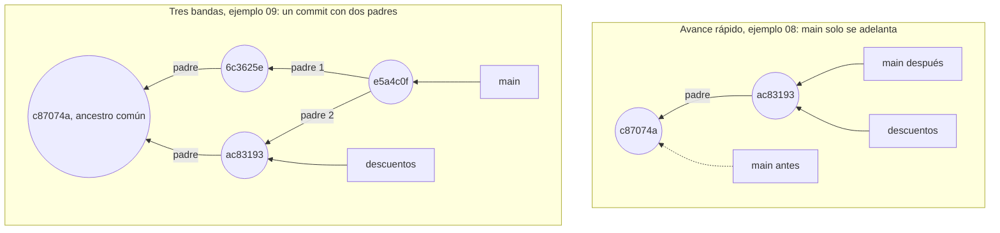

El último ejemplo monta ese segundo caso en una carpeta nueva. `facturas` tiene tres commits, `descuentos` tiene su commit `ac83193` y `main` avanza con otro que redondea el total, `6c3625e`. Ese nombre ya salió en el ejemplo 05: coinciden árbol, padre, autor, fecha y mensaje, y el hash sale de todo eso; la sección 1.6 lo explica [h01-638, h01-570, h01-639, h01-640, h01-647]. El ejemplo fusiona `descuentos` en `main`, resuelve el conflicto y lee el commit que resulta.

<!-- ejemplo: ejemplos/cap-01/09-conflicto.sh -->
```console
# Ejecutado con Bash 5.2.21, Git 2.43.0
$ git log --oneline --graph --all
* ac83193 Empieza los descuentos
| * 6c3625e Redondea el total a dos decimales
|/  
* c87074a Cambia el tipo de IVA al 21 %
* c2466c3 Añade un ejemplo de uso al README
* ce4f8a1 Primera versión de la factura
$ git merge descuentos
Auto-merging factura.py
CONFLICT (content): Merge conflict in factura.py
Automatic merge failed; fix conflicts and then commit the result.
$ git status
On branch main
You have unmerged paths.
  (fix conflicts and run "git commit")
  (use "git merge --abort" to abort the merge)

Unmerged paths:
  (use "git add <file>..." to mark resolution)
	both modified:   factura.py

no changes added to commit (use "git add" and/or "git commit -a")
$ cat factura.py
IVA = 0.21
def total(base, iva=IVA, descuento=0):
    """Calcula el total de una factura."""
<<<<<<< HEAD
    return round(base * (1 + iva), 2)
=======
    return base * (1 + iva) * (1 - descuento)
>>>>>>> descuentos
$ cat > factura.py <<'PY'
> IVA = 0.21
> def total(base, iva=IVA, descuento=0):
>     """Calcula el total de una factura."""
>     return round(base * (1 + iva) * (1 - descuento), 2)
> PY
$ git add factura.py
$ git commit -m "Fusiona los descuentos con el redondeo"
[main e5a4c0f] Fusiona los descuentos con el redondeo
$ git log --oneline --graph
*   e5a4c0f Fusiona los descuentos con el redondeo
|\  
| * ac83193 Empieza los descuentos
* | 6c3625e Redondea el total a dos decimales
|/  
* c87074a Cambia el tipo de IVA al 21 %
* c2466c3 Añade un ejemplo de uso al README
* ce4f8a1 Primera versión de la factura
$ git cat-file -p HEAD
tree 385c27e65b91457544ca1fd1d4815107d5aeb2d2
parent 6c3625ec7e97da8cf33b156f12063e9647bfc66c
parent ac83193a06c714aa6bc5936ce733ee5853d3c887
author devOC <devoc@ejemplo.dev> 1767265200 +0100
committer devOC <devoc@ejemplo.dev> 1767265200 +0100

Fusiona los descuentos con el redondeo
$ git log --oneline -1 HEAD^2
ac83193 Empieza los descuentos
```
<!-- /ejemplo -->

La primera salida dibuja la divergencia: dos líneas que salen de `c87074a`. Esta vez `git merge` se para con `CONFLICT (content)` y avisa de que la fusión automática ha fallado [h01-449]. No crea el commit de fusión, sino que deja el proceso a medias hasta que resuelvas [h01-450]. `git status` te dice dónde está el problema: `factura.py` aparece entre las rutas sin fusionar [h01-451, h01-452]. También te ofrece una salida, `git merge --abort`, que intenta dejarlo todo como antes de fusionar [h01-488, h01-489]. Esa vuelta atrás quizá no recupere cambios que no hubieras confirmado al empezar, y por eso la documentación recomienda confirmarlos o guardarlos antes de fusionar [h01-490, h01-491].

Ahora mira `factura.py`. La línea `def` ya trae el parámetro `descuento`. Solo la cambió `descuentos`, y lo que cambia un único lado entra tal cual en el resultado [h01-855]. Los marcadores encierran solo la línea `return`, que las dos ramas modificaron de forma distinta [h01-448, h01-453, h01-493]. Encima de `=======` va la versión de `HEAD`, la de `main` con el redondeo; debajo, la que llega de `descuentos` [h01-454, h01-494]. Si las dos ramas hubieran escrito la misma línea, no habría conflicto [h01-856].

Git no elige un lado al azar: te deja los dos y espera a que decidas [h01-492]. En el ejemplo, la decisión es combinar ambos cambios en un `return` que aplica el descuento y redondea. `git add` marca el archivo como resuelto [h01-456, h01-457], y `git commit -m` cierra la fusión con el mensaje que eliges [h01-460].

El `git log --graph` final enseña las dos líneas reunidas en `e5a4c0f`. `git cat-file -p HEAD` explica el dibujo: ese commit tiene dos líneas `parent` [h01-404]. La primera, `6c3625e`, es la rama en la que estabas, `main`; la segunda, `ac83193`, es la que fusionaste [h01-841]. Por eso `HEAD^2`, el segundo padre, nombra el commit de `descuentos` [h01-823]. Ese número detrás de `^` solo tiene sentido en un commit de fusión, el único con dos padres o más [h01-824].

> **Error típico.** Borrar una rama cuyo trabajo no has fusionado. `git branch --no-merged` te dice qué ramas están así, y `git branch -d` se niega a borrarlas [h01-467, h01-468]. Con `-D`, Git la borra igualmente [h01-469]. Sus commits solo vuelven si los rescatas del reflog, como el experimento de antes [h01-346]. Algo parecido protege tus archivos al cambiar de rama: si el cambio fuera a pisar modificaciones que no has confirmado, Git aborta la operación [h01-476].

> **Bajo el capó.** Los marcadores del ejemplo enseñan tu versión y la del otro lado, pero no qué decía esa zona antes de que nadie la tocara [h01-857]. Si fijas `merge.conflictStyle` en `diff3` o en `zdiff3`, Git añade un tercer bloque: tras un marcador `|||||||` pone el texto original, antes del `=======` [h01-495, h01-858]. En el ejemplo, ese bloque mostraría el `return` del ancestro común, `c87074a`, que ni redondeaba ni descontaba [h01-442, h01-858].

> **Ojo con la versión.** Pro Git cambia de rama con `git checkout <rama>` y crea una rama y salta a ella en un paso con `git checkout -b` [h01-418, h01-428]. Este libro usa `git switch` para cambiar de rama y `git switch -c` para crearla y cambiar a ella [h01-471, h01-473]. La documentación actual sigue describiendo `git checkout`, con dos modos: cambiar de rama y restaurar otra versión de un archivo [h01-479]. Para lo segundo tienes `git restore`, de la sección 1.3.

## 1.5 Rebase y reescribir historia

Rebase reaplica tus commits uno a uno sobre una base y, a partir del primero que cambia, todos los que salen son commits nuevos, con hashes nuevos; los antiguos se quedan sin rama [h01-859, h01-860, h01-764, h01-570]. La foto final puede coincidir con la de un merge, pero el historial es otro, y eso perjudica a quien ya trabajaba sobre los commits antiguos [h01-510, h01-520, h01-591].

### Lo que hizo la primera orden del asistente

La primera orden de «El problema» fue `git rebase -i HEAD~4`. La `-i` pide el modo interactivo, que es la herramienta de Git para modificar commits que ya no están en la punta [h01-540, h01-542]. Antes de ejecutar nada, Git te enseña una lista de tareas para que la edites [h01-547, h01-807].

El ejemplo parte de `facturas` con tres commits en `main` y `exportar-csv` con los cuatro de «El problema»: A añade la exportación, B pone una cabecera con el separador equivocado, C la corrige y D es la prueba que sobra. En vez de abrir un editor, usa el comando de la variable `GIT_SEQUENCE_EDITOR`, que manda sobre la configuración `sequence.editor` [h01-807, h01-808]. La primera vez solo imprime la lista; la segunda pone `fixup` en la línea 3 y `drop` en la 4, como el asistente. `-q` silencia el rebase [h01-842]. La preparación cambia la fecha de confirmación antes de los rebases: un hash que se conserva prueba que Git no tocó ese commit [h01-639, h01-647].

<!-- ejemplo: ejemplos/cap-01/13-rebase-interactivo.sh -->
```console
# Ejecutado con Bash 5.2.21, Git 2.43.0
$ git log --oneline
7135be3 Prueba el formato con punto y coma
28fab7a Corrige el separador de la cabecera
0da1b36 Añade la cabecera al CSV
00f86cc Añade exportación a CSV
c87074a Cambia el tipo de IVA al 21 %
c2466c3 Añade un ejemplo de uso al README
ce4f8a1 Primera versión de la factura
$ GIT_SEQUENCE_EDITOR="grep '^[a-z]'" git rebase -q -i HEAD~4
pick 00f86cc Añade exportación a CSV
pick 0da1b36 Añade la cabecera al CSV
pick 28fab7a Corrige el separador de la cabecera
pick 7135be3 Prueba el formato con punto y coma
$ git log --oneline
7135be3 Prueba el formato con punto y coma
28fab7a Corrige el separador de la cabecera
0da1b36 Añade la cabecera al CSV
00f86cc Añade exportación a CSV
c87074a Cambia el tipo de IVA al 21 %
c2466c3 Añade un ejemplo de uso al README
ce4f8a1 Primera versión de la factura
$ GIT_SEQUENCE_EDITOR="sed -i -e '3s/^pick/fixup/' -e '4s/^pick/drop/'" git rebase -q -i HEAD~4
$ git log --oneline
17e65b4 Añade la cabecera al CSV
00f86cc Añade exportación a CSV
c87074a Cambia el tipo de IVA al 21 %
c2466c3 Añade un ejemplo de uso al README
ce4f8a1 Primera versión de la factura
```
<!-- /ejemplo -->

Mira la lista. Cada línea es un commit con una acción delante, y el orden es el contrario al de `git log`, con el más antiguo arriba. Git la ejecuta de arriba abajo [h01-546, h01-553]. Cada línea reaplica su commit, uno detrás de otro [h01-859].

Con la lista intacta, los cuatro hashes no cambian. Por defecto, cuando un commit quedaría igual, Git avanza sobre él sin reescribirlo [h01-860]. Solo con `--no-ff` los reaplicaría todos y la rama entera estaría hecha de commits nuevos [h01-860, h01-861].

Con la lista del asistente, A conserva `00f86cc`. En su lugar, B pasa a ser `17e65b4`, un B' que ya lleva dentro la corrección: `fixup` fundió C con B y tiró su mensaje, y `drop` quitó D [h01-552, h01-580]. B' es nuevo porque su contenido cambió. Si hubieras tocado la línea 1, los cuatro serían nuevos: cada commit guarda el hash de su padre, así que un padre distinto da un hijo distinto [h01-570, h01-764]. Hay más acciones, entre otras `reword` (cambiar el mensaje), `edit` (detenerse en el commit) y `squash` (fundir sin tirar el mensaje) [h01-549, h01-550, h01-551, h01-552].

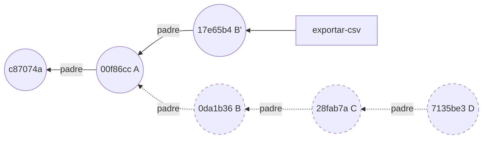

B, C y D, en discontinuo, siguen existiendo, pero ninguna rama los señala: el rebase no los editó, creó B' y movió `exportar-csv` hasta él [h01-763, h01-764]. Es la misma idea que viste con `--amend` en la sección 1.3: no se edita, se sustituye.

### Rebase sobre otra rama

`git rebase main` hace la misma reaplicación, pero sobre otra base. Git apunta los commits de tu rama que `main` no tiene, se coloca en la punta de `main` con `HEAD` desacoplado (sección 1.4), los reaplica uno a uno y, al final, mueve tu rama al último [h01-859].

El ejemplo parte de la rama ya limpia: `exportar-csv` con A y B' sobre el tercer commit, y `main` con un commit más, los tests de Marta. B' tiene aquí otro hash, `68dcc79`, porque la preparación lo crea con otra fecha; el contenido es el mismo [h01-639, h01-647].

<!-- ejemplo: ejemplos/cap-01/11-rebase.sh -->
```console
# Ejecutado con Bash 5.2.21, Git 2.43.0
$ git switch exportar-csv
Switched to branch 'exportar-csv'
$ git log --oneline --graph --all
* 68dcc79 Añade la cabecera al CSV
* 00f86cc Añade exportación a CSV
| * 795693a Añade tests de total
|/  
* c87074a Cambia el tipo de IVA al 21 %
* c2466c3 Añade un ejemplo de uso al README
* ce4f8a1 Primera versión de la factura
$ git rebase -q main
$ git log --oneline --graph --all
* 1723109 Añade la cabecera al CSV
* 2cdbc4b Añade exportación a CSV
* 795693a Añade tests de total
* c87074a Cambia el tipo de IVA al 21 %
* c2466c3 Añade un ejemplo de uso al README
* ce4f8a1 Primera versión de la factura
$ git switch main
Switched to branch 'main'
$ git merge exportar-csv
Updating 795693a..1723109
Fast-forward
 exportar.py | 3 +++
 1 file changed, 3 insertions(+)
 create mode 100644 exportar.py
```
<!-- /ejemplo -->

Antes del rebase, las dos ramas salen de `c87074a`. Después, el historial es una sola línea, y los dos commits de la exportación cuelgan de `795693a`, el de Marta [h01-503, h01-511]. Esta vez cambian los dos, A incluido (`2cdbc4b` y `1723109`), porque el primero ya tiene otro padre y arrastra al segundo [h01-570, h01-571]. La fusión final desde `main` es un avance rápido: `main` solo tiene que avanzar [h01-509, h01-434]. Pro Git aconseja reorganizar así antes de enviar tu trabajo al proyecto principal: a quien lo mantiene le basta, dice, «un avance rápido o una incorporación limpia» [h01-512, h01-513].

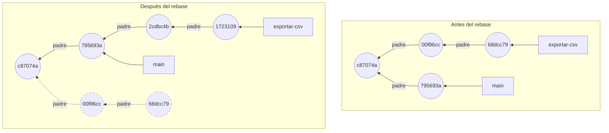

### Qué ganas frente a un merge

El ejemplo 12 parte del mismo estado que el 11, con dos ramas en la punta de `exportar-csv`: integra `main` en `con-merge` con una fusión y en `con-rebase` con un rebase.

<!-- ejemplo: ejemplos/cap-01/12-misma-foto.sh -->
```console
# Ejecutado con Bash 5.2.21, Git 2.43.0
$ git switch con-merge
Switched to branch 'con-merge'
$ git merge main -m "Integra main en con-merge"
Merge made by the 'ort' strategy.
 tests/test_factura.py | 3 +++
 1 file changed, 3 insertions(+)
 create mode 100644 tests/test_factura.py
$ git switch con-rebase
Switched to branch 'con-rebase'
$ git rebase -q main
$ git diff con-merge con-rebase
$ git cat-file -p con-merge | head -n 1
tree e7e3ac802fb69892ddda0dcff783da904beca5ac
$ git cat-file -p con-rebase | head -n 1
tree e7e3ac802fb69892ddda0dcff783da904beca5ac
$ git log --oneline --graph con-merge
*   648a3fc Integra main en con-merge
|\  
| * 795693a Añade tests de total
* | 68dcc79 Añade la cabecera al CSV
* | 00f86cc Añade exportación a CSV
|/  
* c87074a Cambia el tipo de IVA al 21 %
* c2466c3 Añade un ejemplo de uso al README
* ce4f8a1 Primera versión de la factura
$ git log --oneline --graph con-rebase
* 1723109 Añade la cabecera al CSV
* 2cdbc4b Añade exportación a CSV
* 795693a Añade tests de total
* c87074a Cambia el tipo de IVA al 21 %
* c2466c3 Añade un ejemplo de uso al README
* ce4f8a1 Primera versión de la factura
```
<!-- /ejemplo -->

`git diff` entre las dos puntas no imprime nada, y la línea `tree` de las dos es `e7e3ac8` [h01-843, h01-638]. Tus archivos quedan igual por los dos caminos [h01-510]. Cambia el grafo: `con-merge` acaba en `648a3fc`, un commit con dos padres que junta las dos puntas, y `con-rebase` es una línea recta [h01-404, h01-515, h01-511].

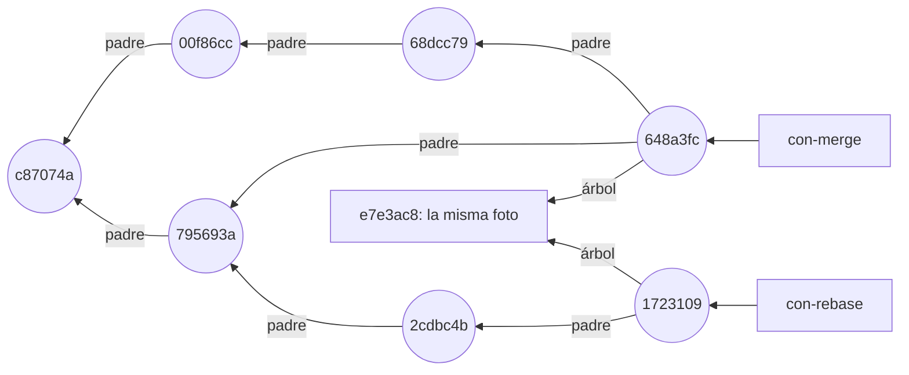

> **Ojo con la versión.** La fusión la hizo `ort`, la estrategia por defecto al fusionar una sola rama, que sustituyó a `recursive`, la de por defecto hasta Git 2.33.0 [h01-801, h01-803, h01-806]. La documentación actual dice que `recursive` es otro nombre de `ort`, pero eso llegó en Git 2.50.0; en tu Git 2.43 aún es una implementación distinta [h01-804, h01-805].

### Caso límite: un conflicto a mitad del rebase

Al reaplicar un commit, sus cambios pueden chocar con los de la nueva base. El ejemplo 14 parte de `facturas` con tres commits. En `exportar-csv` hay dos: A y otro que añade una línea al final del README. `main` tiene un cuarto commit que añade otra línea distinta en el mismo sitio.

<!-- ejemplo: ejemplos/cap-01/14-rebase-conflicto.sh -->
```console
# Ejecutado con Bash 5.2.21, Git 2.43.0
$ git switch exportar-csv
Switched to branch 'exportar-csv'
$ git log --oneline --graph --all
* cfbac44 Documenta la exportación en el README
* 00f86cc Añade exportación a CSV
| * 42dd13a Documenta cómo ejecutar los tests
|/  
* c87074a Cambia el tipo de IVA al 21 %
* c2466c3 Añade un ejemplo de uso al README
* ce4f8a1 Primera versión de la factura
$ git rebase main
Rebasing (1/2)
Rebasing (2/2)
Auto-merging README.md
CONFLICT (content): Merge conflict in README.md
error: could not apply cfbac44... Documenta la exportación en el README
hint: Resolve all conflicts manually, mark them as resolved with
hint: "git add/rm <conflicted_files>", then run "git rebase --continue".
hint: You can instead skip this commit: run "git rebase --skip".
hint: To abort and get back to the state before "git rebase", run "git rebase --abort".
Could not apply cfbac44... Documenta la exportación en el README
$ git status
interactive rebase in progress; onto 42dd13a
Last commands done (2 commands done):
   pick 00f86cc Añade exportación a CSV
   pick cfbac44 Documenta la exportación en el README
No commands remaining.
You are currently rebasing branch 'exportar-csv' on '42dd13a'.
  (fix conflicts and then run "git rebase --continue")
  (use "git rebase --skip" to skip this patch)
  (use "git rebase --abort" to check out the original branch)

Unmerged paths:
  (use "git restore --staged <file>..." to unstage)
  (use "git add <file>..." to mark resolution)
	both modified:   README.md

no changes added to commit (use "git add" and/or "git commit -a")
$ git rebase --abort
$ git log --oneline --graph --all
* cfbac44 Documenta la exportación en el README
* 00f86cc Añade exportación a CSV
| * 42dd13a Documenta cómo ejecutar los tests
|/  
* c87074a Cambia el tipo de IVA al 21 %
* c2466c3 Añade un ejemplo de uso al README
* ce4f8a1 Primera versión de la factura
```
<!-- /ejemplo -->

El rebase reaplica A y se detiene en el segundo commit, con el README en conflicto. `git status` te enseña las órdenes ya hechas, con el mismo `pick` de la lista interactiva. Tienes tres salidas. Puedes resolver el conflicto, prepararlo y seguir con `git rebase --continue` [h01-574]. Puedes saltarte ese commit con `--skip` [h01-576]. O puedes abandonar con `--abort`, que devuelve la rama a su estado original [h01-575]. El ejemplo elige la última, y el `git log` final es idéntico al del principio.

¿Por qué pone «interactive rebase in progress» si no escribiste `-i`? Git tiene dos *backends* (motores internos) para el rebase, `apply` y `merge`, y usa `merge` por defecto [h01-862, h01-863]. Ese motor se llamaba antes «interactive», y hoy se usa también en los rebases que no son interactivos [h01-908, h01-909].

> **Ojo con la versión.** Pro Git describe un rebase que guarda en archivos temporales las diferencias de cada commit y las aplica después sobre la otra rama [h01-504, h01-505, h01-506, h01-507, h01-508]. Esta sección sigue la documentación actual, la de los cuatro pasos y el *backend* `merge`, que es lo que enseña tu Git 2.43 [h01-859, h01-863].

### Vuelta a Marta

El rebase del asistente abandonó B, C y D, sobre los que ella había empezado su rama, y creó B', parecido pero distinto [h01-520]. Luego `push --force` sobrescribió lo que había en el servidor con tu rama nueva; los remotos llegan en el capítulo 2 [h01-522]. Desde ese momento, Marta tiene que arreglar su historial a mano [h01-591] y reorganizar sus commits sobre tu punta nueva [h01-593].

El problema no es que la foto final se parezca. Es que desaparecieron de la rama unos commits que otra persona usaba como base, y en su lugar hay otros [h01-520, h01-521]. De ahí la regla: reorganiza tu trabajo local mientras nadie más lo tenga, y no reorganices lo que ya has compartido [h01-535, h01-519, h01-529].

> **Ojo con la versión.** Pro Git cuenta que, tras un rebase publicado, `git pull` crea una fusión con las dos líneas del historial, y que `git log` enseña commits repetidos con el mismo autor, fecha y mensaje [h01-523, h01-524]. Según la documentación actual de `git pull`, si no eliges cómo reconciliar ramas que han divergido, solo hace avances rápidos y falla si la tuya ha divergido [h01-880, h01-881]. Con `--no-rebase` fusiona y con `--rebase` reorganiza [h01-882, h01-883], y puedes fijar tu preferencia con `pull.rebase` [h01-885]. Es lo que le pasó a Marta: Git se negó y, al forzar ella la fusión, aparecieron tus commits viejos junto al nuevo. Hace falta un remoto para verlo, así que este capítulo no lo ejecuta.

> **Bajo el capó.** ¿Puede Git ahorrarle trabajo a Marta? A veces. Además del hash, calcula para cada commit un `patch-id`, que sale solo de los cambios que introduce [h01-525]. Si Marta reorganiza su rama sobre tu commit nuevo, es posible que Git distinga qué cambios eran suyos y aplique solo esos, pero solo si tus parches viejos y los nuevos se parecen mucho [h01-526, h01-527]. Pro Git propone `git pull --rebase` para simplificarlo [h01-528, h01-530].

> PENDIENTE: «En un proyecto real» sobre cómo integran los PR gentle-shell o FastAPI (squash, rebase o merge); faltan sus guías de contribución, que llegan con el capítulo 2.

### Deshacer sin reescribir

Si el commit que quieres deshacer ya está en una rama compartida, la regla anterior te impide reescribirlo, y `git revert` no lo necesita. El ejemplo parte de `facturas` con cinco commits en `main` y deshace el del IVA, dos por debajo de la punta.

<!-- ejemplo: ejemplos/cap-01/15-revert.sh -->
```console
# Ejecutado con Bash 5.2.21, Git 2.43.0
$ git log --oneline
938b805 Documenta el IVA en el README
795693a Añade tests de total
c87074a Cambia el tipo de IVA al 21 %
c2466c3 Añade un ejemplo de uso al README
ce4f8a1 Primera versión de la factura
$ git revert --no-edit HEAD~2
[main bb7d784] Revert "Cambia el tipo de IVA al 21 %"
 Date: Thu Jan 1 12:00:00 2026 +0100
 1 file changed, 1 insertion(+), 1 deletion(-)
$ git log --oneline
bb7d784 Revert "Cambia el tipo de IVA al 21 %"
938b805 Documenta el IVA en el README
795693a Añade tests de total
c87074a Cambia el tipo de IVA al 21 %
c2466c3 Añade un ejemplo de uso al README
ce4f8a1 Primera versión de la factura
$ git log --stat -1
commit bb7d78477908485454edfb04000bbc5163a57b4f
Author: devOC <devoc@ejemplo.dev>
Date:   Thu Jan 1 12:00:00 2026 +0100

    Revert "Cambia el tipo de IVA al 21 %"
    
    This reverts commit c87074a060dbf507d64ec3e5e304398bd8e17de3.

 factura.py | 2 +-
 1 file changed, 1 insertion(+), 1 deletion(-)
```
<!-- /ejemplo -->

Los cinco commits conservan sus hashes y encima aparece `bb7d784`, que cambia una línea de `factura.py` y dice en su mensaje qué commit revierte. `git revert` registra un commit nuevo que anula el efecto de otro, sin tocar los anteriores [h01-594]. Necesita un directorio de trabajo sin cambios respecto a `HEAD` [h01-595]. Si el commit es una fusión, tienes que decirle con `-m` qué padre es la línea principal [h01-598].

## 1.6 Bajo el capó: objetos y referencias

En `.git` hay dos clases de piezas. Los objetos no cambian nunca y se nombran por el hash de su contenido: *blobs* (objetos binarios), árboles, commits y etiquetas anotadas. Las referencias, en cambio, sí cambian [h01-673, h01-627, h01-766, h01-214]. Todo lo que cambia un comando se reduce a añadir objetos y a añadir o mover referencias [h01-768].

La segunda pregunta de «El problema» era dónde están los commits que «desaparecieron». Para contestarla mira qué es un commit en disco. En la sección 1.2 asomaste a uno con `git cat-file -p`, y en la 1.4 viste que una rama es un archivo con un hash; ahora bajas del todo.

### De `HEAD` a un archivo

El ejemplo parte de `facturas` con cuatro commits, el último el de los tests de Marta, y estás en `main`. Baja de arriba abajo: `HEAD`, la rama, el commit, su árbol, el subárbol `tests` y un archivo.

<!-- ejemplo: ejemplos/cap-01/18-arbol-y-commit.sh -->
```console
# Ejecutado con Bash 5.2.21, Git 2.43.0
$ cat .git/HEAD
ref: refs/heads/main
$ cat .git/refs/heads/main
795693a3558a7d3086daa5692c61635643e96470
$ git cat-file -t $(cat .git/refs/heads/main)
commit
$ git cat-file -p $(cat .git/refs/heads/main)
tree 49049ff53a78a6c89a52640220800608fc6140d5
parent c87074a060dbf507d64ec3e5e304398bd8e17de3
author Marta Ruiz <marta@ejemplo.dev> 1767265200 +0100
committer devOC <devoc@ejemplo.dev> 1767265200 +0100

Añade tests de total
$ git cat-file -p HEAD^{tree}
100644 blob 7a60b85e148f80966a550e5ab6a762a907c69ca6	.gitignore
100644 blob 866692569556ca36d04daf1b94ed88ee9e03606f	README.md
100644 blob 8ff14bec51fd28b8c6601ab9bcafa262cae0cbdb	factura.py
040000 tree e11b3b861512536ee23c90a2742f7f968593a4a7	tests
$ git cat-file -p e11b3b861512536ee23c90a2742f7f968593a4a7
100644 blob 549689f79d442dbb2706af1b1c4bf69f0cbc3ef3	test_factura.py
$ git cat-file -p 549689f79d442dbb2706af1b1c4bf69f0cbc3ef3
from factura import total
def test_total_con_iva_general():
    assert total(100) == 121.0
$ ls .git/objects/54
9689f79d442dbb2706af1b1c4bf69f0cbc3ef3
```
<!-- /ejemplo -->

Léelo nivel a nivel:

- **`HEAD`** no tiene un hash, sino el nombre de la rama en la que estás: es una referencia simbólica [h01-664]. **La rama** es un archivo de `.git/refs` con un hash dentro, `795693a` [h01-652].
- **`git cat-file`** es de los comandos que Pro Git llama «de fontanería», muchos pensados más para scripts que para teclearlos, frente a los «de porcelana», más amigables [h01-603, h01-604]. Con `-t` te dice el tipo del objeto, `commit`, y con `-p` te enseña su contenido [h01-625, h01-624].
- **El commit** es un texto corto. `tree` señala la foto del proyecto [h01-638]. `parent` señala el commit anterior, `c87074a` [h01-570]. Siguen dos líneas con personas: la autora, Marta, y el confirmador, cada uno con su nombre, su correo y una marca de tiempo, el número `1767265200`. Tras una línea vacía va el mensaje [h01-639, h01-640].
- **El árbol** tiene una línea por entrada: modo, tipo, hash y nombre [h01-630]. `100644` es un archivo normal [h01-635]. `tests` no es un archivo, sino otro árbol: así guarda Git las carpetas [h01-632, h01-629]. Los nombres de archivo viven en los árboles [h01-628].
- **El archivo** se guarda como blob (el nombre viene de *binary large object*, objeto binario grande), que tiene el contenido y nada más; ni siquiera el nombre [h01-626, h01-627].
- **En disco**, en principio, cada objeto es un archivo dentro de `.git/objects`: la subcarpeta se llama como los dos primeros caracteres del hash, `54`, y el archivo, como los 38 restantes [h01-621, h01-622, h01-644].

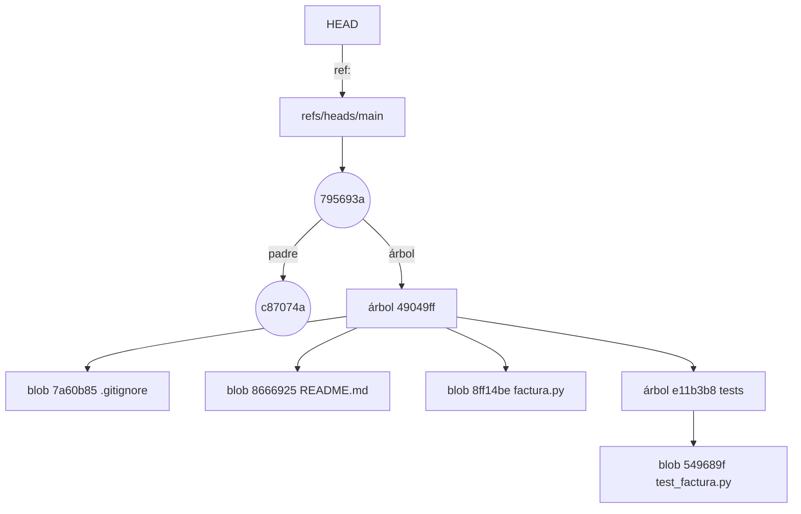

### El nombre sale del contenido

En la sección 1.2 leíste que el hash sale del contenido; ahora lo compruebas. El ejemplo parte de `facturas` con tres commits, pide a Git el hash de `factura.py` de dos formas y lo calcula después en Python.

<!-- ejemplo: ejemplos/cap-01/17-hash-a-mano.sh -->
```console
# Ejecutado con Bash 5.2.21, Git 2.43.0, Python 3.13.18
$ git ls-tree HEAD factura.py
100644 blob 8ff14bec51fd28b8c6601ab9bcafa262cae0cbdb	factura.py
$ git hash-object factura.py
8ff14bec51fd28b8c6601ab9bcafa262cae0cbdb
$ python3 - <<'PY'
> import hashlib, zlib
> contenido = open("factura.py", "rb").read()
> cabecera = b"blob %d\0" % len(contenido)
> hash_a_mano = hashlib.sha1(cabecera + contenido).hexdigest()
> print("hash a mano:", hash_a_mano)
> ruta = f".git/objects/{hash_a_mano[:2]}/{hash_a_mano[2:]}"
> guardado = zlib.decompress(open(ruta, "rb").read())
> print("cabecera guardada:", guardado.split(b"\0")[0])
> print("contenido igual:", guardado == cabecera + contenido)
> PY
hash a mano: 8ff14bec51fd28b8c6601ab9bcafa262cae0cbdb
cabecera guardada: b'blob 108'
contenido igual: True
```
<!-- /ejemplo -->

La primera orden enseña la entrada de `factura.py` en el árbol de `HEAD`, con el hash `8ff14be` [h01-630]. Es el mismo que viste en el ejemplo 18: `factura.py` no cambió entre el tercer commit y el cuarto, así que Git reutilizó su blob [h01-204]. `git hash-object` sin `-w` calcula el hash del archivo sin guardar nada [h01-617, h01-618]. El bloque de Python antepone una cabecera al contenido (la palabra `blob`, un espacio, el tamaño y un byte nulo) y saca el SHA-1 del conjunto [h01-645, h01-646, h01-647, h01-294]. Le sale el mismo hash. Después abre el archivo de ese objeto y lo descomprime con zlib, porque Git guarda los objetos comprimidos [h01-648]. Dentro están la cabecera, `blob 108`, y el contenido exacto de `factura.py`.

Árboles y commits se guardan igual, con `tree` o `commit` en la cabecera, y su contenido sigue un formato fijo [h01-649, h01-650, h01-651]. Por eso el hash de un commit depende de su árbol, de sus padres, de quién lo hizo y cuándo, y del mensaje [h01-638, h01-639, h01-640, h01-647]. Si cambias un commit, cambia su hash, y con él el de todos los que lo tienen detrás, porque cada uno guarda el de su padre [h01-570, h01-571]. Es lo que viste en la sección 1.5: B' nuevo y A intacto.

> **Bajo el capó.** Cada ejemplo del capítulo se ejecuta en una carpeta nueva, y aun así el primer commit de `facturas` es siempre `ce4f8a1`. Es porque el entorno de los ejemplos fija el autor, el confirmador y la fecha, y esos datos entran en el hash del commit [h01-639, h01-647]. En tu máquina, con tu nombre y tu hora, los commits tendrán otros hashes. Los blobs y los árboles, no: si el contenido es idéntico, el hash también lo es [h01-294, h01-630]. Por eso `8ff14be` aparece igual en los ejemplos 17 y 18.

### Qué escribe un commit

El ejemplo 16 parte de `facturas` con cuatro commits. Cuenta los archivos de `.git/objects` y lee el de `main`, confirma una prueba nueva en `tests/test_factura.py` y repite las dos lecturas.

<!-- ejemplo: ejemplos/cap-01/16-dentro-de-git.sh -->
```console
# Ejecutado con Bash 5.2.21, Git 2.43.0
$ find .git/objects -type f | wc -l
15
$ cat .git/refs/heads/main
795693a3558a7d3086daa5692c61635643e96470
$ echo "def test_sin_iva():" >> tests/test_factura.py
$ echo "    assert total(100, iva=0) == 100" >> tests/test_factura.py
$ git add tests/test_factura.py
$ git commit -m "Prueba el total sin IVA"
[main d4b3b8a] Prueba el total sin IVA
 1 file changed, 2 insertions(+)
$ find .git/objects -type f | wc -l
19
$ cat .git/refs/heads/main
d4b3b8a8c2adb6cf899bbab2b2b324d52c078271
$ git rev-list --objects HEAD~1..HEAD
d4b3b8a8c2adb6cf899bbab2b2b324d52c078271
41ecff1245d291289fd7eb15964bbd89e2062b19 
e732f7f58e0ded9b1f7001ee934d1912d2ccae81 tests
cb2faffa743532d1cc34d41d3314f5c9d131ebb9 tests/test_factura.py
```
<!-- /ejemplo -->

Los objetos pasan de 15 a 19, y el archivo de `main` cambia de `795693a` a `d4b3b8a`. Los cuatro objetos nuevos son los que imprime la última orden. Hay un blob con el nuevo `test_factura.py` (`cb2faff`) y un árbol `tests` que lo contiene (`e732f7f`). Hay también un árbol raíz nuevo, la línea sin nombre (`41ecff1`), porque una de sus entradas cambió. Y está el commit, `d4b3b8a` [h01-643, h01-630, h01-647]. `README.md`, `.gitignore` y `factura.py` no se guardan otra vez: el árbol nuevo apunta a sus blobs de siempre [h01-204]. Cuatro objetos añadidos y una referencia movida: eso es un commit visto por dentro [h01-768, h01-766].

### Las otras referencias

Ya conoces las ramas y `HEAD`. Quedan las etiquetas, que en este capítulo caben en dos frases, y las remotas. Una etiqueta suele señalar un commit y, a diferencia de una rama, no se mueve; la ligera es solo esa referencia [h01-675, h01-677]. La anotada, que se crea con `git tag -a`, apunta a un cuarto tipo de objeto con su mensaje y una línea `tagger` con quién la creó y cuándo [h01-673, h01-679, h01-680, h01-875]. Las referencias remotas marcan dónde estaba cada rama de un remoto la última vez que hablaste con él; las verás en el capítulo 2 [h01-683, h01-687].

> **Error típico.** Como una rama es un archivo con un hash, es tentador editarlo a mano, y técnicamente funciona [h01-655]. No lo hagas: Pro Git lo desaconseja y propone `git update-ref`, que es mucho más seguro [h01-657, h01-658]. Para `HEAD` existe `git symbolic-ref`, que además no te deja apuntarlo fuera de `refs` [h01-669, h01-672].

> **Ojo con la versión.** Los hashes de este capítulo son SHA-1, el algoritmo por defecto de `git init`; con `--object-format=sha256`, si está habilitado, el repositorio usa SHA-256 [h01-280]. En 2017 el ataque SHAttered demostró una colisión práctica de SHA-1 [h01-288]. Desde Git 2.13.0 se usa una versión reforzada que resiste ese ataque, pero SHA-1 sigue siendo débil, y a finales de 2018 el proyecto eligió SHA-256 como sucesor [h01-289, h01-290, h01-292]. Por ahora los repositorios de un formato y del otro no interoperan [h01-283]. El cálculo del ejemplo 17 es el de tus repositorios, salvo que crees uno con SHA-256.

### Dónde están tus commits

Los commits que el asistente quitó de tu rama siguen en `.git/objects`: los objetos no cambian, y sus órdenes crearon commits nuevos y movieron la rama, pero no borraron los antiguos [h01-763, h01-764, h01-346]. Lo que ya no tienen es una referencia que llegue hasta ellos. Como viste en la sección 1.4, un commit al que nada señala acabará borrado por la recolección de basura [h01-485]. Hasta entonces, el reflog conserva por dónde pasó la rama [h01-774], y la sección 1.7 lo usa para recuperarlos.

## 1.7 reset sin miedo

Sin ruta, `git reset` lleva la rama en la que estás a otro commit y, según el modo, copia además ese commit al índice y al directorio de trabajo [h01-718, h01-724, h01-728]. Lo confirmado sigue localizable en el reflog durante un tiempo; lo que `--hard` pisa sin que lo hubieras confirmado no vuelve [h01-774, h01-870, h01-872, h01-733].

### Lo que hizo el asistente

Tras el rebase interactivo de la sección 1.5, `exportar-csv` tiene dos commits propios, A y B', encima del tercer commit de `main`. El ejemplo 21 arranca ahí y ejecuta las órdenes 2 y 3 del asistente.

<!-- ejemplo: ejemplos/cap-01/21-reset-tres-modos.sh -->
```console
# Ejecutado con Bash 5.2.21, Git 2.43.0
$ git log --oneline
17e65b4 Añade la cabecera al CSV
00f86cc Añade exportación a CSV
c87074a Cambia el tipo de IVA al 21 %
c2466c3 Añade un ejemplo de uso al README
ce4f8a1 Primera versión de la factura
$ git reset --soft HEAD~2
$ git status -s
A  exportar.py
$ git log --oneline
c87074a Cambia el tipo de IVA al 21 %
c2466c3 Añade un ejemplo de uso al README
ce4f8a1 Primera versión de la factura
$ git commit -m "Añade la exportación a CSV"
[exportar-csv 77efd1e] Añade la exportación a CSV
 1 file changed, 3 insertions(+)
 create mode 100644 exportar.py
$ git log --oneline
77efd1e Añade la exportación a CSV
c87074a Cambia el tipo de IVA al 21 %
c2466c3 Añade un ejemplo de uso al README
ce4f8a1 Primera versión de la factura
$ git reflog -3
77efd1e HEAD@{0}: commit: Añade la exportación a CSV
c87074a HEAD@{1}: reset: moving to HEAD~2
17e65b4 HEAD@{2}: rebase (finish): returning to refs/heads/exportar-csv
```
<!-- /ejemplo -->

Tras `git reset --soft HEAD~2`, `git log` ya no enseña `17e65b4` ni `00f86cc`: la rama ha retrocedido dos commits, hasta `c87074a` [h01-718, h01-828]. Pero `git status -s` dice `A  exportar.py`: el contenido de B' sigue preparado. Ni el índice ni tu disco se han movido; solo la rama [h01-891, h01-720, h01-715]. Después, `git commit` guarda lo preparado en un único commit nuevo, `77efd1e`, hijo de `c87074a` [h01-711, h01-742, h01-570]. El `git reflog -3` del final lo resume visto desde `HEAD`: de abajo arriba, rebase, reset y commit [h01-775, h01-778].

La documentación actual de `git reset` propone esta misma pareja para juntar varios commits en uno, siempre que antes no tengas nada preparado [h01-892]. Pro Git la presenta como una de las formas de aplastar commits [h01-874]; en la sección 1.5 viste otra, el `fixup` de la lista del rebase [h01-552].

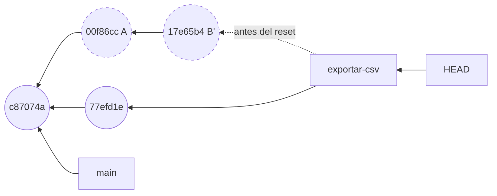

En el dibujo, `exportar-csv` deja de señalar a B' y pasa al commit nuevo. A y B' no se han borrado ni modificado, pero ya ninguna rama llega hasta ellos [h01-763, h01-764, h01-766].

### Los tres modos desde el mismo punto

¿Y si el asistente hubiera escrito otro modo? El ejemplo 25 parte del mismo estado y prueba los tres; entre uno y otro vuelve al punto de partida sin enseñarlo.

<!-- ejemplo: ejemplos/cap-01/25-tres-modos-mismo-punto.sh -->
```console
# Ejecutado con Bash 5.2.21, Git 2.43.0
$ git log --oneline
17e65b4 Añade la cabecera al CSV
00f86cc Añade exportación a CSV
c87074a Cambia el tipo de IVA al 21 %
c2466c3 Añade un ejemplo de uso al README
ce4f8a1 Primera versión de la factura
$ git reset --soft HEAD~2
$ git status -s
A  exportar.py
$ ls
README.md
exportar.py
factura.py
$ git reset HEAD~2
$ git status -s
?? exportar.py
$ ls
README.md
exportar.py
factura.py
$ git reset --hard HEAD~2
HEAD is now at c87074a Cambia el tipo de IVA al 21 %
$ git status -s
$ ls
README.md
factura.py
```
<!-- /ejemplo -->

La rama acaba siempre en `c87074a`; lo que cambia es dónde queda `exportar.py`. Con `--soft`, preparado y en el disco [h01-891]. Sin modo, que equivale a `--mixed` [h01-888], Git rehace el índice a partir de `c87074a`, que no tiene ese archivo, y por eso sale `??` aunque `ls` lo siga viendo [h01-889, h01-890]. Con `--hard`, desaparece del disco: estaba rastreado y no existe en el commit de destino, así que Git lo borra para que tu directorio coincida con él [h01-893, h01-895, h01-896].

### Tres pasos sobre tres lugares

Son los tres lugares de la sección 1.2, que Pro Git llama «tres árboles» en el sentido de colecciones de archivos [h01-701, h01-702, h01-703, h01-704]. Sin ruta, `reset` da como mucho tres pasos, y el modo decide en cuál se detiene [h01-717, h01-720, h01-725, h01-728].

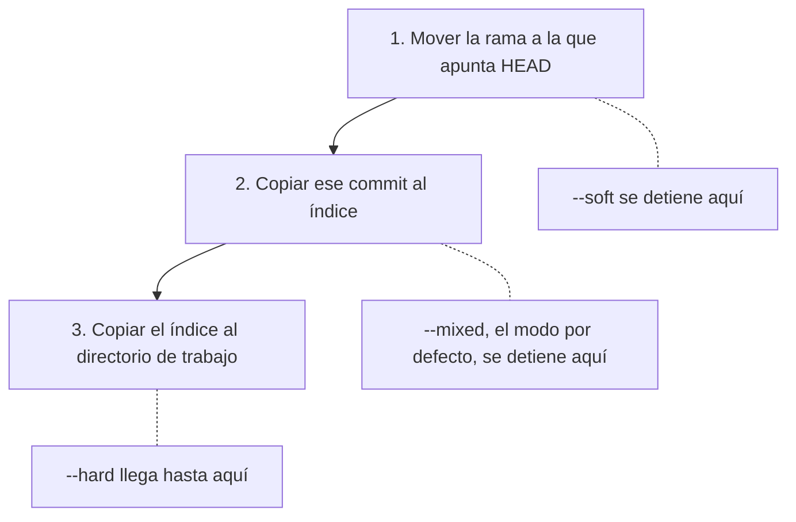

El caso más corto se lee en el dibujo. Con `git reset --soft HEAD~`, la rama vuelve al padre y nada más cambia: has deshecho el último commit y sus cambios siguen preparados [h01-721, h01-722, h01-715].

### reset mueve la rama; switch mueve HEAD

En la sección 1.4 llegaste a un commit antiguo con `git switch --detach`. ¿Es lo mismo? El ejemplo 23 parte otra vez de A y B' y, tras cada orden, lee `.git/HEAD` y el archivo de la rama.

<!-- ejemplo: ejemplos/cap-01/23-reset-frente-a-switch.sh -->
```console
# Ejecutado con Bash 5.2.21, Git 2.43.0
$ cat .git/HEAD
ref: refs/heads/exportar-csv
$ cat .git/refs/heads/exportar-csv
17e65b42bd0b0bdad056437fdf0447a2b622df8f
$ git reset --soft HEAD~2
$ cat .git/HEAD
ref: refs/heads/exportar-csv
$ cat .git/refs/heads/exportar-csv
c87074a060dbf507d64ec3e5e304398bd8e17de3
$ git switch --detach HEAD~2
HEAD is now at c87074a Cambia el tipo de IVA al 21 %
$ cat .git/HEAD
c87074a060dbf507d64ec3e5e304398bd8e17de3
$ cat .git/refs/heads/exportar-csv
17e65b42bd0b0bdad056437fdf0447a2b622df8f
```
<!-- /ejemplo -->

Las dos órdenes te dejan en `c87074a`, pero por caminos distintos. Tras `reset --soft`, `.git/HEAD` sigue nombrando la rama y lo que cambia es el archivo de `exportar-csv` [h01-718, h01-747]. Tras `switch --detach`, la rama conserva `17e65b4…` y es `.git/HEAD` el que pasa a guardar un hash: HEAD desacoplado [h01-474, h01-483]. Hay otra diferencia. Cambiar de sitio se aborta si fuera a perder cambios locales [h01-476], y Pro Git dice lo mismo de `git checkout <rama>` [h01-745]; `reset --hard` lo sustituye todo sin comprobar [h01-746].

### Con una ruta, reset no mueve la rama

El ejemplo 22 parte de otro estado: `facturas` en `main`, con los tres primeros commits y uno que redondea el total.

<!-- ejemplo: ejemplos/cap-01/22-reset-con-ruta.sh -->
```console
# Ejecutado con Bash 5.2.21, Git 2.43.0
$ git log --oneline
6c3625e Redondea el total a dos decimales
c87074a Cambia el tipo de IVA al 21 %
c2466c3 Añade un ejemplo de uso al README
ce4f8a1 Primera versión de la factura
$ git reset HEAD~2 factura.py
Unstaged changes after reset:
M	factura.py
$ git status -s
MM factura.py
$ git restore --source=HEAD~2 --staged factura.py
$ git status -s
MM factura.py
$ git log --oneline -1
6c3625e Redondea el total a dos decimales
```
<!-- /ejemplo -->

El último `git log` sigue en `6c3625e`: la rama no se ha movido. `git reset HEAD~2 factura.py` ha copiado al índice el `factura.py` de `HEAD~2`, el del IVA del 20 %, y ha dejado tu archivo como estaba. De ahí el aviso «Unstaged changes after reset» y el `MM` [h01-899, h01-902, h01-714, h01-715]. Con ruta, `reset` se salta el primer paso, porque `HEAD` no puede apuntar a medio commit, y solo actualiza el índice [h01-734, h01-735, h01-902].

`git restore --source=HEAD~2 --staged factura.py` deja el mismo `MM` [h01-358, h01-849]. Sin commit, la forma con ruta es lo contrario de `git add` y equivale a `git restore --staged` [h01-900, h01-901]. Para llevar esa versión también al disco, la documentación de `reset` te manda a `git restore`, que lo hace con `--staged --worktree` [h01-903, h01-851].

### Qué toca cada orden

La última columna pregunta por el riesgo: si la orden puede borrar cambios de tu directorio que no habías confirmado.

| Orden | Qué cambia de sitio | Índice | Directorio de trabajo | ¿Puede pisar cambios sin confirmar? |
| --- | --- | --- | --- | --- |
| `git reset --soft <commit>` | la rama | no | no | no [h01-718, h01-891] |
| `git reset <commit>` | la rama | sí | no | no [h01-888, h01-889, h01-890] |
| `git reset --hard <commit>` | la rama | sí | sí | sí [h01-893, h01-896, h01-746, h01-912] |
| `git switch <rama>` o `git switch --detach <commit>` | `HEAD` | sí | sí | no: se aborta [h01-471, h01-472, h01-474, h01-476] |
| `git reset [<commit>] <archivo>` | nada | sí | no | no [h01-899, h01-902] |
| `git restore --staged [--source=<commit>] <archivo>` | nada | sí | no | no [h01-354, h01-356, h01-358, h01-849] |
| `git restore [--source=<commit>] <archivo>` | nada | no | sí | sí [h01-352, h01-357, h01-850, h01-772, h01-912] |

### Recuperar lo que el asistente abandonó

El ejemplo 24 parte de la secuencia completa del asistente (rebase, `reset --soft` y `commit`) y busca los commits originales.

<!-- ejemplo: ejemplos/cap-01/24-recuperar-con-reflog.sh -->
```console
# Ejecutado con Bash 5.2.21, Git 2.43.0
$ git log --oneline
77efd1e Añade la exportación a CSV
c87074a Cambia el tipo de IVA al 21 %
c2466c3 Añade un ejemplo de uso al README
ce4f8a1 Primera versión de la factura
$ git reflog exportar-csv
77efd1e exportar-csv@{0}: commit: Añade la exportación a CSV
c87074a exportar-csv@{1}: reset: moving to HEAD~2
17e65b4 exportar-csv@{2}: rebase (finish): refs/heads/exportar-csv onto c87074a060dbf507d64ec3e5e304398bd8e17de3
7135be3 exportar-csv@{3}: commit: Prueba el formato con punto y coma
28fab7a exportar-csv@{4}: commit: Corrige el separador de la cabecera
0da1b36 exportar-csv@{5}: commit: Añade la cabecera al CSV
00f86cc exportar-csv@{6}: commit: Añade exportación a CSV
c87074a exportar-csv@{7}: branch: Created from HEAD
$ git branch rescate exportar-csv@{3}
$ git log --oneline -4 rescate
7135be3 Prueba el formato con punto y coma
28fab7a Corrige el separador de la cabecera
0da1b36 Añade la cabecera al CSV
00f86cc Añade exportación a CSV
```
<!-- /ejemplo -->

`git log` solo ve el commit nuevo, pero `git reflog exportar-csv` enseña cada movimiento de la punta de esa rama [h01-774, h01-777]. Leído de abajo arriba, es «El problema» entero: la rama nace en `c87074a`, recibe tus cuatro commits, salta a `17e65b4` con el rebase, vuelve a `c87074a` con el reset y avanza a `77efd1e` con el commit.

`exportar-csv@{3}` es el valor que tenía la rama tres movimientos atrás: la punta de antes del rebase [h01-904, h01-905]. Basta con ponerle una rama. Tras `git branch rescate exportar-csv@{3}`, el `git log` de `rescate` enseña tus cuatro commits originales [h01-783, h01-788].

### Cuánto dura la red

Las entradas del reflog caducan. Por defecto, las que se alcanzan desde la punta actual de la rama se podan al pasar de 90 días, y las demás, al pasar de 30 [h01-868, h01-870, h01-871, h01-872]. Desde `77efd1e` no se llega a tus cuatro commits originales ni a B', así que sus entradas tienen el plazo corto [h01-871, h01-872]. La poda no la sueles lanzar tú: la página de `git reflog` remite a `git gc` [h01-873]. Sin entrada ni referencia, el commit queda a merced de la recolección de basura de la sección 1.4 [h01-485].

Como último recurso, Pro Git propone `git fsck --full`, que lista los objetos a los que nada apunta: un commit perdido aparece tras «dangling commit» y se rescata con una rama [h01-791, h01-792, h01-793]. Lo que nunca confirmaste, en cambio, es irrecuperable si `--hard` lo pisa [h01-733, h01-347].

> **Error típico.** Lanzar `git reset --hard` para «volver atrás» con cambios sin confirmar. Es la única forma peligrosa de `reset` y una de las raras ocasiones en las que Git borra datos de verdad, porque reescribe tu directorio sin mirar [h01-730, h01-746]. Lo confirmado se puede recuperar durante un tiempo, y la vía más rápida suele ser el reflog [h01-784, h01-872]; lo demás se pierde [h01-733]. Antes, mira `git status -s`, o cambia de sitio con `git switch`, que no pisa tus cambios [h01-476].

> **Bajo el capó.** El reflog es local y vive en `.git/logs/` [h01-774, h01-790]. Sin argumentos, `git reflog` enseña el de `HEAD`; con un nombre, el de esa referencia [h01-777]. `HEAD@{n}` es dónde estaba `HEAD` n movimientos atrás [h01-775], y `rama@{n}`, el valor que tenía esa rama; sin nombre, `@{n}` usa la rama actual [h01-904, h01-906, h01-907]. Como el de `HEAD` apunta también los cambios de rama, un mismo momento puede llevar un número distinto en cada reflog [h01-778].

> **Ojo con la versión.** Pro Git explica `git reset <archivo>` como abreviatura de `git reset --mixed HEAD <archivo>` [h01-736] y compara el reset con ruta con `git checkout <rama> <archivo>`, que además sobrescribe el archivo del disco [h01-751]. En la documentación actual, la forma con ruta solo actualiza el índice, equivale a `git restore --staged` y, para tocar también los archivos, remite a `git restore` [h01-902, h01-901, h01-903].

### Vuelta a «El problema»

**Qué hizo cada orden.** El rebase conservó A y creó commits nuevos desde el primero que cambió, B' (sección 1.5) [h01-860, h01-764]. `reset --soft HEAD~2` llevó la rama al commit del IVA sin tocar el índice, y `commit` guardó de una vez lo preparado [h01-718, h01-891, h01-742]. `push --force` sobrescribió lo que había en el servidor [h01-522].

**Dónde están los commits.** En tu repositorio: el reflog de `exportar-csv` los localiza y una rama los rescata [h01-774, h01-783]. Como ya no se alcanzan desde la punta, sus entradas se podan al pasar de 30 días [h01-871, h01-872].

**Cómo lo defiendes.** El fallo no fue limpiar la rama, sino reescribir commits sobre los que Marta ya trabajaba, y quien depende de una rama reescrita arregla su historial a mano [h01-591]. La regla: reorganiza tu trabajo antes de compartirlo, nunca después [h01-535].

**Qué puede hacer Marta.** Reorganizar su trabajo sobre tu commit nuevo, con la ayuda del `patch-id` de la sección 1.5 si los parches se parecen mucho [h01-593, h01-526, h01-527].

## El proyecto avanza: Arqueología de un PR

La misión de la Parte I es reimplementar sin mirar el diff un PR ya integrado en gentle-shell y comparar tu versión con la real. Aquí solo preparas la excavación, sin escribir código.

1. Clona gentle-shell con el `git clone` de la sección 1.1 y la URL del proyecto; los remotos llegan en el capítulo 2. Elige un PR integrado y, sin abrir su diff, localiza el commit que lo integró.
2. Ábrelo con `git cat-file -p` y cuenta sus líneas `parent`: con más de una, es un commit de fusión [h01-404, h01-570]. Con una sola, anota «no concluyente»: con lo que sabes no puedes decidir cómo se integró, y el capítulo 2 vuelve sobre ello. Apunta en `arqueologia.md` las pruebas de cada conclusión.
3. En una fusión, el primer padre es la rama en la que se estaba al fusionar, así que tu base es `<hash>^1` [h01-841, h01-823]. Sin fusión, toma el padre del primer commit del PR y anótalo como supuesto. Crea tu rama con `git switch -c arqueologia/pr-NNN <base>` [h01-473] y comprueba con `cat .git/HEAD` y `git log --oneline -1` dónde estás.
4. Dibuja en Mermaid el grafo alrededor del PR: la base, sus commits y el punto de integración.
5. Anota qué archivos tocó y cuántas líneas cambió con `git log --stat` [h01-308, h01-309]. Pásalo sobre los commits del PR, no sobre el de fusión: `git log` no desglosa una fusión salvo que se lo pidas con una variante de `--diff-merges` [h01-877]. Será tu plano para reimplementarlo en el capítulo 5.

Repite los pasos con un PR de FastAPI.

## Resumen

- Un commit guarda una foto completa del proyecto, sus padres y sus metadatos, y se nombra por el hash de su contenido [h01-203, h01-638, h01-570, h01-639, h01-214].
- Los commits no cambian y forman un grafo que se recorre hacia atrás por los padres [h01-763, h01-761, h01-762].
- Una rama es un archivo con el hash de un commit, y `HEAD` dice en qué rama o commit estás; los dos se mueven [h01-424, h01-664, h01-483, h01-766].
- Reescribir crea commits nuevos desde el primero que cambia; no reescribas lo que otros ya tienen [h01-764, h01-860, h01-570, h01-535, h01-591].
- Sin ruta, `reset` mueve la rama y solo `--hard` destruye lo no confirmado; lo confirmado sigue en el reflog un tiempo, 30 días por defecto si ya no se alcanza [h01-718, h01-730, h01-733, h01-872].

## Ejercicios

Las soluciones están en `soluciones.md` de la Parte I.

**Comprobación**

1. `main` apunta a C3; `descuentos`, a C2, padre de C3; y `HEAD`, a `descuentos`. Haces un commit. Dibuja el grafo y di qué archivos de `.git` cambian y cuáles no.
2. Explica cada columna de estas salidas de `git status -s`: `??`, `A `, ` M` y `MM`. Escribe qué órdenes llevan a cada una desde un repositorio sin cambios.

**Aplicación**

3. Con `facturas` montado como en el ejemplo 22, o con cualquier repositorio de tres commits que cambien un mismo archivo, recupera el `factura.py` de dos commits atrás de dos formas: con `git restore --source` y con `git reset <commit> <archivo>`. Confirma cada resultado. Explica qué lugares toca cada camino, qué queda en tu disco tras el commit y por qué ninguno mueve la rama antes de confirmar [h01-902, h01-358, h01-850].
4. Haz tres commits pequeños seguidos y crea una rama de respaldo en el último. Júntalos con `git reset --soft` y `git commit`; vuelve al punto de partida con el respaldo y júntalos con un rebase interactivo y `fixup`. Compara el árbol y el hash de los dos resultados y explica en qué coinciden y en qué no.

**Construir sin IA**

5. Crea un repo, tres ramas, provoca un conflicto, resuélvelo y limpia el historial con rebase interactivo. Dibuja el grafo antes y después. Pista: limpia la rama antes de fusionarla, porque por defecto el rebase quita los commits de fusión de su lista [h01-866].

**Reto**

6. Escribe en Python un `git log --oneline` mínimo que no llame a `git`. Lee `.git/HEAD`, sigue la referencia hasta el commit, descomprime cada objeto con `zlib`, salta su cabecera y recorre los padres hasta el primer commit, imprimiendo hash y mensaje [h01-664, h01-652, h01-648, h01-646, h01-570]. Compara su salida con la de Git en un repositorio pequeño.

## Preguntas de examen

**Explicar.** ¿Qué es realmente una rama y qué cambia en el repositorio cuando haces un commit?

**Defender**

1. Un merge y un rebase de las mismas ramas pueden dejar la misma foto [h01-510]. ¿Por qué no son intercambiables y con qué criterio eliges?
2. Reorganizas una rama sobre la que Marta ya trabaja y la subes con `--force`. ¿Qué le dirá Git al intentar traerla y qué verá si fuerza la fusión [h01-591, h01-881, h01-883, h01-523, h01-524]?
3. Con un rebase interactivo corriges el mensaje de un commit de hace diez. ¿Qué hashes cambian, cuáles no y por qué [h01-860, h01-570, h01-571]?
4. ¿Qué hace `git reset HEAD~` en cada uno de los tres lugares y por qué no pierdes trabajo [h01-726, h01-889, h01-731]?
5. ¿Qué pasaría si ejecutas `git reset --hard HEAD~2` con cambios sin confirmar? ¿Qué recuperarías, cómo, durante cuánto tiempo y qué no?
6. Un commit defectuoso ya está en una rama que usa todo el equipo. `git revert` añade un commit que deshace su efecto [h01-594]. ¿Por qué lo eliges en lugar de `reset` [h01-764, h01-535, h01-591]?
